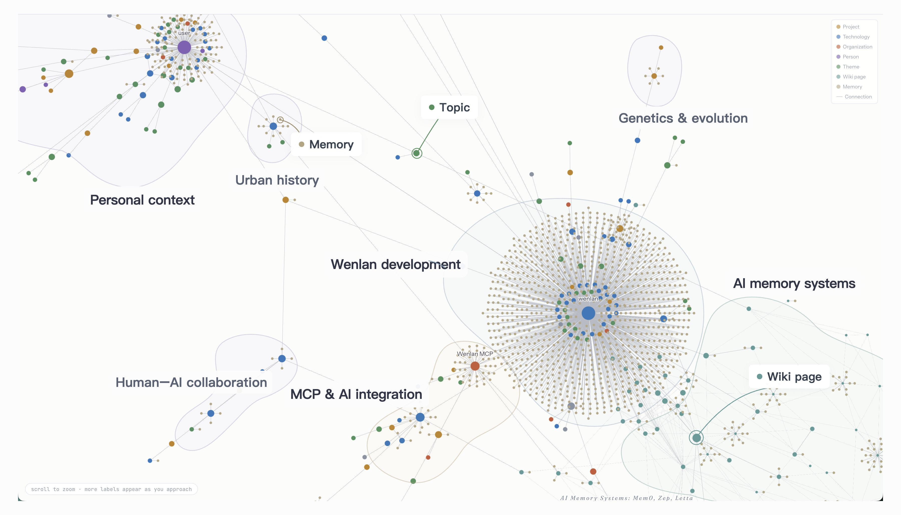
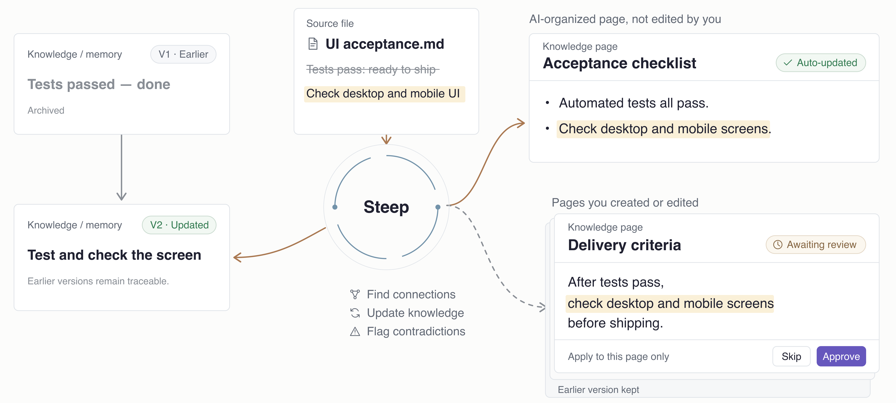

<!-- README_SYNC: source=README.md sha256=5a4a4b887bb26ec4cc193050b02b7ffa6a40dca76287fa57ccd05b9043a07446 -->

  <picture>
    <source media="(max-width: 600px)" srcset="./docs/assets/readme-banner-es-ES-mobile.png">
    
  </picture>

  Wenlan organiza notas, documentos y conversaciones dispersos en una base de conocimiento que se actualiza y enlaza a sus fuentes, 
  para que tú y herramientas de IA como Claude y Codex reutilicéis lo aprendido sin tener que explicar de nuevo decisiones anteriores.

  <a href="./README.md">English</a> | <a href="./README.zh-Hans.md">简体中文</a> | <a href="./README.zh-Hant.md">繁體中文</a> | Español

  
  
  

  <a href="#start-in-30-seconds">Primeros&nbsp;pasos</a> ·
  <a href="#what-can-i-bring-in">Funciones</a> ·
  <a href="#learn-more">Docs</a> ·
  <a href="https://discord.gg/nmzVTTU3HG">Discord</a>

<!-- R113 walkthrough: approved 0.5-second cover; 1080p; original video/audio and masters retained. -->

https://github.com/user-attachments/assets/5e661389-d7ea-4a36-a645-2b1ec2a92d32

Portada: composición de vistas reales con datos de ejemplo; el grafo es ilustrativo, no una vista nativa de tres columnas.

 

## Primeros pasos

Guarda tu material en Wenlan para que tus herramientas de IA habituales lo usen para responder preguntas y ayudarte a completar tareas.

### 1. Descarga y abre Wenlan

[Descarga la aplicación de escritorio](https://github.com/wenlan-app/wenlan/releases/latest) (macOS Apple Silicon o Windows x64), instálala y ábrela.

¿Prefieres el terminal? [Usa Wenlan desde la CLI o con herramientas de IA](docs/setup-and-data.es-ES.md#installation).

También puedes activar Steep con un [modelo local](docs/steep.md#enable-steep) para organizar recuerdos y actualizar páginas de conocimiento en segundo plano.

### 2. Crea una página o importa material existente

Crea una página en Wenlan, conecta una bóveda de Obsidian o importa conversaciones y recuerdos de IA anteriores. [Guía de importación](docs/import-guide.md).

### 3. Conecta una herramienta de IA cuando quieras

| Herramienta de IA | Conexión | Configuración |
|---|---|---|
| Claude Code / Claude Desktop | Plugin / MCP | [Guía de Claude](docs/setup-with-ai.md#claude-code) |
| ChatGPT Desktop (Codex), Codex CLI | Plugin | [Guía de Codex](docs/setup-with-ai.md#codex) |
| Cursor, VS Code, Gemini CLI, Muse Code | MCP | [Guía de MCP](docs/setup-with-ai.md#mcp-only-setup-and-other-clients) |

Tras instalar un plugin, inicia una nueva sesión de IA y ejecuta `/wenlan` (`$wenlan` en Codex). Comprueba que Wenlan funciona y lo configura si hace falta. Para todo lo demás, escribe lo que quieres a continuación, por ejemplo `/wenlan abre mi nota sobre el plan de lanzamiento`.

El material importado ya está listo para usar; no hace falta crear una página primero. Pregunta a tu IA:

> Usa lo que he guardado en Wenlan para ayudarme con esta tarea: …

 

## Uso diario

Guarda los nuevos hallazgos y avances mientras trabajas y retoma donde lo dejaste la próxima vez.

  

Flujo simplificado. Los comandos del plugin y la organización de páginas son opcionales, sin un orden fijo.

- **Trabaja en la aplicación.** Añade material, escribe o edita páginas, consulta las citas y revisa los cambios propuestos sin conectar una IA.
- **Usa tu conocimiento y escribe páginas nuevas.** Pide a tu IA que recupere fuentes y memorias relevantes para la tarea (`/recall`). También puede escribir una página con citas o actualizar una existente a partir de su versión actual y guardarla en Wenlan.
- **Conserva lo que aprendes.** Guarda una decisión o lección, junto con sus motivos y fuentes, en la aplicación o a través de tu IA (`/capture`).
- **Pausa y retoma.** Guarda hallazgos y un registro de la sesión, actualiza las páginas afectadas y anota el progreso y los siguientes pasos en el Brief del proyecto (`/handoff`). La próxima vez, recupera ese contexto para continuar (`/brief`).

**Organiza las memorias acumuladas cuando lo necesites:** Sintetiza o actualiza páginas con citas a partir de memorias relacionadas (`/wenlan distill`); no es necesario para escribir una página nueva. [Comandos del plugin](plugin/skills/README.md).

 

## Organiza la información dispersa en conocimiento

Las **fuentes** conservan documentos y conversaciones; las **memorias** guardan decisiones, aprendizajes y motivos que conviene reutilizar. Combínalas en **páginas Markdown editables con citas**, enlázalas con `[[wikilinks]]` y sigue las citas hasta los originales.

- **Memorias atómicas:** Siguiendo el [principio de atomicidad de Zettelkasten](https://zettelkasten.de/posts/create-zettel-from-reading-notes/), cada hallazgo puede recuperarse y reutilizarse por separado, sin cargar una conversación o página completa.
- **Temas compartidos:** Con un modelo de enriquecimiento configurado, la extracción y resolución de entidades mediante LLM vinculan menciones de la misma persona, proyecto o concepto en documentos y conversaciones, conservando sus memorias y fuentes.
- **Comunidades de conocimiento:** Agrupa temas conectados para descubrir relaciones en tu material. Label Propagation se ejecuta de forma predeterminada; Leiden está disponible como algoritmo opcional. [Detalles del grafo](docs/technical-foundations.md#graph-data-and-entity-resolution).

### Fuentes e importaciones

| Qué puedes importar | Para qué sirve |
| --- | --- |
| Markdown, texto, PDF con texto o una carpeta | Busca y cita el texto importado; actualiza desde el disco las fuentes de archivos conectadas. |
| Una bóveda de Obsidian | Busca y cita notas existentes mediante una conexión de solo lectura. Actualízala cuando quieras; no se escribe en ella. |
| Extractos web con URL | Pega el texto y su URL para guardar material buscable con un enlace al original. |
| ZIP de exportación de ChatGPT o Claude | Recupera conversaciones anteriores y cítalas como contexto; la importación es una instantánea, no una conexión activa a la cuenta. |
| Memorias existentes como texto | Guarda preferencias, decisiones o aprendizajes como memorias individuales. |

Los PDF escaneados necesitan extracción de texto; los adjuntos de chats no se importan. [Guía de importación (en inglés)](docs/import-guide.md).

  

Nodos y conexiones de la app; los nombres y límites de las regiones son ilustrativos.

 

## Pon tu conocimiento a trabajar con IA

Un agente puede leer archivos y escribir texto. Wenlan añade una **base de conocimiento compartida y mantenida entre tareas y herramientas de IA**: recupera decisiones anteriores con sus fuentes, guarda el trabajo nuevo y sigue usándolo a medida que cambia la evidencia.

**Úsala para:**

- **Desarrollo:** Incorpora decisiones técnicas, aprendizajes y criterios de aceptación anteriores al implementar y depurar.
- **Productos y sitios web:** Usa investigación de clientes, posicionamiento y principios de diseño para redactar especificaciones o crear páginas.
- **Investigación y aprendizaje:** Convierte lecturas y hallazgos guardados en informes citados o apuntes de estudio reutilizables.

**Recuperación y conexiones:** Los plugins orientan la recuperación y el guardado; las conexiones MCP exponen las herramientas para que las use tu IA.

- **[Búsqueda híbrida local](docs/technical-foundations.md#retrieval-pipeline):** Encuentra términos exactos y significados similares con SQLite FTS5 y embeddings BGE, combinados mediante Reciprocal Rank Fusion (RRF) ponderado; la búsqueda base no requiere clave API.
- **Clasificación asistida por el grafo:** Los enlaces entre entidades compartidas elevan memorias relacionadas aunque usen palabras distintas. El reranking opcional con cross-encoder compara cada candidato con la pregunta para ajustar el orden.
- **Recuperación limitada a un Espacio:** Selecciona un Espacio para limitar el conocimiento devuelto al proyecto o colección personal pertinente.

**Próximamente:** Compatibilidad con repositorios de código en Espacios.

Activa el interruptor **Web access** en Settings para que clientes web de IA compatibles, como Claude, ChatGPT o Muse, puedan buscar en toda la biblioteca o en un Espacio elegido mientras el ordenador con Wenlan esté conectado. Esta función es experimental; las consultas y los resultados pasan por un relay. Consulta los [límites de privacidad](docs/PRIVACY.md#pre-release-standalone-wenlan-relay-connector).

 

## Steep: mantén útil el conocimiento cuando cambia

Guardar material es solo el comienzo. **Steep lo prepara para reutilizarlo y mantiene al día las páginas compatibles**, para que tú y tu IA podáis continuar a partir de hallazgos anteriores sin volver a procesar los originales.

- **Enriquece las memorias:** Añade tipos, detalles estructurados, pistas de búsqueda y enlaces al grafo para facilitar la recuperación contextual de cada hallazgo.
- **Sigue la evidencia:** Los cambios en fuentes o memorias marcan las páginas dependientes para actualizarlas; las memorias nuevas también pueden enriquecer páginas compatibles. Si un borrador no supera las comprobaciones de citas, se conserva la página guardada. Superarlas no demuestra que los datos sean correctos.
- **Conserva el control y el historial:** La actualización en segundo plano modifica las páginas compatibles mantenidas por IA; las páginas que hayas escrito o editado reciben propuestas de revisión. Las sustituciones explícitas ocultan o archivan las memorias anteriores y conservan sus enlaces. Las revisiones de páginas se pueden inspeccionar.

[Guía de Steep: activadores, reglas de revisión y modelos (en inglés)](docs/steep.md). Elige un modelo en el dispositivo, un servidor local o un proveedor en la nube; el trabajo en segundo plano con modelos es opcional.

  

Ilustración basada en el comportamiento actual de actualización; no es una captura de la app.

 

## Arquitectura

**Una base local compartida.** La app, la CLI y las herramientas de IA conectadas leen y escriben mediante el servicio local de Wenlan. Las páginas son archivos Markdown; memorias, relaciones e índices de búsqueda residen en libSQL local.

  

Esquema de la arquitectura. [Búsqueda, evidencias y modelos](docs/technical-foundations.md).

 

## Datos y privacidad

**Exporta tu wiki:** Exporta las páginas compatibles como una wiki Open Knowledge Format (OKF).

Un cliente de IA en la nube puede enviarle el conocimiento recuperado a su proveedor; un modelo en la nube también recibe el contenido que procesa. El almacenamiento local no mantiene locales esas interacciones. Las estadísticas de uso están desactivadas por defecto.

[Ubicación de archivos, copias y eliminación](docs/setup-and-data.es-ES.md#backup-and-removal) · [Red y privacidad](docs/PRIVACY.md#when-wenlan-reaches-the-network).

 

## Evaluación

Estas mediciones de LongMemEval (LME) evalúan la recuperación de conocimiento guardado, no la calidad de las respuestas de IA. Recall@5 mide cuánto material relevante aparece entre los cinco primeros resultados.

<!-- EVAL_SNAPSHOT_START -->
| Benchmark | Recall@5 | MRR | NDCG@10 |
|---|---:|---:|---:|
| LME_Oracle (500 Q) | 93.6% | 0.857 | 0.883 |
| LME_S (deep, 90 Q) | 87.7% | 0.815 | 0.822 |
<!-- EVAL_SNAPSHOT_END -->

[Método de evaluación y detalles del benchmark](docs/eval/README.md).

 

## Leer más

- [Primeros pasos e instalación](docs/setup-and-data.es-ES.md#installation)
- [Conectar una herramienta de IA](docs/setup-with-ai.md)
- [Fuentes e importaciones](docs/import-guide.md)
- [Archivos locales, copias y uso sin conexión](docs/setup-and-data.es-ES.md)
- [Privacidad](docs/PRIVACY.md)
- [Diagnóstico e incidencias](https://wenlan.app/docs/diagnostics-and-issue-reports)
- [Índice completo de documentación](docs/README.md)

 

## Contribuir

Únete a la [comunidad de Discord](https://discord.gg/nmzVTTU3HG). Informa de errores o pide funciones en [GitHub issues](https://github.com/wenlan-app/wenlan/issues); son públicos, así que oculta secretos y datos personales.

Para contribuir con código o documentación, consulta [Contribuir](.github/CONTRIBUTING.md), [Seguridad](.github/SECURITY.md) y el [Código de Conducta](.github/CODE_OF_CONDUCT.md).

 

## Política de firma de código

Consulta los [detalles de firma y notarización por plataforma](docs/code-signing.md).

 

## Licencia

El runtime local, la CLI, el servidor MCP, los tipos compartidos y los plugins usan [Apache-2.0](LICENSE). La aplicación de escritorio y su frontend usan [AGPL-3.0-only](app/LICENSE); si ejecutas una versión modificada como servicio de red, debes ofrecer su código fuente a los usuarios.

 

## Linaje y proyectos afines

Wenlan toma su nombre del Pabellón Wenlan y continúa las tradiciones de LLM-wiki y agent-memory: [la nota LLM-wiki de Karpathy](https://gist.github.com/karpathy/442a6bf555914893e9891c11519de94f), [la propuesta de Rohitg00](https://gist.github.com/rohitg00/2067ab416f7bbe447c1977edaaa681e2) y [nashsu/llm_wiki](https://github.com/nashsu/llm_wiki).
