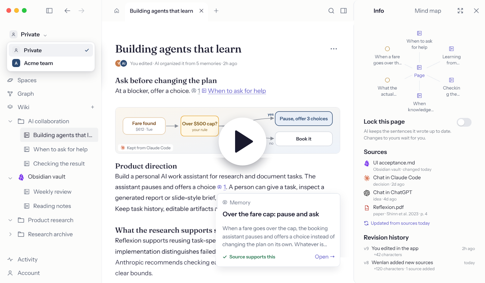

<!-- README_SYNC: source=README.md sha256=778fa1b7a6113674421b2aa873db798c82539ac46ee2fe10debd54342b7ecbd3 -->

<p align="center">
  <picture>
    <source media="(max-width: 600px)" srcset="./docs/assets/readme-banner-es-ES-mobile.png">
    
  </picture>
</p>

<p align="center">
  <strong>Documentos, skills y reglas con los que trabajáis tú y tus herramientas de IA, siempre al día.</strong><br>
  Trae tus notas y conocimiento. Cada documento cita sus fuentes. Gratis y open source, para ti y tu equipo.
</p>

<p align="center">
  <a href="./README.md">English</a> | <a href="./README.zh-Hans.md">简体中文</a> | <a href="./README.zh-Hant.md">繁體中文</a> | Español
</p>

<p align="center">
  <a href="https://github.com/wenlan-app/wenlan/releases/latest"><strong>Descargar</strong></a> ·
  <a href="#start-in-30-seconds">Primeros&nbsp;pasos</a> ·
  <a href="#what-can-i-bring-in">Fuentes</a> ·
  <a href="#learn-more">Docs</a> ·
  <a href="https://discord.gg/nmzVTTU3HG">Discord</a>
</p>

<p align="center">
  <a href="https://github.com/wenlan-app/wenlan/actions/workflows/ci.yml?query=branch%3Amain"></a>
  <a href="https://github.com/wenlan-app/wenlan/releases/latest"></a>
  <a href="#license"></a>
</p>

<p align="center">
  <a href="https://youtu.be/vM2GXS6UjyA"></a>
</p>

<a id="why-wenlan"></a>

<br>

## Por qué Wenlan

Cada IA guarda su memoria y sus reglas. Wenlan lleva lo que decides a cada herramienta, agente y equipo.

Para quien usa varias herramientas de IA cada día, y equipos pequeños, solo de ingenieros o mixtos.

- **Documentos con fuentes.** Wenlan comprueba que cada fuente citada respalda su frase.
- **Una sola copia de skills y reglas.** Funciona en cada herramienta y plataforma de IA que conectas.
- **Memoria ordenada.** Lo que decides pasa a tus documentos, skills y reglas; por eso están al día.
- **Tú mandas.** Ves cada cambio, lo deshaces y bloqueas una página para que la IA pregunte.
- **Archivos primero, autoalojado, portable.** Archivos Markdown; la base de datos es solo un índice.
- **Fácil de leer también para personas.** Una página puede ser texto o una web que dibuja tu IA.

<a id="how-it-compares"></a>

### ¿Wenlan o un archivo de reglas por herramienta?

Un archivo de reglas (AGENTS.md, CLAUDE.md…) basta para una herramienta y un repositorio. Más allá:

- **Una copia para todas.** Sin copiar un archivo por herramienta ni sincronizarlos a mano.
- **Las reglas viejas no se quedan.** Tus herramientas de IA actualizan la página si cambia su fuente.
- **Más que reglas.** Documentos, skills y memoria están al lado.

Más comparaciones, con Obsidian, Notion AI y herramientas de memoria: [wenlan.app/learn](https://wenlan.app/learn).

<a id="quickstart"></a>
<a id="start-in-30-seconds"></a>
<a id="start-with-the-app"></a>
<a id="open-the-wiki"></a>
<a id="desktop-app"></a>
<a id="claude-code-in-30-seconds"></a>
<a id="codex-plugin"></a>
<a id="mcp-setup"></a>
<a id="mcp-clients"></a>

<br>

## Primeros pasos

**Por tu cuenta.** Empieza desde tu herramienta de IA. Sin instalar la app.

1. Un comando (requiere Node.js): instala Wenlan, lo arranca y conecta tus herramientas de IA.

   ```sh
   npx -y wenlan setup
   ```

   Pregunta una vez si quieres traer una carpeta de notas. Enter la omite. [Otras formas de instalar](docs/setup-and-data.es-ES.md#installation).

   Después: `wenlan connect cursor` y `wenlan sources add ~/notes` añaden más. [Más](docs/import-guide.md).

2. Dile a una herramienta de IA algo que guardar. Luego pregunta en otra:

   > Guarda en Wenlan: publicamos los martes, cuando pasan las pruebas.

   > Pregunta a Wenlan: ¿cuándo publicamos?

3. Lee y edita tus páginas en el navegador: `wenlan open`.

Opcional: la [app de escritorio](https://github.com/wenlan-app/wenlan/releases/latest) para macOS, Windows y Linux añade importaciones y conexión con un clic.

**En equipo.** Un servidor de Wenlan para todos. [Guía del servidor de equipo](docs/team-server.md).

- Cada persona se conecta con su propia clave, con acceso de lectura o edición en cada Space.
- Los miembros entran con un enlace de invitación y su propia IA. La app se sincroniza sola.

Funciona con Claude Code, Codex, Cursor, Copilot, Gemini CLI y otras herramientas MCP: [guía](docs/setup-with-ai.md).

<a id="what-can-i-bring-in"></a>
<a id="sources-and-imports"></a>

<br>

## Qué puedes traer

- **Archivos y carpetas:** Markdown, texto, PDF con texto y DOCX. Una vez, o en sincronía.
- **Obsidian y Logseq:** en sincronía o una sola vez. Tus notas empiezan en **Ask me first**.
- **Enlaces web:** pega un enlace en una página y se convierte en fuente.
- **Gmail, Notion, Google Drive, Slack, GitHub:** tu IA los lee y guarda lo importante, con enlace al original.
- **Chats de IA:** decisiones y hallazgos se guardan como memorias. También los ZIP de ChatGPT y Claude.
- **Un repositorio de código:** tu herramienta de IA lee el código y escribe documentos ligados a él. [Más](#code-repository-wiki).

También carpetas OKF. Los PDF escaneados necesitan extraer el texto antes. [Guía de importación](docs/import-guide.md).

<a id="what-makes-wenlan-distinct"></a>
<a id="why-is-wenlan-different"></a>
<a id="two-lifecycles"></a>
<a id="two-lifecycles-one-maintained-knowledge-system"></a>
<a id="local-markdown"></a>
<a id="atomic-memory"></a>
<a id="maintained-page"></a>
<a id="local-markdown-that-works-with-obsidian"></a>
<a id="keep-knowledge-current-and-preserve-history"></a>
<a id="steep-keep-knowledge-useful-as-it-changes"></a>
<a id="what-it-does-on-its-own"></a>
<a id="what-does-wenlan-build"></a>
<a id="why-it-compounds"></a>
<a id="what-is-this"></a>
<a id="what-you-get"></a>
<a id="what-can-it-do"></a>
<a id="knowledge-graph"></a>
<a id="browse-and-organize-your-knowledge"></a>
<a id="connect-your-knowledge"></a>
<a id="organize-scattered-material-into-knowledge"></a>
<a id="explore-your-personal-knowledge-graph"></a>
<a id="daily-workflow"></a>
<a id="in-everyday-use"></a>
<a id="how-wenlan-works"></a>
<a id="how-does-it-work"></a>
<a id="use-your-knowledge-with-ai"></a>
<a id="put-your-knowledge-to-work-with-ai"></a>
<a id="if-you-already-use-claude-code-on-your-notes"></a>

<a id="dos-ciclos-de-vida-un-sistema-de-conocimiento-mantenido"></a>
<a id="memoria-atómica"></a>
<a id="página-mantenida"></a>
<a id="markdown-local-que-funciona-con-obsidian"></a>
<a id="mantén-el-conocimiento-al-día-y-conserva-su-historial"></a>
<a id="qué-es-esto"></a>
<a id="explora-y-organiza-tu-conocimiento"></a>
<a id="conecta-tu-conocimiento"></a>
<a id="explora-tu-grafo-de-conocimiento-personal"></a>
<a id="recuperación-a-través-de-palabras-significado-y-conexiones"></a>
<a id="usa-tu-conocimiento-con-ia"></a>
<br>

## Cómo se mantiene ordenada

Tu IA convierte lo que traes en páginas Markdown enlazadas y con citas, y las mantiene al día.

<p align="center">
  
</p>
<p>Ilustración basada en el comportamiento actual de actualización; no es una captura de la app.</p>

- **Documentos con fuentes:** Wenlan rechaza una página si las citas no coinciden. Pasar no es prueba.
- **Al día:** Si cambia una fuente, una memoria o el código citado, se marcan las páginas afectadas.
- **Tú decides qué cambia la IA:** **Allowed** o **Ask me first** por página, y restauras cualquier versión.
- **Dos formas:** tu IA mientras trabaja (por defecto) o un modelo en segundo plano. [Guía de Steep](docs/steep.md).
- **En tu herramienta de IA:** nombra Wenlan y pide. El plugin añade `/wenlan`. [Comandos](plugin/skills/README.md).
- **En la app:** añade material, edita páginas, sigue las citas y revisa cambios sin conectar ninguna IA.

¿Ya usas Claude Code con una carpeta de notas? Sigue. Wenlan añade comprobación de citas.

<a id="code-repository-wiki"></a>
<a id="a-wiki-for-your-code-repository"></a>

<br>

## Documentación para tu repositorio de código

En un repositorio, tu herramienta de IA lee el código y escribe un resumen y un documento por cada parte.

```sh
cd your-repo
wenlan init
```

Conecta tus herramientas de IA y pregunta por la pull request diaria. El plugin los escribe ya.

- **Ligada al código:** Cada frase clave apunta a las líneas de código de las que salió. Si cambian, lo ves.
- **Como pull request:** Las páginas entran en el repositorio como pull request, al pulsar el botón o a diario.
- **También la documentación:** La misma pull request corrige frases que el código ya no respalda.
- **También las reglas:** Las reglas del proyecto van a `AGENTS.md`, para las herramientas del equipo.
- **Tus ediciones se quedan:** Lo editado en el repositorio se conserva. Tus memorias quedan fuera.

<a id="what-wenlan-is-not"></a>
<a id="retrieval"></a>
<a id="retrieval-across-words-meaning-and-connections"></a>
<a id="architecture"></a>

<br>

## Para lectores técnicos

**Una base de conocimiento local.** La app, la CLI y las herramientas de IA conectadas leen y escriben a través del servicio local de Wenlan. Las páginas son archivos Markdown; las memorias, relaciones e índices de búsqueda viven en libSQL local. El servicio, la CLI y el servidor MCP están escritos en Rust; la app de escritorio usa Tauri con React y TypeScript.

<p align="center">
  
</p>

- **Recuperación:** SQLite FTS5 encuentra términos exactos y los embeddings BGE en un índice DiskANN de libSQL encuentran significados parecidos, combinados con Reciprocal Rank Fusion (RRF) ponderado. La búsqueda básica no necesita clave de API. Los enlaces entre entidades compartidas suben las memorias relacionadas, y un reranking opcional con cross-encoder afina el orden. Elegir un Espacio limita los resultados a ese proyecto.
- **Grafo:** Con un modelo de enriquecimiento, la extracción y resolución de entidades enlaza las menciones de una misma persona, proyecto o concepto en distintas fuentes. Label Propagation (por defecto) o Leiden agrupan los temas relacionados.
- **Memorias:** Los hallazgos se guardan como memorias pequeñas y separadas, así que se puede encontrar una sin cargar una conversación o página entera.

[Recuperación, evidencias y modelos](docs/technical-foundations.md).

<a id="evaluation"></a>

### Evaluación

Estas mediciones de LongMemEval (LME) evalúan la recuperación de conocimiento guardado, no la calidad de las respuestas de IA. Recall@5 mide cuánto material relevante aparece entre los cinco primeros resultados.

<!-- EVAL_SNAPSHOT_START -->
| Benchmark | Recall@5 | MRR | NDCG@10 |
|---|---:|---:|---:|
| LME_Oracle (500 Q) | 93.6% | 0.857 | 0.883 |
| LME_S (deep, 90 Q) | 87.7% | 0.815 | 0.822 |
<!-- EVAL_SNAPSHOT_END -->

En una prueba con 10.000 páginas (páginas generadas, M2 Pro con 16 GB, v0.20.0), la búsqueda en la App respondió en 11 a 50 ms, el reinicio tardó menos de 0,3 s y la memoria llegó a un máximo de unos 1,2 GB. Con la corrección de búsqueda de 0.20.1, la búsqueda de las herramientas de IA encontró las 30 palabras raras de prueba en esa biblioteca.

Al importar una bóveda de Obsidian de 10.000 notas en 0.20.2 (notas inventadas, Mac M2 Pro con 16 GB, compilación de depuración, Claude Code escribiendo las páginas): se puede buscar a los 15 s, la primera página llega en unos 2 minutos y 8 páginas con citas en unos 4 minutos.

[Método de evaluación y detalles del benchmark](docs/eval/README.md).

<a id="models-and-privacy"></a>
<a id="data-and-privacy"></a>

<br>

## Datos y privacidad

- Las páginas son archivos Markdown en tu ordenador y solo van adonde tú las envías.
- Exporta las páginas que cumplan los requisitos como una wiki Open Knowledge Format (OKF).
- Una herramienta de IA en la nube puede enviar lo que recupera a su proveedor, y un modelo en la nube recibe el material que procesa, así que el almacenamiento local no mantiene locales esas interacciones.
- Las estadísticas de uso están desactivadas por defecto.

**Web access (experimental):** Activa **Web access** en Settings para que clientes web de IA como Claude, ChatGPT o Muse puedan buscar en tu biblioteca o en un Espacio elegido mientras tu ordenador está conectado. Al permitir una app, elige solo búsqueda o búsqueda y escritura; una app con escritura también puede añadir, editar y borrar, y las apps de IA pueden preguntarte antes de cada cambio. Las consultas y los resultados pasan por un relay. Consulta los [límites de privacidad](docs/PRIVACY.md#pre-release-standalone-wenlan-relay-connector).

[Ubicación de archivos, copias de seguridad y eliminación](docs/setup-and-data.es-ES.md#backup-and-removal) · [Detalles de red y privacidad](docs/PRIVACY.md#when-wenlan-reaches-the-network).

<a id="learn-more"></a>
<a id="whats-new"></a>

<a id="cola-offline-outbox"></a>

<br>

## Leer más

- [Primeros pasos e instalación](docs/setup-and-data.es-ES.md#installation)
- [Conectar una herramienta de IA](docs/setup-with-ai.md)
- [Fuentes e importaciones](docs/import-guide.md)
- [Archivos locales, copias y uso sin conexión](docs/setup-and-data.es-ES.md)
- [Privacidad](docs/PRIVACY.md)
- [Diagnóstico e incidencias](https://wenlan.app/docs/diagnostics-and-issue-reports)
- [Novedades de cada versión](CHANGELOG.md)
- [Índice completo de documentación](docs/README.md)

<br>

## Contribuir

Únete a la [comunidad de Discord](https://discord.gg/nmzVTTU3HG). Informa de errores o pide funciones en [GitHub issues](https://github.com/wenlan-app/wenlan/issues); son públicos, así que oculta secretos y datos personales.

Para contribuir con código o documentación, consulta [Contribuir](.github/CONTRIBUTING.md), [Seguridad](.github/SECURITY.md) y el [Código de Conducta](.github/CODE_OF_CONDUCT.md).

<a id="code-signing-policy"></a>

<br>

## Política de firma de código

Consulta los [detalles de firma y notarización por plataforma](docs/code-signing.md).

<a id="license"></a>

<br>

## Licencia

El runtime local, la CLI, el servidor MCP, los tipos compartidos y los plugins usan [Apache-2.0](LICENSE). La aplicación de escritorio y su frontend usan [AGPL-3.0-only](app/LICENSE); si ejecutas una versión modificada como servicio de red, debes ofrecer su código fuente a los usuarios.

<a id="acknowledgments"></a>

<br>

## Linaje y proyectos afines

Wenlan toma su nombre del Pabellón Wenlan y continúa las tradiciones de LLM-wiki y agent-memory: [la nota LLM-wiki de Karpathy](https://gist.github.com/karpathy/442a6bf555914893e9891c11519de94f), [la propuesta de Rohitg00](https://gist.github.com/rohitg00/2067ab416f7bbe447c1977edaaa681e2) y [nashsu/llm_wiki](https://github.com/nashsu/llm_wiki). Para documentar código, el proyecto más afín es [OpenWiki](https://github.com/langchain-ai/openwiki); la pull request diaria de Wenlan sigue su patrón.
