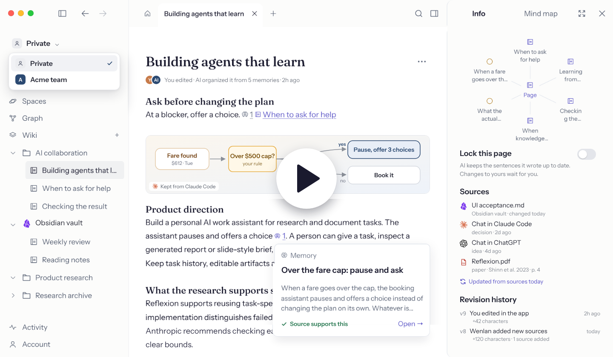

<!-- README_SYNC: source=README.md sha256=9f094ffed80b3f1ace444f71c374825e2bf74c138ffa70b8ff3b3d90b4a77fc1 -->

  <picture>
    <source media="(max-width: 600px)" srcset="./docs/assets/readme-banner-es-ES-mobile.png">
    
  </picture>

  Las notas exigen mantenimiento constante, los plugins se rompen y cada chat nuevo con la IA empieza de cero. 
  <strong>Configúralo una vez. Tus herramientas de IA guardan lo importante, mantienen tus páginas organizadas y te lo traen de vuelta en tu próximo chat; ves cada cambio y puedes deshacerlo.</strong> 
  Alternativa de código abierto a Obsidian que funciona con tu bóveda actual.

  <a href="./README.md">English</a> | <a href="./README.zh-Hans.md">简体中文</a> | <a href="./README.zh-Hant.md">繁體中文</a> | Español

  <a href="https://github.com/wenlan-app/wenlan/releases/latest"><strong>Descargar</strong></a> ·
  <a href="#start-in-30-seconds">Primeros&nbsp;pasos</a> ·
  <a href="#what-can-i-bring-in">Fuentes</a> ·
  <a href="#learn-more">Docs</a> ·
  <a href="https://discord.gg/nmzVTTU3HG">Discord</a>

  
  
  

  

 

## Por qué Wenlan

Empecé Wenlan porque mis notas, documentos y chats de IA estaban dispersos, y evitar que un sistema de notas se echara a perder exigía un mantenimiento constante. Desde entonces no dejamos de oír lo mismo sobre Obsidian: demasiada configuración, con plugins que buscar, instalar y mantener al día. Wenlan es para quienes usan herramientas de IA a diario y no quieren mantener un sistema de notas.

**Personal:** descarga la app de escritorio y úsala por tu cuenta.

**Equipos (en la próxima versión):** un servidor de Wenlan autoalojado al que todos se conectan, con acceso de solo lectura o de edición para cada persona.

- **Se mantiene al día sola.** Tus herramientas de IA guardan lo que decides en los chats y lo integran en páginas. Cuando cambia una fuente, las páginas que dependen de ella se actualizan.
- **Configúralo una vez, sin plugins.** **Connect all** en los ajustes conecta tus herramientas de IA con un clic. Sin plugins que instalar ni mantener.
- **Tú decides qué cambia la IA.** Cada página cita sus fuentes, y una cita abre el original. Ves cada cambio, lo deshaces y eliges qué páginas esperan tu visto bueno.
- **Trae lo que ya tienes.** Bóvedas de Obsidian, notas, documentos y chats de IA. [Lista completa](#what-can-i-bring-in).

### Además

- **Una página puede ser texto o HTML.** Pide a tu IA una vista HTML de cualquier página, o guarda el HTML que hizo como una página HTML propia. La vista HTML muestra el texto actual de la página, así que nunca la rehaces.
- **Comparte un Space.** Con un compañero, o entre tus propios ordenadores, a través de una carpeta de Google Drive o iCloud Drive.

### Cómo se compara

| | Obsidian + plugins | Claude Code + una carpeta | Apps de LLM wiki | Wenlan |
|---|---|---|---|---|
| Quién organiza | Tú, con plugins | Tú, pidiéndoselo cada vez | Una IA que configuras | Tus herramientas de IA; actualiza cuando cambia una fuente |
| Configuración | Buscar y actualizar plugins | Escribir y mantener tus propias instrucciones y comandos | Clave de modelo o rutina programada | Una vez; sin plugins que instalar ni mantener |
| Revisa a la IA | Depende del plugin | Tú, revisando el git diff | Enlaza a fuentes | Rechaza páginas cuyas citas no coinciden |
| Qué puede cambiar la IA | Depende del plugin | Lo que apruebes o permitas en sus ajustes | Su carpeta de wiki | Tú eliges por página; restaura cuando quieras |
| Dónde viven tus notas | Tu ordenador | Tu ordenador | Tu ordenador | Tu ordenador; funciona con tu bóveda |

 

## Primeros pasos

### 1. Empieza con la app o desde tu herramienta de IA

| **Descarga la app de escritorio** | **Conecta desde tu herramienta de IA** |
|---|---|
| [La experiencia completa](https://github.com/wenlan-app/wenlan/releases/latest): páginas, importaciones y conexiones con un clic. macOS 11 o posterior en Apple Silicon, Windows x64 o Linux x64 (AppImage o .deb, desde v0.22). En inglés, chino simplificado y chino tradicional. | En un Mac, ejecuta `npx -y wenlan setup` (requiere Node.js), o `brew install 7xuanlu/tap/wenlan` y después `wenlan setup`. En Claude Code, añade el [plugin](docs/setup-with-ai.md). Linux y Windows: [guía de instalación de la CLI](docs/setup-and-data.es-ES.md#installation). |

### 2. Trae tu material

Crea una página o trae una bóveda de Obsidian, un grafo de Logseq, una carpeta o chats de IA anteriores. [Guía de importación](docs/import-guide.md).

### 3. Conecta tu herramienta de IA

Si empezaste desde tu herramienta de IA, ya está conectada: pasa directamente a pedirle lo de abajo.

En los ajustes de la aplicación, **Add a tool** encuentra las herramientas de IA de tu ordenador y **Connect all** las configura con un solo clic. No hay nada más que instalar ni mantener al día. Después, inicia una nueva sesión de IA y pide:

> /wenlan ¿qué decidí antes sobre esto? Luego ayúdame con: …

`/wenlan` (`$wenlan` en Codex) es el único comando que hay que recordar: después, di lo que quieres.

Funciona con Claude Code, Claude Desktop, Codex, Cursor, GitHub Copilot, VS Code, Gemini CLI, Windsurf, Grok Bot y otras herramientas MCP. [Configurar una a mano](docs/setup-with-ai.md).

Cuando termina una importación, la aplicación ofrece **Write pages with** tu herramienta de IA para convertirla en tus primeras páginas con citas. No hace falta ningún comando.

 

## Qué puedes traer

- **Archivos y carpetas:** Markdown, texto, PDF con texto y DOCX. Importa una vez o mantén una carpeta sincronizada.
- **Bóvedas de Obsidian y grafos de Logseq:** mantenlos sincronizados o impórtalos una vez. Las notas que escribiste empiezan en **Ask me first**.
- **Enlaces web:** pega un enlace en una página y se convierte en fuente. Los enlaces de YouTube, X, Threads, Instagram y RedNote se muestran como tarjeta o vídeo.
- **Gmail, Notion, Google Drive, Slack, GitHub:** tu herramienta de IA los lee con sus propios conectores y guarda lo importante, con un enlace al original.
- **Chats de IA:** las decisiones y hallazgos se guardan como memorias, no como transcripciones completas. También sirven los ZIP exportados de ChatGPT y Claude.
- **Un repositorio de código:** `/wenlan wiki` escribe páginas ligadas al código. [Wiki de código](#code-repository-wiki).

También puedes conectar una carpeta Open Knowledge Format (OKF) como fuente. Los PDF escaneados necesitan extracción de texto primero; los adjuntos de los chats no se importan. [Guía de importación](docs/import-guide.md).

 

## Cómo se mantiene ordenada

Tu herramienta de IA lee lo que traes y lo escribe en páginas Markdown. Enlaza las páginas relacionadas, cita de dónde sale cada frase y pone las páginas al día cuando cambia una fuente. Puedes abrir cualquier página y escribir en ella tú mismo.

  

Ilustración basada en el comportamiento actual de actualización; no es una captura de la app.

- **Páginas con fuentes:** Cada cita abre el original. Cuando una página cita sus fuentes como `[n]`, Wenlan compara cada frase citada con su fuente y rechaza la página si la mayoría de las citas no coinciden. Pasar la comprobación no demuestra que la página sea correcta.
- **Al día:** Cuando cambia una fuente, una memoria o el código citado, se marcan las páginas que dependen de ello. Sin ningún modelo, Wenlan también sugiere fusionar páginas casi duplicadas y lista los `[[enlaces]]` que aún no apuntan a ninguna página.
- **Tú decides qué puede cambiar la IA:** Las páginas que escribiste empiezan en **Ask me first**, así que los cambios de la IA esperan tu visto bueno. Pon cualquier página en **Allowed** o **Ask me first**, mira qué cambió y restaura una versión anterior.
- **Dos formas de funcionar:** En **On demand**, el modo por defecto, tu herramienta de IA escribe mientras trabaja, así que no hay ninguna clave de API que configurar. En **Automatic**, Wenlan lo hace en segundo plano con el modelo que elijas, en tu ordenador o en la nube. [Guía de Steep](docs/steep.md).
- **En tu herramienta de IA:** escribe `/wenlan` y di lo que quieres: recuperar decisiones anteriores, guardar una lección o retomar donde lo dejaste. Atajos: `/recall`, `/capture`, `/handoff`, `/brief`. [Comandos del plugin](plugin/skills/README.md).
- **En la app:** Añade material, escribe y edita páginas, sigue las citas y revisa los cambios propuestos sin conectar ninguna IA. Las páginas pueden incluir diagramas Mermaid, que la app dibuja.

¿Ya usas Claude Code o Codex con una carpeta de notas? Sigue haciéndolo. Wenlan se conecta a la misma herramienta y añade lo que una carpeta no hace por sí sola: comprobación de citas, avisos cuando cambian las fuentes y control por página de lo que puede cambiar la IA.

 

## Una wiki para tu repositorio de código

Ejecuta `/wenlan wiki` (`$wenlan wiki` en Codex) en un repositorio. Tu herramienta de IA escribe un resumen y una página por cada parte o flujo que necesita conocer alguien nuevo. Al volver a ejecutarlo, solo escribe las páginas que faltan.

- **Ligada al código:** Cada página registra las líneas de código de las que se leyó y muestra qué cambió cuando ese código cambia.
- **Como pull request:** El botón de GitHub de un Espacio pone las páginas en la carpeta `wiki/` del repositorio como pull request, cuando lo pulsas o a diario. La ejecución diaria usa tu propia herramienta de IA en tu ordenador, o GitHub Actions con la clave de tu herramienta de IA guardada como secreto del repositorio. La misma pull request corrige las frases de la documentación del repositorio con las que el código ya no coincide.
- **Tus ediciones se quedan:** Una página de la wiki que alguien editó en el repositorio conserva esa edición. Las páginas que citan tus memorias o chats se quedan fuera del repositorio.

 

## Para lectores técnicos

**Una base de conocimiento local.** La app, la CLI y las herramientas de IA conectadas leen y escriben a través del servicio local de Wenlan. Las páginas son archivos Markdown; las memorias, relaciones e índices de búsqueda viven en libSQL local. El servicio, la CLI y el servidor MCP están escritos en Rust; la app de escritorio usa Tauri con React y TypeScript.

  

- **Recuperación:** SQLite FTS5 encuentra términos exactos y los embeddings BGE en un índice DiskANN de libSQL encuentran significados parecidos, combinados con Reciprocal Rank Fusion (RRF) ponderado. La búsqueda básica no necesita clave de API. Los enlaces entre entidades compartidas suben las memorias relacionadas, y un reranking opcional con cross-encoder afina el orden. Elegir un Espacio limita los resultados a ese proyecto.
- **Grafo:** Con un modelo de enriquecimiento, la extracción y resolución de entidades enlaza las menciones de una misma persona, proyecto o concepto en distintas fuentes. Label Propagation (por defecto) o Leiden agrupan los temas relacionados.
- **Memorias:** Los hallazgos se guardan como memorias pequeñas y separadas, así que se puede encontrar una sin cargar una conversación o página entera.

[Recuperación, evidencias y modelos](docs/technical-foundations.md).

### Evaluación

Estas mediciones de LongMemEval (LME) evalúan la recuperación de conocimiento guardado, no la calidad de las respuestas de IA. Recall@5 mide cuánto material relevante aparece entre los cinco primeros resultados.

<!-- EVAL_SNAPSHOT_START -->
| Benchmark | Recall@5 | MRR | NDCG@10 |
|---|---:|---:|---:|
| LME_Oracle (500 Q) | 93.6% | 0.857 | 0.883 |
| LME_S (deep, 90 Q) | 87.7% | 0.815 | 0.822 |
<!-- EVAL_SNAPSHOT_END -->

En una prueba con 10.000 páginas (páginas generadas, M2 Pro con 16 GB, v0.20.0), la búsqueda en la App respondió en 11 a 50 ms, el reinicio tardó menos de 0,3 s y la memoria llegó a un máximo de unos 1,2 GB. Con la corrección de búsqueda de 0.20.1, la búsqueda de las herramientas de IA encontró las 30 palabras raras de prueba en esa biblioteca.

Al importar una bóveda de Obsidian de 10.000 notas en 0.20.2 (notas inventadas, Mac M2 Pro con 16 GB, compilación de depuración, Claude Code escribiendo las páginas): se puede buscar a los 15 s, la primera página llega en unos 2 minutos y 8 páginas con citas en unos 4 minutos.

[Método de evaluación y detalles del benchmark](docs/eval/README.md).

 

## Datos y privacidad

- Las páginas son archivos Markdown en tu ordenador y solo van adonde tú las envías.
- Exporta las páginas que cumplan los requisitos como una wiki Open Knowledge Format (OKF).
- Una herramienta de IA en la nube puede enviar lo que recupera a su proveedor, y un modelo en la nube recibe el material que procesa, así que el almacenamiento local no mantiene locales esas interacciones.
- Las estadísticas de uso están desactivadas por defecto.

**Web access (experimental):** Activa **Web access** en Settings para que clientes web de IA como Claude, ChatGPT o Muse puedan buscar en tu biblioteca o en un Espacio elegido mientras tu ordenador está conectado. Al permitir una app, elige solo búsqueda o búsqueda y escritura; una app con escritura también puede añadir, editar y borrar, y las apps de IA pueden preguntarte antes de cada cambio. Las consultas y los resultados pasan por un relay. Consulta los [límites de privacidad](docs/PRIVACY.md#pre-release-standalone-wenlan-relay-connector).

[Ubicación de archivos, copias de seguridad y eliminación](docs/setup-and-data.es-ES.md#backup-and-removal) · [Detalles de red y privacidad](docs/PRIVACY.md#when-wenlan-reaches-the-network).

 

## Leer más

- [Primeros pasos e instalación](docs/setup-and-data.es-ES.md#installation)
- [Conectar una herramienta de IA](docs/setup-with-ai.md)
- [Fuentes e importaciones](docs/import-guide.md)
- [Archivos locales, copias y uso sin conexión](docs/setup-and-data.es-ES.md)
- [Privacidad](docs/PRIVACY.md)
- [Diagnóstico e incidencias](https://wenlan.app/docs/diagnostics-and-issue-reports)
- [Novedades de cada versión](CHANGELOG.md)
- [Índice completo de documentación](docs/README.md)

 

## Contribuir

Únete a la [comunidad de Discord](https://discord.gg/nmzVTTU3HG). Informa de errores o pide funciones en [GitHub issues](https://github.com/wenlan-app/wenlan/issues); son públicos, así que oculta secretos y datos personales.

Para contribuir con código o documentación, consulta [Contribuir](.github/CONTRIBUTING.md), [Seguridad](.github/SECURITY.md) y el [Código de Conducta](.github/CODE_OF_CONDUCT.md).

 

## Política de firma de código

Consulta los [detalles de firma y notarización por plataforma](docs/code-signing.md).

 

## Licencia

El runtime local, la CLI, el servidor MCP, los tipos compartidos y los plugins usan [Apache-2.0](LICENSE). La aplicación de escritorio y su frontend usan [AGPL-3.0-only](app/LICENSE); si ejecutas una versión modificada como servicio de red, debes ofrecer su código fuente a los usuarios.

 

## Linaje y proyectos afines

Wenlan toma su nombre del Pabellón Wenlan y continúa las tradiciones de LLM-wiki y agent-memory: [la nota LLM-wiki de Karpathy](https://gist.github.com/karpathy/442a6bf555914893e9891c11519de94f), [la propuesta de Rohitg00](https://gist.github.com/rohitg00/2067ab416f7bbe447c1977edaaa681e2) y [nashsu/llm_wiki](https://github.com/nashsu/llm_wiki).
