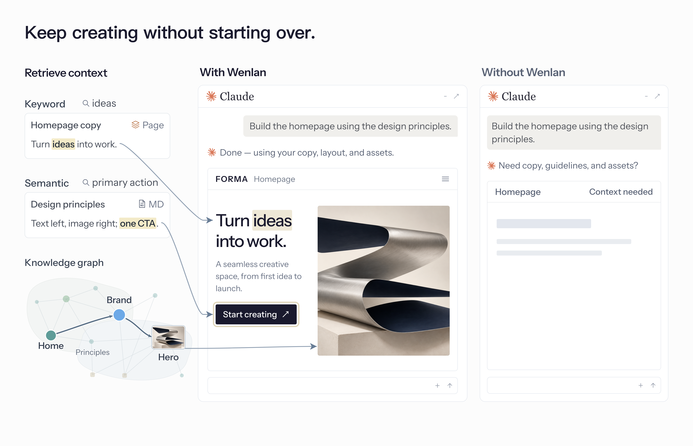

  <picture>
    <source media="(max-width: 600px)" srcset="./docs/assets/readme-banner-mobile.png">
    
  </picture>

  Wenlan organizes scattered notes, documents, and conversations into a knowledge base that stays current and links back to its sources, 
  so you and AI tools like Claude and Codex can reuse what you learned without explaining past decisions again.

  English | <a href="./README.zh-Hans.md">简体中文</a> | <a href="./README.zh-Hant.md">繁體中文</a> | <a href="./README.es-ES.md">Español</a>

  
  
  

  <a href="#start-in-30-seconds">Get&nbsp;started</a> ·
  <a href="#what-can-i-bring-in">Capabilities</a> ·
  <a href="#learn-more">Docs</a> ·
  <a href="https://discord.gg/nmzVTTU3HG">Discord</a>

<!-- R113 walkthrough: approved 0.5-second cover; 1080p; original video/audio and masters retained. -->

https://github.com/user-attachments/assets/5e661389-d7ea-4a36-a645-2b1ec2a92d32

Cover: localized composite of App views with demo data; the graph is illustrative, not a native three-column layout.

 

## Get started

Save your material in Wenlan so your everyday AI tools can use it to answer questions and get work done.

### 1. Download and open Wenlan

[Download the desktop app](https://github.com/wenlan-app/wenlan/releases/latest) (macOS Apple Silicon or Windows x64), install it, and open it.

Prefer the terminal? [Use Wenlan through the CLI or AI tools](docs/setup-and-data.md#installation).

Optionally enable Steep with a [local model](docs/steep.md#enable-steep) to organize memories and update knowledge pages in the background.

### 2. Create a page or import existing material

Create a page in Wenlan, connect an Obsidian vault, or import earlier AI conversations and memories. [Import guide](docs/import-guide.md).

### 3. Connect an AI tool when you want

| AI tool | Connection | Setup |
|---|---|---|
| Claude Code / Claude Desktop | Plugin / MCP | [Claude guide](docs/setup-with-ai.md#claude-code) |
| ChatGPT Desktop (Codex), Codex CLI | Plugin | [Codex guide](docs/setup-with-ai.md#codex) |
| Cursor, VS Code, Gemini CLI, Muse Code | MCP | [MCP guide](docs/setup-with-ai.md#mcp-only-setup-and-other-clients) |

After installing a plugin, start a new AI session and run `/setup`.

Imported material is ready to use; you do not need to create a page first. Ask your AI:

> Use what I’ve saved in Wenlan to help me with this task: …

 

## In everyday use

Save new findings and progress as you work, then pick up where you left off next time.

  

Simplified workflow. Plugin commands and page organization are optional, with no fixed sequence.

- **Work in the App.** Add material, write or edit pages, follow citations, and review proposed changes without connecting AI.
- **Use your knowledge and write new pages.** Ask your AI to find relevant sources and memories for the task (`/recall`). It can also write cited pages or update existing ones from their current version, then save them to Wenlan.
- **Keep what you learn.** Save a decision or lesson, with its reasons and sources, in the App or through your AI (`/capture`).
- **Pause and resume.** Save findings and a session log, update affected pages, and record progress and next steps in the project Brief (`/handoff`). Pick up that context next time (`/brief`).

**Organize accumulated memories when needed:** Synthesize or refresh cited pages from related memories (`/distill`); writing a new page does not require this step. [Plugin commands](plugin/skills/README.md).

 

## Organize scattered material into knowledge

**Sources** preserve documents and conversations; **memories** keep the decisions, lessons, and reasons worth reusing. Combine them in editable **Markdown pages with citations**, connect pages with `[[wikilinks]]`, and follow citations back to the originals.

- **Atomic memories:** Following [Zettelkasten’s principle of atomicity](https://zettelkasten.de/posts/create-zettel-from-reading-notes/), keep findings independently retrievable and reusable without loading an entire conversation or page.
- **Shared topics:** With an enrichment model configured, LLM entity extraction and entity resolution link mentions of the same person, project, or concept across documents and conversations, retaining their memories and sources.
- **Knowledge communities:** Group connected topics to reveal related knowledge across your material. Label Propagation runs by default; Leiden is available as an opt-in algorithm. [Graph details](docs/technical-foundations.md#graph-data-and-entity-resolution).

### Sources and imports

| Bring in | How you can use it |
| --- | --- |
| Markdown, text, text-based PDFs, or a folder | Search and cite the imported text; refresh connected file sources from disk. |
| An Obsidian vault | Search and cite existing notes through a read-only connection. Refresh on demand; nothing is written back. |
| Web excerpts with a URL | Paste the text and its URL to save searchable material with a link to the original. |
| ChatGPT or Claude export ZIPs | Retrieve earlier conversation text and cite it as context; imports are snapshots, not live account connections. |
| Existing memories as text | Save preferences, decisions, or lessons as individual memories. |

Scanned PDFs need text extraction first; chat attachments are not imported. [Import guide](docs/import-guide.md).

  

App nodes and connections; translated labels and illustrative regions.

 

## Put your knowledge to work with AI

An agent can read files and write text. Wenlan adds a **shared knowledge base maintained across tasks and AI tools**: retrieve earlier decisions with their supporting material, save new work, and keep using it as the evidence changes.

**Use it for:**

- **Development:** Bring earlier technical decisions, lessons, and acceptance criteria into implementation and debugging.
- **Products and websites:** Use customer research, positioning, and design principles to draft specifications or build pages.
- **Research and learning:** Turn reading material and saved findings into cited reports or study notes you can reuse.

**Retrieval and connections:** Plugins guide retrieval and saving; MCP connections expose the tools for your AI to call.

- **[Local hybrid retrieval](docs/technical-foundations.md#retrieval-pipeline):** Find exact terms and similar meaning with SQLite FTS5 and BGE embeddings, fused by weighted Reciprocal Rank Fusion (RRF); base search needs no API key.
- **Graph-assisted ranking:** Shared-entity links boost related memories even when their wording differs. Optional cross-encoder reranking compares each candidate with the question to refine the order.
- **Space-scoped retrieval:** Select a Space to limit returned knowledge to the relevant project or personal collection.

**Coming soon:** Coding repository support in Spaces.

  

Fictional example, not a product test; Wenlan adds context alongside Claude’s native memory.

Turn on **Web access** in Settings to let supported web AI clients such as Claude, ChatGPT, or Muse search your library or a chosen Space while your computer is online. This feature is experimental; queries and results pass through a relay. See the [privacy limits](docs/PRIVACY.md#pre-release-standalone-wenlan-relay-connector).

 

## Steep: keep knowledge useful as it changes

Saving material is only the start. **Steep prepares it for reuse and keeps supported pages current**, so you and your AI can build on earlier findings instead of repeatedly working through the originals.

- **Enrich memories:** Add types, structured details, search cues, and graph links so individual findings are easier to retrieve in context.
- **Follow the evidence:** Changed sources or memories flag dependent pages for refresh; new memories can enrich eligible pages. Refresh keeps the saved page if a draft fails citation checks. Passing these checks does not establish factual correctness.
- **Keep control and history:** Background refresh updates eligible AI-maintained pages; your authored or edited pages receive proposed revisions. Explicit memory replacements hide or archive earlier memories while preserving their links. Page revisions remain inspectable.

[Steep guide: triggers, review rules, and model setup](docs/steep.md). Choose an on-device model, a local server, or a cloud provider; model-backed background work is optional.

  

Illustration based on current update behavior; not an App screenshot.

 

## Architecture

**One local knowledge base.** App, CLI, and connected AI tools read and write through Wenlan’s local service. Pages are Markdown files; memories, relationships, and search indexes live in local libSQL.

  

Architecture overview. [Retrieval, evidence, and models](docs/technical-foundations.md).

 

## Data and privacy

**Export your wiki:** Export eligible pages as an Open Knowledge Format (OKF) wiki.

A cloud AI client may send retrieved knowledge to its provider, and a cloud model receives the material it processes. Local storage does not keep those interactions local. Usage statistics are off by default.

[File locations, backup, and removal](docs/setup-and-data.md#backup-and-removal) · [Network and privacy details](docs/PRIVACY.md#when-wenlan-reaches-the-network).

 

## Evaluation

These LongMemEval (LME) snapshots measure retrieval of saved knowledge, not AI answer quality. Recall@5 measures how much relevant material appears in the top five results.

<!-- EVAL_SNAPSHOT_START -->
| Benchmark | Recall@5 | MRR | NDCG@10 |
|---|---:|---:|---:|
| LME_Oracle (500 Q) | 93.6% | 0.857 | 0.883 |
| LME_S (deep, 90 Q) | 87.7% | 0.815 | 0.822 |
<!-- EVAL_SNAPSHOT_END -->

[Evaluation method and benchmark details](docs/eval/README.md).

 

## Learn more

- [Get started and install](docs/setup-and-data.md#installation)
- [Connect an AI tool](docs/setup-with-ai.md)
- [Sources and imports](docs/import-guide.md)
- [Local files, backups, and offline use](docs/setup-and-data.md)
- [Privacy](docs/PRIVACY.md)
- [Doctor and issue reports](https://wenlan.app/docs/diagnostics-and-issue-reports)
- [Full documentation index](docs/README.md)

 

## Contributing

Join the [Discord community](https://discord.gg/nmzVTTU3HG). Report bugs or request features in [GitHub issues](https://github.com/wenlan-app/wenlan/issues); issues are public, so redact secrets and personal information.

For code and docs, see [Contributing](.github/CONTRIBUTING.md), [Security](.github/SECURITY.md), and the [Code of Conduct](.github/CODE_OF_CONDUCT.md).

 

## Code signing policy

See the [platform signing and notarization details](docs/code-signing.md).

 

## License

The local runtime, CLI, MCP server, shared types, and plugins use [Apache-2.0](LICENSE). The desktop app and its frontend use [AGPL-3.0-only](app/LICENSE); modified versions run as a network service must offer their source to users.

 

## Lineage and peers

Wenlan takes its name from Wenlan Pavilion. Its direction builds on the LLM-wiki and agent-memory lineages: [Karpathy’s LLM-wiki note](https://gist.github.com/karpathy/442a6bf555914893e9891c11519de94f), [Rohitg00’s proposal](https://gist.github.com/rohitg00/2067ab416f7bbe447c1977edaaa681e2), and [nashsu/llm_wiki](https://github.com/nashsu/llm_wiki).
