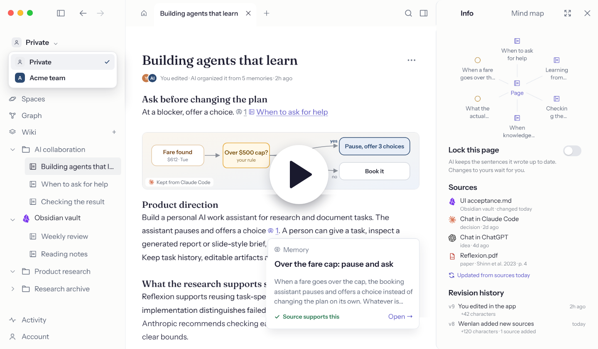

<p align="center">
  <picture>
    <source media="(max-width: 600px)" srcset="./docs/assets/readme-banner-mobile.png">
    
  </picture>
</p>

<p align="center">
  <strong>Docs, skills and rules you and your AI tools both work from, kept current.</strong><br>
  Bring your notes and knowledge. Every doc cites its sources. Free, open source, for you and your team.
</p>

<p align="center">
  English | <a href="./README.zh-Hans.md">简体中文</a> | <a href="./README.zh-Hant.md">繁體中文</a> | <a href="./README.es-ES.md">Español</a>
</p>

<p align="center">
  <a href="https://github.com/wenlan-app/wenlan/releases/latest"><strong>Download</strong></a> ·
  <a href="#start-in-30-seconds">Get&nbsp;started</a> ·
  <a href="#what-can-i-bring-in">Sources</a> ·
  <a href="#learn-more">Docs</a> ·
  <a href="https://discord.gg/nmzVTTU3HG">Discord</a>
</p>

<p align="center">
  <a href="https://github.com/wenlan-app/wenlan/actions/workflows/ci.yml?query=branch%3Amain"></a>
  <a href="https://github.com/wenlan-app/wenlan/releases/latest"></a>
  <a href="#license"></a>
</p>

<p align="center">
  <a href="https://youtu.be/vM2GXS6UjyA"></a>
</p>

<a id="why-wenlan"></a>

<br>

## Why Wenlan

Each AI tool keeps its own memory and rules. Wenlan gives every tool, agent and teammate what you settled.

For people who use several AI tools daily, and small teams, all engineers or mixed.

- **Docs with sources.** Wenlan checks that each cited source supports its sentence before saving.
- **One copy of skills and rules.** It runs in every AI tool and platform you connect.
- **Organized memory.** What you settle is sorted into your docs, skills and rules, so they stay current.
- **You stay in charge.** See every change, undo it, and lock a page so AI asks you first.
- **Files first, self-hosted, portable.** Plain Markdown files; the database is only an index.
- **Easy for people to read too.** A page can be text, or a web page you ask your AI to draw.

<a id="how-it-compares"></a>

### Wenlan or a rules file per tool?

A rules file (AGENTS.md, CLAUDE.md, .cursor/rules) is enough for one tool in one repository. Beyond that:

- **One copy for every tool.** No more copying a file per tool and keeping them in step by hand.
- **Old rules don't linger.** Your AI tools update a page when its source changes.
- **More than rules.** Docs, skills and memory sit next to them.

More comparisons, with Obsidian, Notion AI, and memory tools: [wenlan.app/learn](https://wenlan.app/learn).

<a id="quickstart"></a>
<a id="start-in-30-seconds"></a>
<a id="start-with-the-app"></a>
<a id="open-the-wiki"></a>
<a id="desktop-app"></a>
<a id="claude-code-in-30-seconds"></a>
<a id="codex-plugin"></a>
<a id="mcp-setup"></a>
<a id="mcp-clients"></a>

<br>

## Get started

**On your own.** Start from your AI tool. No app needed.

1. Install it (needs Node.js). This also starts Wenlan and keeps it running; nothing else to configure.

   ```sh
   npx -y wenlan setup
   ```

   In Claude Code, the [plugin](docs/setup-with-ai.md) does steps 1 and 2 for you. [Other ways to install](docs/setup-and-data.md#installation).

2. Connect your AI tool. Run it once for each tool you use.

   ```sh
   wenlan connect claude-code   # or codex, cursor, gemini, vscode, claude-desktop
   ```

3. Optional: bring in a folder of notes or documents, such as an Obsidian vault. [More ways](docs/import-guide.md).

   ```sh
   wenlan sources add ~/notes
   ```

4. Start a new AI session and ask:

   > /wenlan what did I decide about this before? Then help me: …

5. Read and edit your pages in your browser: `wenlan open`.

Optional: the [desktop app](https://github.com/wenlan-app/wenlan/releases/latest) for macOS, Windows and Linux adds imports and one-press connections.

**With a team.** Run one Wenlan server. [Team server guide](docs/team-server.md).

- Each person connects with their own key, with view-only or edit access to each Space.
- Members join from an invite link with their own AI tool. Desktop apps sync by themselves.

Works with Claude Code, Codex, Cursor, GitHub Copilot, Gemini CLI, and other MCP tools: [setup guide](docs/setup-with-ai.md).

<a id="what-can-i-bring-in"></a>
<a id="sources-and-imports"></a>

<br>

## What you can bring in

- **Files and folders:** Markdown, text, text-based PDFs, and DOCX. Import once, or keep in sync.
- **Obsidian and Logseq:** keep in sync or import once. Notes you wrote start on **Ask me first**.
- **Web links:** paste a link into a page and it becomes a source.
- **Gmail, Notion, Google Drive, Slack, GitHub:** your AI tool reads them and saves what matters, with a link.
- **AI chats:** decisions and findings are saved as memories. ChatGPT and Claude export ZIPs work too.
- **A code repository:** `/wenlan wiki` writes pages tied to the code. [Docs for code](#code-repository-wiki).

OKF folders work too. Scanned PDFs need text extraction first. [Import guide](docs/import-guide.md).

<a id="what-makes-wenlan-distinct"></a>
<a id="why-is-wenlan-different"></a>
<a id="two-lifecycles"></a>
<a id="two-lifecycles-one-maintained-knowledge-system"></a>
<a id="local-markdown"></a>
<a id="atomic-memory"></a>
<a id="maintained-page"></a>
<a id="local-markdown-that-works-with-obsidian"></a>
<a id="keep-knowledge-current-and-preserve-history"></a>
<a id="steep-keep-knowledge-useful-as-it-changes"></a>
<a id="what-it-does-on-its-own"></a>
<a id="what-does-wenlan-build"></a>
<a id="why-it-compounds"></a>
<a id="what-is-this"></a>
<a id="what-you-get"></a>
<a id="what-can-it-do"></a>
<a id="knowledge-graph"></a>
<a id="browse-and-organize-your-knowledge"></a>
<a id="connect-your-knowledge"></a>
<a id="organize-scattered-material-into-knowledge"></a>
<a id="explore-your-personal-knowledge-graph"></a>
<a id="daily-workflow"></a>
<a id="in-everyday-use"></a>
<a id="how-wenlan-works"></a>
<a id="how-does-it-work"></a>
<a id="use-your-knowledge-with-ai"></a>
<a id="put-your-knowledge-to-work-with-ai"></a>
<a id="if-you-already-use-claude-code-on-your-notes"></a>

<br>

## How it stays organized

Your AI tool turns what you bring in into linked, cited Markdown pages and keeps them current.

<p align="center">
  
</p>
<p>Illustration based on current update behavior; not an App screenshot.</p>

- **Docs with sources:** Wenlan refuses a page when most citations don't match. A pass is not proof.
- **Kept current:** When a source, memory, or cited code changes, pages relying on it are flagged.
- **You decide what AI may change:** Set a page to **Allowed** or **Ask me first**, and restore any earlier version.
- **Two ways to run it:** your AI tool as it works (default), or a background model you pick. [Steep guide](docs/steep.md).
- **In your AI tool:** type `/wenlan` and say what you want. [All commands](plugin/skills/README.md).
- **In the app:** add material, edit pages, follow citations, and review changes without connecting an AI.

Already run Claude Code on a notes folder? Keep it. Wenlan adds citation checks and per-page control.

<a id="code-repository-wiki"></a>
<a id="a-wiki-for-your-code-repository"></a>

<br>

## Docs for your code repository

Run `/wenlan wiki` (`$wenlan wiki` in Codex) in a repository to get an overview and a page for each part.

- **Tied to the code:** Each page records the code lines it was read from and shows what changed.
- **As a pull request:** Pages go into the repository as a pull request, when you press the button or daily.
- **Existing docs too:** The same pull request fixes doc sentences the code no longer matches.
- **Your edits stay:** Edits made in the repository are kept. Pages that cite your memories or chats stay out.

<a id="what-wenlan-is-not"></a>
<a id="retrieval"></a>
<a id="retrieval-across-words-meaning-and-connections"></a>
<a id="architecture"></a>

<br>

## For technical readers

**One local knowledge base.** The app, CLI, and connected AI tools read and write through Wenlan’s local service. Pages are Markdown files; memories, relationships, and search indexes live in local libSQL. The service, CLI, and MCP server are written in Rust; the desktop app uses Tauri with React and TypeScript.

<p align="center">
  
</p>

- **Retrieval:** SQLite FTS5 finds exact terms and BGE embeddings in a libSQL DiskANN index find similar meaning, fused by weighted Reciprocal Rank Fusion (RRF). Base search needs no API key. Shared-entity links boost related memories, and optional cross-encoder reranking refines the order. Choosing a Space limits results to that project.
- **Graph:** With an enrichment model, entity extraction and resolution link mentions of the same person, project, or concept across sources. Label Propagation (default) or Leiden groups related topics.
- **Memories:** Findings are saved as small, separate memories, so one can be found without loading a whole conversation or page.

[Retrieval, evidence, and models](docs/technical-foundations.md).

<a id="evaluation"></a>

### Evaluation

These LongMemEval (LME) snapshots measure retrieval of saved knowledge, not AI answer quality. Recall@5 measures how much relevant material appears in the top five results.

<!-- EVAL_SNAPSHOT_START -->
| Benchmark | Recall@5 | MRR | NDCG@10 |
|---|---:|---:|---:|
| LME_Oracle (500 Q) | 93.6% | 0.857 | 0.883 |
| LME_S (deep, 90 Q) | 87.7% | 0.815 | 0.822 |
<!-- EVAL_SNAPSHOT_END -->

On a 10,000-page test (generated pages, M2 Pro with 16 GB, v0.20.0), App search answered in 11 to 50 ms, restart took under 0.3 s, and memory peaked at about 1.2 GB. With the search fix in 0.20.1, AI-tool search found all 30 rare test words in that library.

Importing a 10,000-note Obsidian vault in 0.20.2 (invented notes, M2 Pro Mac with 16 GB, debug build, Claude Code writing the pages): searchable in 15 s, the first page in about 2 minutes, and 8 cited pages in about 4 minutes.

[Evaluation method and benchmark details](docs/eval/README.md).

<a id="models-and-privacy"></a>
<a id="data-and-privacy"></a>

<br>

## Data and privacy

- Pages are Markdown files on your computer, and they go only where you send them.
- Export eligible pages as an Open Knowledge Format (OKF) wiki.
- A cloud AI tool may send what it retrieves to its provider, and a cloud model receives the material it processes, so local storage does not keep those interactions local.
- Usage statistics are off by default.

**Web access (experimental):** Turn on **Web access** in Settings to let web AI clients such as Claude, ChatGPT, or Muse search your library or a chosen Space while your computer is online. When you allow an app, choose search only or search and write; a write app can also add, edit and delete, and AI apps can ask you before each change. Queries and results pass through a relay. See the [privacy limits](docs/PRIVACY.md#pre-release-standalone-wenlan-relay-connector).

[File locations, backup, and removal](docs/setup-and-data.md#backup-and-removal) · [Network and privacy details](docs/PRIVACY.md#when-wenlan-reaches-the-network).

<a id="learn-more"></a>
<a id="whats-new"></a>

<a id="offline-queue-outbox"></a>

<br>

## Learn more

- [Get started and install](docs/setup-and-data.md#installation)
- [Connect an AI tool](docs/setup-with-ai.md)
- [Sources and imports](docs/import-guide.md)
- [Local files, backups, and offline use](docs/setup-and-data.md)
- [Privacy](docs/PRIVACY.md)
- [Doctor and issue reports](https://wenlan.app/docs/diagnostics-and-issue-reports)
- [What's new in each release](CHANGELOG.md)
- [Full documentation index](docs/README.md)

<br>

## Contributing

Join the [Discord community](https://discord.gg/nmzVTTU3HG). Report bugs or request features in [GitHub issues](https://github.com/wenlan-app/wenlan/issues); issues are public, so redact secrets and personal information.

For code and docs, see [Contributing](.github/CONTRIBUTING.md), [Security](.github/SECURITY.md), and the [Code of Conduct](.github/CODE_OF_CONDUCT.md).

<a id="code-signing-policy"></a>

<br>

## Code signing policy

See the [platform signing and notarization details](docs/code-signing.md).

<a id="license"></a>

<br>

## License

The local runtime, CLI, MCP server, shared types, and plugins use [Apache-2.0](LICENSE). The desktop app and its frontend use [AGPL-3.0-only](app/LICENSE); modified versions run as a network service must offer their source to users.

<a id="acknowledgments"></a>

<br>

## Lineage and peers

Wenlan takes its name from Wenlan Pavilion. Its direction builds on the LLM-wiki and agent-memory lineages: [Karpathy’s LLM-wiki note](https://gist.github.com/karpathy/442a6bf555914893e9891c11519de94f), [Rohitg00’s proposal](https://gist.github.com/rohitg00/2067ab416f7bbe447c1977edaaa681e2), and [nashsu/llm_wiki](https://github.com/nashsu/llm_wiki).
