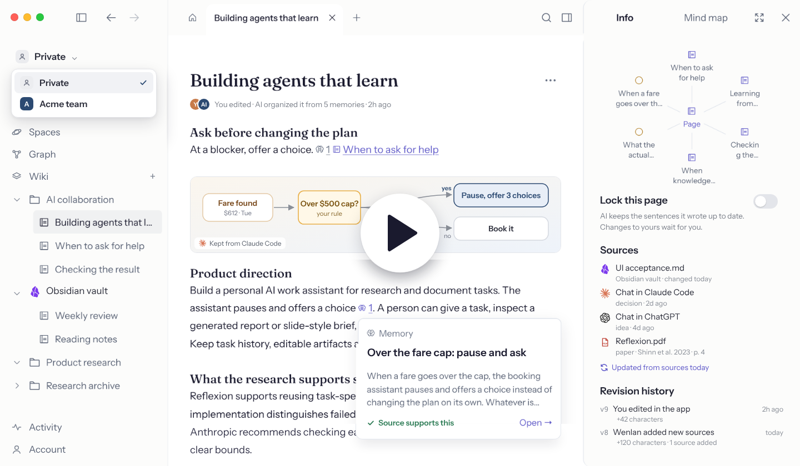
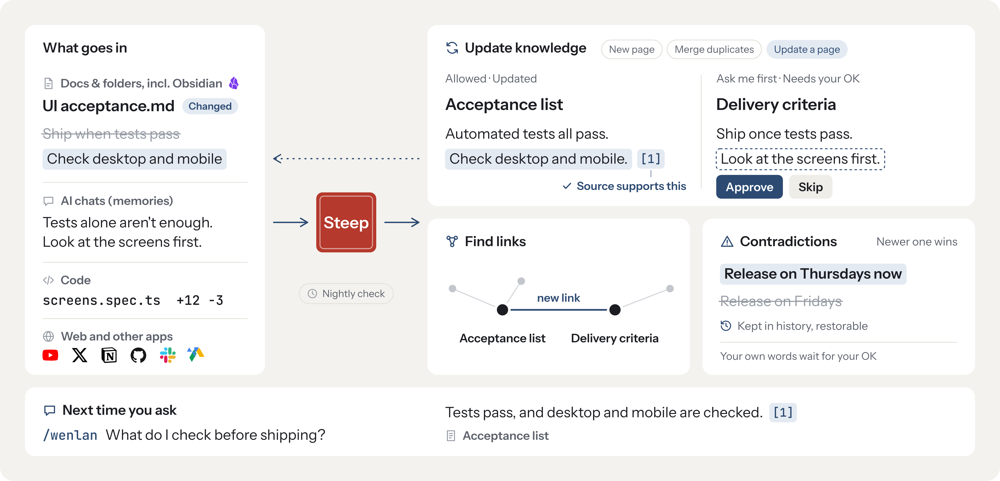

  <picture>
    <source media="(max-width: 600px)" srcset="./docs/assets/readme-banner-mobile.png">
    
  </picture>

  <strong>Open-source Obsidian alternative that works with your existing vault.</strong> 
  Write when you want; your AI tools keep it organized and up to date, with no API keys or plugins to set up. 
  For you and your team. Your notes go only where you send them.

  English | <a href="./README.zh-Hans.md">简体中文</a> | <a href="./README.zh-Hant.md">繁體中文</a> | <a href="./README.es-ES.md">Español</a>

  <a href="https://github.com/wenlan-app/wenlan/releases/latest"><strong>Download</strong></a> ·
  <a href="#start-in-30-seconds">Get&nbsp;started</a> ·
  <a href="#what-can-i-bring-in">Sources</a> ·
  <a href="#learn-more">Docs</a> ·
  <a href="https://discord.gg/nmzVTTU3HG">Discord</a>

  
  
  

  

 

## Why Wenlan

I started Wenlan because my notes, documents, and AI chats were scattered, and keeping a note system from rotting took constant upkeep. Since then we keep hearing the same about Obsidian: too much setup, with plugins to find, install, and keep updated. Wenlan is for people who use AI tools every day and don't want to maintain a note system.

**Personal:** download the desktop app and use it on your own. **Teams (coming soon):** a self-hosted Wenlan server everyone connects to, with view-only or edit access for each person.

- **You decide what AI changes.** See every change, undo it, and choose which pages wait for your OK.
- **Pages cite their sources.** A citation opens the original; a page whose citations mostly don't match isn't saved.
- **Organized and up to date.** The AI tool you already use links your pages and updates them when a source changes.
- **One click to connect.** **Connect all** in Settings sets up your AI tools. No plugins to install.
- **Share a Space.** With a colleague, or across your own computers, through a Google Drive or iCloud Drive folder.
- **Bring what you have.** Notes, documents, chats, and Obsidian vaults. [Full list](#what-can-i-bring-in).

### How it compares

| | Obsidian with plugins | Notion | LLM wiki apps | Wenlan |
|---|---|---|---|---|
| Who keeps it organized | You, with plugins you find and update | You; Notion Agent when asked, or a Custom Agent on its own | An AI you set up for it: a model API key, or a scheduled routine | Your AI tools as they work, and again when a source changes |
| Setup | Find, install, and update plugins | Sign in; full AI on the Business plan | Add a model key, or connect your AI and schedule it | **Connect all** in Settings, one click, no API key |
| Checking the AI's work | Depends on the plugin | Answers cite sources; no check that a page matches them | Pages link to their sources | Each citation opens the original; a page whose citations mostly don't match is refused |
| What the AI may change | Depends on the plugin | Custom Agents: the pages you give them | The wiki folder it writes | You choose per page, and can restore an earlier version |
| Where your notes live | Markdown files on your computer | Notion's cloud; export to Markdown | Files on your computer | Markdown files on your computer; works with your existing vault |

 

## Get started

### 1. Download and open Wenlan

[Download the desktop app](https://github.com/wenlan-app/wenlan/releases/latest) for macOS 11 or later on Apple Silicon, or Windows x64. The app is in English, 简体中文, and 繁體中文.

Prefer the terminal? On a Mac, run `npx -y wenlan setup`, or `brew install 7xuanlu/tap/wenlan` and then `wenlan setup`. Linux and Windows: [CLI install guide](docs/setup-and-data.md#installation).

### 2. Bring in your material

Create a page, or bring in an Obsidian vault, a Logseq graph, a folder, or earlier AI chats. [Import guide](docs/import-guide.md).

### 3. Connect your AI tool

In the App's Settings, **Add a tool** finds the AI tools on your computer and **Connect all** sets them up in one press. There is nothing else to install or keep updated. Then start a new AI session and ask:

> /wenlan what did I decide about this before? Then help me: …

`/wenlan` (`$wenlan` in Codex) is the one command to remember: say what you want after it.

To set up a tool by hand, or to see what gets connected:

| AI tool | What gets set up | Guide |
|---|---|---|
| Claude Code / Claude Desktop | Plugin / MCP | [Claude guide](docs/setup-with-ai.md#claude-code) |
| ChatGPT Desktop (Codex), Codex CLI | Plugin | [Codex guide](docs/setup-with-ai.md#codex) |
| Cursor, GitHub Copilot, VS Code, Gemini CLI, Antigravity, Windsurf, Kiro, OpenCode, Kimi Code | MCP and skills | [MCP guide](docs/setup-with-ai.md#mcp-only-setup-and-other-clients) |
| Muse Code and other MCP clients | MCP | [MCP guide](docs/setup-with-ai.md#mcp-only-setup-and-other-clients) |
| Grok Bot | CLI on your computer, or MCP | [Grok Bot guide](docs/setup-with-ai.md#grok-bot) |

Use `$recall` in Codex; with an MCP-only tool, just ask it to check Wenlan first. Grok Bot runs `wenlan recall` on your computer, or a short `wenlan-mcp` session there ([Grok Bot guide](docs/setup-with-ai.md#grok-bot)).

When an import finishes, the app offers **Write pages with** your AI tool to turn it into your first cited pages. No command needed.

 

## What you can bring in

| Bring in | How you can use it |
| --- | --- |
| Markdown, text, text-based PDFs, DOCX, or a folder | Search and cite the text. Import a folder once, or keep it in sync as its files change. |
| An Obsidian vault or a Logseq graph | Search and cite existing notes. Keep it in sync to follow changes in the background, or import it once. Notes you wrote start on **Ask me first**: AI changes to them come as suggestions you accept or decline, and you can change that per page. |
| Web links | Paste a link into a page and it is saved as a source. YouTube, X, Threads, Instagram, and RedNote links show as a card, a playable video, or the original post. |
| Gmail, Notion, Google Drive, Slack, GitHub | Your AI tool reads them with its own connectors and saves what matters to Wenlan with a link to the original. |
| Your AI chats | Your AI tools save the decisions, findings, and progress from each conversation as memories, not full transcripts. ChatGPT or Claude export ZIPs bring in earlier conversations as snapshots. |
| A code repository | `/wenlan wiki` writes pages tied to the code lines they rely on. [Code wiki](#code-repository-wiki). |

You can also connect an Open Knowledge Format (OKF) folder as a source. Scanned PDFs need text extraction first; chat attachments are not imported. [Import guide](docs/import-guide.md).

 

## How it stays organized

Your AI tool reads what you bring in and writes it into Markdown pages. It links related pages, cites where each sentence came from, and brings pages up to date when a source changes. You can open any page and write in it yourself.

  

Illustration based on current update behavior; not an App screenshot.

- **Pages with sources:** Each citation opens the original. When a page cites its sources as `[n]`, Wenlan compares each cited sentence with its source and refuses the page when most citations don't match. Passing the check does not prove a page correct.
- **Kept current:** When a source, memory, or cited code changes, the pages that rely on it are flagged for an update. Without any model, Wenlan also suggests merging near-duplicate pages and lists `[[links]]` that point to no page yet.
- **You decide what AI may change:** Pages you wrote start on **Ask me first**, so AI changes wait for your OK. Set any page to **Allowed** or **Ask me first**, see what changed, and restore an earlier version.
- **Two ways to run it:** In **On demand**, the default, your AI tool does the writing while it works, so there is no API key to set up. In **Automatic**, Wenlan does it in the background with a model you choose, on your computer or in the cloud. [Steep guide](docs/steep.md).
- **In your AI tool:** type `/wenlan` and say what you want: look up earlier decisions, save a lesson, or pick up where you stopped. Shortcuts: `/recall`, `/capture`, `/handoff`, `/brief`. [Plugin commands](plugin/skills/README.md).
- **In the app:** Add material, write and edit pages, follow citations, and review proposed changes without connecting an AI. Pages can include Mermaid diagrams, which the app draws.

Already using Claude Code or Codex on a folder of notes? Keep doing that. Wenlan connects to the same tool and adds what a folder can't do alone: citation checks, flags when sources change, and per-page control over what AI may change.

 

## A wiki for your code repository

Run `/wenlan wiki` (`$wenlan wiki` in Codex) in a repository. Your AI tool writes an overview and one page for each part or flow a newcomer needs. A rerun writes only the pages that are missing.

- **Tied to the code:** Each page records the code lines it was read from, and shows what changed when that code changes.
- **As a pull request:** The GitHub button on a Space puts the pages in the repository's `wiki/` folder as a pull request, when you press it or daily. The daily run uses your own AI tool on your computer, or GitHub Actions with your AI tool's key saved as a repository secret. The same pull request fixes sentences in the repository's docs that the code no longer agrees with.
- **Your edits stay:** A wiki page someone edited in the repository keeps that edit. Pages that cite your memories or chats stay out of the repository.

 

## For technical readers

**One local knowledge base.** The app, CLI, and connected AI tools read and write through Wenlan’s local service. Pages are Markdown files; memories, relationships, and search indexes live in local libSQL. The service, CLI, and MCP server are written in Rust; the desktop app uses Tauri with React and TypeScript.

  

- **Retrieval:** SQLite FTS5 finds exact terms and BGE embeddings in a libSQL DiskANN index find similar meaning, fused by weighted Reciprocal Rank Fusion (RRF). Base search needs no API key. Shared-entity links boost related memories, and optional cross-encoder reranking refines the order. Choosing a Space limits results to that project.
- **Graph:** With an enrichment model, entity extraction and resolution link mentions of the same person, project, or concept across sources. Label Propagation (default) or Leiden groups related topics.
- **Memories:** Findings are saved as small, separate memories, so one can be found without loading a whole conversation or page.

[Retrieval, evidence, and models](docs/technical-foundations.md).

### Evaluation

These LongMemEval (LME) snapshots measure retrieval of saved knowledge, not AI answer quality. Recall@5 measures how much relevant material appears in the top five results.

<!-- EVAL_SNAPSHOT_START -->
| Benchmark | Recall@5 | MRR | NDCG@10 |
|---|---:|---:|---:|
| LME_Oracle (500 Q) | 93.6% | 0.857 | 0.883 |
| LME_S (deep, 90 Q) | 87.7% | 0.815 | 0.822 |
<!-- EVAL_SNAPSHOT_END -->

On a 10,000-page test (generated pages, M2 Pro with 16 GB, v0.20.0), App search answered in 11 to 50 ms, restart took under 0.3 s, and memory peaked at about 1.2 GB. With the search fix in 0.20.1, AI-tool search found all 30 rare test words in that library.

Importing a 10,000-note Obsidian vault in 0.20.2 (invented notes, M2 Pro Mac with 16 GB, debug build, Claude Code writing the pages): searchable in 15 s, the first page in about 2 minutes, and 8 cited pages in about 4 minutes.

[Evaluation method and benchmark details](docs/eval/README.md).

 

## Data and privacy

Pages are Markdown files on your computer. Export eligible pages as an Open Knowledge Format (OKF) wiki. A cloud AI tool may send what it retrieves to its provider, and a cloud model receives the material it processes, so local storage does not keep those interactions local. Usage statistics are off by default.

**Web access (experimental):** Turn on **Web access** in Settings to let web AI clients such as Claude, ChatGPT, or Muse search your library or a chosen Space while your computer is online. When you allow an app, choose search only or search and write; a write app can also add, edit and delete, and AI apps can ask you before each change. Queries and results pass through a relay. See the [privacy limits](docs/PRIVACY.md#pre-release-standalone-wenlan-relay-connector).

[File locations, backup, and removal](docs/setup-and-data.md#backup-and-removal) · [Network and privacy details](docs/PRIVACY.md#when-wenlan-reaches-the-network).

 

## Learn more

- [Get started and install](docs/setup-and-data.md#installation)
- [Connect an AI tool](docs/setup-with-ai.md)
- [Sources and imports](docs/import-guide.md)
- [Local files, backups, and offline use](docs/setup-and-data.md)
- [Privacy](docs/PRIVACY.md)
- [Doctor and issue reports](https://wenlan.app/docs/diagnostics-and-issue-reports)
- [What's new in each release](CHANGELOG.md)
- [Full documentation index](docs/README.md)

 

## Contributing

Join the [Discord community](https://discord.gg/nmzVTTU3HG). Report bugs or request features in [GitHub issues](https://github.com/wenlan-app/wenlan/issues); issues are public, so redact secrets and personal information.

For code and docs, see [Contributing](.github/CONTRIBUTING.md), [Security](.github/SECURITY.md), and the [Code of Conduct](.github/CODE_OF_CONDUCT.md).

 

## Code signing policy

See the [platform signing and notarization details](docs/code-signing.md).

 

## License

The local runtime, CLI, MCP server, shared types, and plugins use [Apache-2.0](LICENSE). The desktop app and its frontend use [AGPL-3.0-only](app/LICENSE); modified versions run as a network service must offer their source to users.

 

## Lineage and peers

Wenlan takes its name from Wenlan Pavilion. Its direction builds on the LLM-wiki and agent-memory lineages: [Karpathy’s LLM-wiki note](https://gist.github.com/karpathy/442a6bf555914893e9891c11519de94f), [Rohitg00’s proposal](https://gist.github.com/rohitg00/2067ab416f7bbe447c1977edaaa681e2), and [nashsu/llm_wiki](https://github.com/nashsu/llm_wiki).
