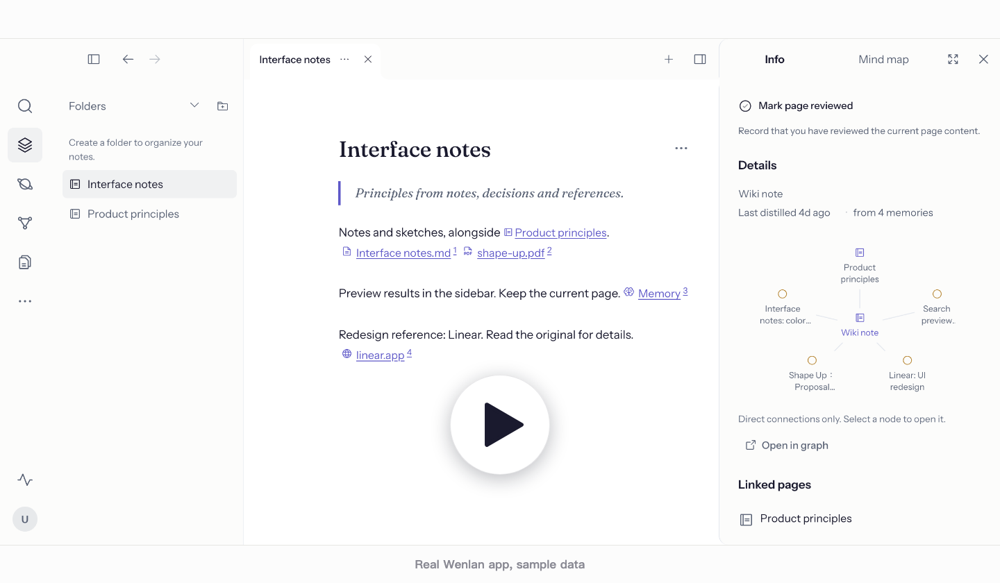

  <picture>
    <source media="(max-width: 600px)" srcset="./docs/assets/readme-banner-mobile.png">
    
  </picture>

  <strong>Notes, code, AI chats into a wiki, checked against sources.</strong> 
  One source of truth for you and your AI tools, kept up to date as your sources change. 
  Your notes stay on your machine and go only to the AI tools you pick.

  English | <a href="./README.zh-Hans.md">简体中文</a> | <a href="./README.zh-Hant.md">繁體中文</a> | <a href="./README.es-ES.md">Español</a>

  <a href="https://github.com/wenlan-app/wenlan/releases/latest"><strong>Download</strong></a> ·
  <a href="#start-in-30-seconds">Get&nbsp;started</a> ·
  <a href="#what-can-i-bring-in">Sources</a> ·
  <a href="#learn-more">Docs</a> ·
  <a href="https://discord.gg/nmzVTTU3HG">Discord</a>

  
  
  

<!-- R113 walkthrough: approved 0.5-second cover; 1080p; original video/audio and masters retained. -->

  

 

## Why Wenlan

I started Wenlan because my notes, documents, and AI chats were scattered and always changing, and keeping a vault from rotting took constant upkeep. I wanted an AI-native knowledge base that stays useful without the hassle.

- **Your AI writes it and keeps it current:** The AI tool you already use turns your notes, files, and AI chats into pages, with no extra model.
- **It tells you what it can't back up:** A page is refused when most of its citations don't match the source, and each citation opens the original.
- **It flags what changed:** When a source, page, or code line changes, only the pages that rely on it are flagged.
- **What you write stays yours:** Wenlan never edits your existing notes without your OK, and pages you wrote are set to **Ask me first**.
- **Bring what you have, keep it when you switch tools:** Notes, documents, links, and chats come in ([full list](#what-can-i-bring-in)) as local Markdown that works in the AI tools you pick.

 

## Get started

### 1. Download and open Wenlan

[Download the desktop app](https://github.com/wenlan-app/wenlan/releases/latest) for macOS 11 or later on Apple Silicon, or Windows x64. The app is in English, 简体中文, and 繁體中文.

Prefer the terminal? On a Mac, run `npx -y wenlan setup`, or `brew install 7xuanlu/tap/wenlan` and then `wenlan setup`. Linux and Windows: [CLI install guide](docs/setup-and-data.md#installation).

### 2. Bring in your material

Create a page, or bring in an Obsidian vault, a Logseq graph, a folder, or earlier AI chats. [Import guide](docs/import-guide.md).

### 3. Connect your AI tool

| AI tool | Connection | Setup |
|---|---|---|
| Claude Code / Claude Desktop | Plugin / MCP | [Claude guide](docs/setup-with-ai.md#claude-code) |
| ChatGPT Desktop (Codex), Codex CLI | Plugin | [Codex guide](docs/setup-with-ai.md#codex) |
| Cursor, GitHub Copilot, VS Code, Gemini CLI, Antigravity, Windsurf, Kiro, OpenCode, Kimi Code | MCP and skills | [MCP guide](docs/setup-with-ai.md#mcp-only-setup-and-other-clients) |
| Muse Code and other MCP clients | MCP | [MCP guide](docs/setup-with-ai.md#mcp-only-setup-and-other-clients) |

In the App's Settings, **Add a tool** finds the AI tools on your computer and **Connect all** sets them up in one press. Then start a new AI session and ask:

> /recall my earlier pages and decisions on this, then help me: …

Use `$recall` in Codex; with an MCP-only tool, just ask it to check Wenlan first.

When an import finishes, the app offers **Write pages with** your AI tool to turn it into your first cited pages. No command needed.

 

## Sources and imports

| Bring in | How you can use it |
| --- | --- |
| Markdown, text, text-based PDFs, DOCX, or a folder | Search and cite the imported text. Import a folder once, or keep it in sync as its files change. |
| An Obsidian vault or a Logseq graph | Search and cite existing notes. Keep it in sync to follow changes in the background, or import it once. Wenlan never edits your existing notes without your OK: in an Obsidian vault, notes you set to **Ask me first** get AI suggestions you accept or decline. |
| Web links | Paste a link into a page and it is saved as a source. YouTube, X, Threads, Instagram, and RedNote links show as a card, a playable video, or the original post. Or paste text with its URL to save that excerpt. |
| Gmail, Notion, Google Drive, Slack, GitHub | Your AI tool reads them with its own connectors and saves what matters to Wenlan with a link to the original. |
| A code repository | `/wenlan wiki` writes pages tied to the code lines they rely on. [Code wiki](#code-repository-wiki). |
| An OKF bundle | Connect an Open Knowledge Format folder, such as an OpenWiki or a Wenlan export, as a source. |
| Your AI chats as you work | Claude Code, Codex, and your other AI tools save the decisions, findings, and progress from each conversation as memories, and pages cite them. Full transcripts are not imported. |
| ChatGPT or Claude export ZIPs | Retrieve earlier conversation text, including a last message that got no reply, and cite it as context; imports are snapshots, not live account connections. |
| Existing memories as text | Save preferences, decisions, or lessons as individual memories. |

Scanned PDFs need text extraction first; chat attachments are not imported. [Import guide](docs/import-guide.md).

 

## Steep: keep knowledge useful as it changes

  

Illustration based on current update behavior; not an App screenshot.

Saving material is only the start. **Steep prepares it for reuse and keeps supported pages current**, so you and your AI can build on earlier findings instead of repeatedly working through the originals.

Choose one of two modes in Settings:

- **On demand** (new installs start here): when your AI tool saves or writes into Wenlan, it steeps as it goes, and while it works it hears which pages are out of date and which material is in no page yet. No command needed; `/wenlan steep` is there if you want to catch up on everything at once.
- **Automatic:** Wenlan steeps in the background with the model you assign.

What steep does:

- **Enrich memories:** Add types, structured details, search cues, and graph links so individual findings are easier to retrieve in context.
- **Follow the evidence:** Changed sources, memories, or cited code flag dependent pages for refresh; new memories can enrich eligible pages. Refresh keeps the saved page if a draft fails citation checks. Passing these checks does not establish factual correctness.
- **Keep control and history:** Background refresh updates eligible AI-maintained pages; your authored or edited pages receive proposed revisions. Explicit memory replacements hide or archive earlier memories while preserving their links. Page revisions remain inspectable.
- **Ask me first:** With **Ask me first on pages I wrote** on, as it is for new installs, AI changes to pages you wrote or edited wait for your OK. Each page's **AI changes** setting shows **Allowed** or **Ask me first**. Pages AI wrote keep updating.

### What it does on its own

In both modes, without a model, Wenlan:

- **Flags out-of-date pages** when their sources, memories, or cited code change. Repository wiki pages show what changed in the code.
- **Suggests merging near-duplicate pages** as a card for you or your AI to accept or dismiss.
- **Tidies links:** lists `[[links]]` that point to no page yet, and drops citations to memories you deleted.

Rewriting a flagged page takes a model. In Automatic, Wenlan does it in the background. In On demand, your AI tool is told which pages are waiting and can bring them up to date while it works.

[Steep guide: triggers, review rules, and model setup](docs/steep.md). Choose an on-device model, a local server, or a cloud provider; model-backed background work is optional.

 

## A wiki for your code repository

Run `/wenlan wiki` (`$wenlan wiki` in Codex) in a repository. Your AI tool plans the wiki from the repository itself: an overview that lists every page, then one page for each part or flow a newcomer needs. A small tool gets a few pages, a large monorepo many more. A rerun writes only the pages that are missing.

- **Tied to the code:** Each page records the code lines it was read from. When that code changes, the page shows what changed with one Review button, and steep brings the page up to date.
- **In the repository as a pull request:** The GitHub button on a Space connects it to its repository and puts the pages that rely on that code in the repository's `wiki/` folder as a pull request. Run it from the button, or turn on the daily update: it runs your own AI tool on your computer, or runs on GitHub Actions with your AI tool's key saved as a repository secret, so your computer can stay off. The same pull request fixes sentences in the repository's own docs that the code no longer agrees with, for you to review.
- **Your edits stay:** A wiki page someone edited in the repository keeps that edit. Pages that cite your memories or chats stay out of the repository.

 

## Organize scattered material into knowledge

  

App nodes and connections; translated labels and illustrative regions.

**Sources** preserve documents and conversations; **memories** keep the decisions, lessons, and reasons worth reusing. Combine them in editable **Markdown pages with citations**, connect pages with `[[wikilinks]]`, and follow citations back to the originals. Pages can include Mermaid diagrams, which the App draws; when an AI tool writes a page, Wenlan checks its diagrams for common mistakes and names the line to fix.

- **Atomic memories:** Following [Zettelkasten’s principle of atomicity](https://zettelkasten.de/posts/create-zettel-from-reading-notes/), keep findings independently retrievable and reusable without loading an entire conversation or page.
- **Shared topics:** With an enrichment model configured, LLM entity extraction and entity resolution link mentions of the same person, project, or concept across documents and conversations, retaining their memories and sources.
- **Knowledge communities:** Group connected topics to reveal related knowledge across your material. Label Propagation runs by default; Leiden is available as an opt-in algorithm. [Graph details](docs/technical-foundations.md#graph-data-and-entity-resolution).

 

## In everyday use

Save new findings and progress as you work, and start the next session with them.

  

Simplified workflow. Plugin commands and page organization are optional, with no fixed sequence.

- **Work in the App.** Add material, write or edit pages, follow citations, and review proposed changes without connecting AI. The menu bar (or tray) icon opens a small panel with what needs you, your latest pages, and Quick capture.
- **Use your knowledge and write new pages.** Ask your AI to find relevant sources and memories for the task (`/recall`). It can also write cited pages or update existing ones from their current version, then save them to Wenlan. When a page cites its sources as `[n]`, Wenlan compares each cited sentence with its source and refuses the page when most of its citations don't match.
- **Keep what you learn.** Save a decision or lesson, with its reasons and sources, in the App or through your AI (`/capture`).
- **Pause and resume.** Save findings and a session log, update affected pages, and record progress and next steps in the project Brief (`/handoff`). Pick up that context next time (`/brief`).

**Organize accumulated memories when needed:** Synthesize or refresh cited pages from related memories (`/wenlan distill`); writing a new page does not require this step. [Plugin commands](plugin/skills/README.md).

 

## Put your knowledge to work with AI

Once your material is in Wenlan, your AI tools can build on it: retrieve earlier decisions with their supporting material, save new work, and keep using it as the evidence changes.

### If you already use Claude Code or Codex on your notes

Keep doing that. Wenlan connects to the same AI tool and adds the checks a folder of Markdown can't do by itself: a page refused when most of its citations don't match the source, flags when sources change, review for AI edits to pages you wrote, and it never edits your existing notes without your OK.

**Use it for:**

- **Development:** Bring earlier technical decisions, lessons, and acceptance criteria into implementation and debugging.
- **Products and websites:** Use customer research, positioning, and design principles to draft specifications or build pages.
- **Research and learning:** Turn reading material and saved findings into cited reports or study guides you can reuse.

**Retrieval and connections:** Plugins guide retrieval and saving; MCP connections expose the tools for your AI to call.

- **[Local hybrid retrieval](docs/technical-foundations.md#retrieval-pipeline):** Find exact terms and similar meaning with SQLite FTS5 and BGE embeddings in a libSQL DiskANN vector index, fused by weighted Reciprocal Rank Fusion (RRF); base search needs no API key.
- **Graph-assisted ranking:** Shared-entity links boost related memories even when their wording differs. Optional cross-encoder reranking compares each candidate with the question to refine the order.
- **Space-scoped retrieval:** Select a Space to limit returned knowledge to the relevant project or personal collection.

Turn on **Web access** in Settings to let supported web AI clients such as Claude, ChatGPT, or Muse search your library or a chosen Space while your computer is online. When you allow an app, choose search only or search and write; a write app can also add, edit and delete, and AI apps can ask you before each change. This feature is experimental; queries and results pass through a relay. See the [privacy limits](docs/PRIVACY.md#pre-release-standalone-wenlan-relay-connector).

 

## Architecture

**One local knowledge base.** App, CLI, and connected AI tools read and write through Wenlan’s local service. Pages are Markdown files; memories, relationships, and search indexes live in local libSQL.

**Built with** Rust for the local service, CLI, and MCP server, and Tauri with React and TypeScript for the desktop app.

  

Architecture overview. [Retrieval, evidence, and models](docs/technical-foundations.md).

 

## Data and privacy

**Export your wiki:** Export eligible pages as an Open Knowledge Format (OKF) wiki.

A cloud AI client may send retrieved knowledge to its provider, and a cloud model receives the material it processes. Local storage does not keep those interactions local. Usage statistics are off by default.

[File locations, backup, and removal](docs/setup-and-data.md#backup-and-removal) · [Network and privacy details](docs/PRIVACY.md#when-wenlan-reaches-the-network).

 

## Evaluation

These LongMemEval (LME) snapshots measure retrieval of saved knowledge, not AI answer quality. Recall@5 measures how much relevant material appears in the top five results.

<!-- EVAL_SNAPSHOT_START -->
| Benchmark | Recall@5 | MRR | NDCG@10 |
|---|---:|---:|---:|
| LME_Oracle (500 Q) | 93.6% | 0.857 | 0.883 |
| LME_S (deep, 90 Q) | 87.7% | 0.815 | 0.822 |
<!-- EVAL_SNAPSHOT_END -->

On a 10,000-page test (generated pages, M2 Pro with 16 GB, v0.20.0), App search answered in 11 to 50 ms, restart took under 0.3 s, and memory peaked at about 1.2 GB. With the search fix in 0.20.1, AI-tool search found all 30 rare test words in that library.

Importing a 10,000-note Obsidian vault in 0.20.2 (invented notes, M2 Pro Mac with 16 GB, debug build, Claude Code writing the pages): searchable in 15 s, the first page in about 2 minutes, and 8 cited pages in about 4 minutes.

[Evaluation method and benchmark details](docs/eval/README.md).

 

## Learn more

- [Get started and install](docs/setup-and-data.md#installation)
- [Connect an AI tool](docs/setup-with-ai.md)
- [Sources and imports](docs/import-guide.md)
- [Local files, backups, and offline use](docs/setup-and-data.md)
- [Privacy](docs/PRIVACY.md)
- [Doctor and issue reports](https://wenlan.app/docs/diagnostics-and-issue-reports)
- [What's new in each release](CHANGELOG.md)
- [Full documentation index](docs/README.md)

 

## Contributing

Join the [Discord community](https://discord.gg/nmzVTTU3HG). Report bugs or request features in [GitHub issues](https://github.com/wenlan-app/wenlan/issues); issues are public, so redact secrets and personal information.

For code and docs, see [Contributing](.github/CONTRIBUTING.md), [Security](.github/SECURITY.md), and the [Code of Conduct](.github/CODE_OF_CONDUCT.md).

 

## Code signing policy

See the [platform signing and notarization details](docs/code-signing.md).

 

## License

The local runtime, CLI, MCP server, shared types, and plugins use [Apache-2.0](LICENSE). The desktop app and its frontend use [AGPL-3.0-only](app/LICENSE); modified versions run as a network service must offer their source to users.

 

## Lineage and peers

Wenlan takes its name from Wenlan Pavilion. Its direction builds on the LLM-wiki and agent-memory lineages: [Karpathy’s LLM-wiki note](https://gist.github.com/karpathy/442a6bf555914893e9891c11519de94f), [Rohitg00’s proposal](https://gist.github.com/rohitg00/2067ab416f7bbe447c1977edaaa681e2), and [nashsu/llm_wiki](https://github.com/nashsu/llm_wiki).
