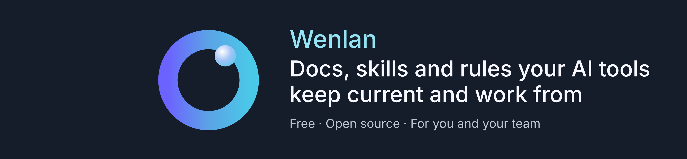

<p align="center">
  <picture>
    <source media="(max-width: 600px)" srcset="./docs/assets/readme-banner-mobile.png">
    
  </picture>
</p>

<p align="center">
  <strong>Docs, skills and rules you and your AI tools both work from, kept current.</strong><br>
  Bring your notes and knowledge. Every doc cites its sources. Free, open source, for you and your team.
</p>

<p align="center">
  English | <a href="./README.zh-Hans.md">简体中文</a> | <a href="./README.zh-Hant.md">繁體中文</a> | <a href="./README.es-ES.md">Español</a>
</p>

<p align="center">
  <a href="https://github.com/wenlan-app/wenlan/releases/latest"><strong>Download</strong></a> ·
  <a href="#start-in-30-seconds">Get&nbsp;started</a> ·
  <a href="#what-can-i-bring-in">Sources</a> ·
  <a href="#learn-more">Docs</a> ·
  <a href="https://discord.gg/nmzVTTU3HG">Discord</a>
</p>

<p align="center">
  <a href="https://github.com/wenlan-app/wenlan/actions/workflows/ci.yml?query=branch%3Amain"></a>
  <a href="https://github.com/wenlan-app/wenlan/releases/latest"></a>
  <a href="#license"></a>
</p>

<p align="center">
  <a href="https://youtu.be/vM2GXS6UjyA"></a>
</p>

<a id="why-wenlan"></a>

<br>

## Why Wenlan

Your AI tools each start from zero, and each wants its own rules file. Wenlan gives every tool you connect the same docs, skills and rules, keeps them current, and lets you read and change all of it.

- **Docs with sources.** Notes, documents and AI chats become pages. Before saving, Wenlan checks that each cited source supports its sentence.
- **Skills and rules, written once.** Kept current in every AI tool you connect. Bring in the skills already on your computer, or find more to install.
- **Organized memory keeps it current.** What you settle in any AI tool is saved and is there in the next. Wenlan organizes those memories into knowledge and topic pages, merging repeats. That is how your docs, skills and rules stay current.
- **You stay in charge.** See every change, undo it, and lock a page so AI asks you first.
- **Any layout you ask for.** A page can be text, or a web page your AI draws that shows the live content.
- **Files first, self-hosted, portable.** Run it on your own computer or server. Pages are plain Markdown files and the database is only an index of your files, so you can take them anywhere.

<a id="how-it-compares"></a>

### Wenlan or a rules file per tool?

A rules file (AGENTS.md, CLAUDE.md, .cursor/rules) is enough for one tool in one repository. Wenlan is for when that stops being enough:

- **One copy for every tool.** A rules file is copied and kept in step by hand, once for each tool. In Wenlan you write it once.
- **It stays current.** In a rules file, an old rule stays until someone notices. In Wenlan, your AI tools update a page when its source changes, and the old version is kept.
- **More than rules.** Docs with sources, skills and memory sit next to the rules.
- **You choose what AI may change.** AI can rewrite anything in a rules file. In Wenlan you choose per page, and locked pages ask you first.

More comparisons, with Obsidian, Notion AI, and memory tools: [wenlan.app/learn](https://wenlan.app/learn).

<a id="quickstart"></a>
<a id="start-in-30-seconds"></a>
<a id="start-with-the-app"></a>
<a id="open-the-wiki"></a>
<a id="desktop-app"></a>
<a id="claude-code-in-30-seconds"></a>
<a id="codex-plugin"></a>
<a id="mcp-setup"></a>
<a id="mcp-clients"></a>

<br>

## Get started

**On your own.** Start from your AI tool. No app needed.

1. In a terminal, run this (it needs Node.js):

   ```sh
   npx -y wenlan setup
   ```

   In Claude Code you can add the [plugin](docs/setup-with-ai.md) instead. On a Mac, `brew install 7xuanlu/tap/wenlan` then `wenlan setup` works too. [Other ways to install](docs/setup-and-data.md#installation).

2. Start a new AI session and ask:

   > /wenlan what did I decide about this before? Then help me: …

   `/wenlan` (`$wenlan` in Codex) is the one command to remember: say what you want after it.

3. Read and edit your pages in your browser: `wenlan open`.

Optional: the [desktop app](https://github.com/wenlan-app/wenlan/releases/latest) keeps pages as files on your computer, imports your material, and connects your AI tools in one press. macOS 11 or later on Apple Silicon, Windows x64, or Linux x64.

**With a team.** Run one Wenlan server that everyone connects to with their own key. Each person gets view-only or edit access to each Space, and the owner can remove a person at once. Members open an invite link and connect their own AI tool, with no app needed; with the desktop app, their copy syncs by itself. [Team server guide](docs/team-server.md).

Bring in an Obsidian vault, a Logseq graph, a folder, or earlier AI chats: [Import guide](docs/import-guide.md). Works with Claude Code, Claude Desktop, Codex, Cursor, GitHub Copilot, VS Code, Gemini CLI, Windsurf, Grok Bot, and other MCP tools: [set one up by hand](docs/setup-with-ai.md).

<a id="what-can-i-bring-in"></a>
<a id="sources-and-imports"></a>

<br>

## What you can bring in

- **Files and folders:** Markdown, text, text-based PDFs, and DOCX. Import once, or keep a folder in sync.
- **Obsidian vaults and Logseq graphs:** keep them in sync, or import once. Notes you wrote start on **Ask me first**.
- **Web links:** paste a link into a page and it becomes a source. YouTube, X, Threads, Instagram, and RedNote links show as a card or video.
- **Gmail, Notion, Google Drive, Slack, GitHub:** your AI tool reads them with its own connectors and saves what matters, with a link to the original.
- **AI chats:** decisions and findings are saved as memories, not full transcripts. ChatGPT and Claude export ZIPs work too.
- **A code repository:** `/wenlan wiki` writes pages tied to the code. [Docs for code](#code-repository-wiki).

You can also connect an Open Knowledge Format (OKF) folder as a source. Scanned PDFs need text extraction first; chat attachments are not imported. [Import guide](docs/import-guide.md).

<a id="what-makes-wenlan-distinct"></a>
<a id="why-is-wenlan-different"></a>
<a id="two-lifecycles"></a>
<a id="two-lifecycles-one-maintained-knowledge-system"></a>
<a id="local-markdown"></a>
<a id="atomic-memory"></a>
<a id="maintained-page"></a>
<a id="local-markdown-that-works-with-obsidian"></a>
<a id="keep-knowledge-current-and-preserve-history"></a>
<a id="steep-keep-knowledge-useful-as-it-changes"></a>
<a id="what-it-does-on-its-own"></a>
<a id="what-does-wenlan-build"></a>
<a id="why-it-compounds"></a>
<a id="what-is-this"></a>
<a id="what-you-get"></a>
<a id="what-can-it-do"></a>
<a id="knowledge-graph"></a>
<a id="browse-and-organize-your-knowledge"></a>
<a id="connect-your-knowledge"></a>
<a id="organize-scattered-material-into-knowledge"></a>
<a id="explore-your-personal-knowledge-graph"></a>
<a id="daily-workflow"></a>
<a id="in-everyday-use"></a>
<a id="how-wenlan-works"></a>
<a id="how-does-it-work"></a>
<a id="use-your-knowledge-with-ai"></a>
<a id="put-your-knowledge-to-work-with-ai"></a>
<a id="if-you-already-use-claude-code-on-your-notes"></a>

<br>

## How it stays organized

Your AI tool reads what you bring in and writes it into Markdown pages. It links related pages, cites where each sentence came from, and brings pages up to date when a source changes. You can open any page and write in it yourself.

<p align="center">
  
</p>
<p>Illustration based on current update behavior; not an App screenshot.</p>

- **Pages with sources:** Each citation opens the original. When a page cites its sources as `[n]`, Wenlan compares each cited sentence with its source and refuses the page when most citations don't match. Passing the check does not prove a page correct.
- **Kept current:** When a source, memory, or cited code changes, the pages that rely on it are flagged for an update. Without any model, Wenlan also suggests merging near-duplicate pages and lists `[[links]]` that point to no page yet.
- **You decide what AI may change:** Pages you wrote start on **Ask me first**, so AI changes wait for your OK. Set any page to **Allowed** or **Ask me first**, see what changed, and restore an earlier version.
- **Two ways to run it:** In **On demand**, the default, your AI tool does the writing while it works, so there is no API key to set up. In **Automatic**, Wenlan does it in the background with a model you choose, on your computer or in the cloud. [Steep guide](docs/steep.md).
- **In your AI tool:** type `/wenlan` and say what you want: look up earlier decisions, save a lesson, or pick up where you stopped. Shortcuts: `/recall`, `/capture`, `/handoff`, `/brief`. [Plugin commands](plugin/skills/README.md).
- **In the app:** Add material, write and edit pages, follow citations, and review proposed changes without connecting an AI. Pages can include Mermaid diagrams, which the app draws.

Already using Claude Code or Codex on a folder of notes? Keep doing that. Wenlan connects to the same tool and adds what a folder can't do alone: citation checks, flags when sources change, and per-page control over what AI may change.

<a id="code-repository-wiki"></a>
<a id="a-wiki-for-your-code-repository"></a>

<br>

## Docs for your code repository

Run `/wenlan wiki` (`$wenlan wiki` in Codex) in a repository. Your AI tool writes an overview and one page for each part or flow a newcomer needs. A rerun writes only the pages that are missing.

- **Tied to the code:** Each page records the code lines it was read from, and shows what changed when that code changes.
- **As a pull request:** The GitHub button on a Space puts the pages in the repository's `wiki/` folder as a pull request, when you press it or daily. The daily run uses your own AI tool on your computer, or GitHub Actions with your AI tool's key saved as a repository secret. The same pull request fixes sentences in the repository's docs that the code no longer agrees with.
- **Your edits stay:** A page someone edited in the repository keeps that edit. Pages that cite your memories or chats stay out of the repository.

<a id="what-wenlan-is-not"></a>
<a id="retrieval"></a>
<a id="retrieval-across-words-meaning-and-connections"></a>
<a id="architecture"></a>

<br>

## For technical readers

**One local knowledge base.** The app, CLI, and connected AI tools read and write through Wenlan’s local service. Pages are Markdown files; memories, relationships, and search indexes live in local libSQL. The service, CLI, and MCP server are written in Rust; the desktop app uses Tauri with React and TypeScript.

<p align="center">
  
</p>

- **Retrieval:** SQLite FTS5 finds exact terms and BGE embeddings in a libSQL DiskANN index find similar meaning, fused by weighted Reciprocal Rank Fusion (RRF). Base search needs no API key. Shared-entity links boost related memories, and optional cross-encoder reranking refines the order. Choosing a Space limits results to that project.
- **Graph:** With an enrichment model, entity extraction and resolution link mentions of the same person, project, or concept across sources. Label Propagation (default) or Leiden groups related topics.
- **Memories:** Findings are saved as small, separate memories, so one can be found without loading a whole conversation or page.

[Retrieval, evidence, and models](docs/technical-foundations.md).

<a id="evaluation"></a>

### Evaluation

These LongMemEval (LME) snapshots measure retrieval of saved knowledge, not AI answer quality. Recall@5 measures how much relevant material appears in the top five results.

<!-- EVAL_SNAPSHOT_START -->
| Benchmark | Recall@5 | MRR | NDCG@10 |
|---|---:|---:|---:|
| LME_Oracle (500 Q) | 93.6% | 0.857 | 0.883 |
| LME_S (deep, 90 Q) | 87.7% | 0.815 | 0.822 |
<!-- EVAL_SNAPSHOT_END -->

On a 10,000-page test (generated pages, M2 Pro with 16 GB, v0.20.0), App search answered in 11 to 50 ms, restart took under 0.3 s, and memory peaked at about 1.2 GB. With the search fix in 0.20.1, AI-tool search found all 30 rare test words in that library.

Importing a 10,000-note Obsidian vault in 0.20.2 (invented notes, M2 Pro Mac with 16 GB, debug build, Claude Code writing the pages): searchable in 15 s, the first page in about 2 minutes, and 8 cited pages in about 4 minutes.

[Evaluation method and benchmark details](docs/eval/README.md).

<a id="models-and-privacy"></a>
<a id="data-and-privacy"></a>

<br>

## Data and privacy

- Pages are Markdown files on your computer, and they go only where you send them.
- Export eligible pages as an Open Knowledge Format (OKF) wiki.
- A cloud AI tool may send what it retrieves to its provider, and a cloud model receives the material it processes, so local storage does not keep those interactions local.
- Usage statistics are off by default.

**Web access (experimental):** Turn on **Web access** in Settings to let web AI clients such as Claude, ChatGPT, or Muse search your library or a chosen Space while your computer is online. When you allow an app, choose search only or search and write; a write app can also add, edit and delete, and AI apps can ask you before each change. Queries and results pass through a relay. See the [privacy limits](docs/PRIVACY.md#pre-release-standalone-wenlan-relay-connector).

[File locations, backup, and removal](docs/setup-and-data.md#backup-and-removal) · [Network and privacy details](docs/PRIVACY.md#when-wenlan-reaches-the-network).

<a id="learn-more"></a>
<a id="whats-new"></a>

<a id="offline-queue-outbox"></a>

<br>

## Learn more

- [Get started and install](docs/setup-and-data.md#installation)
- [Connect an AI tool](docs/setup-with-ai.md)
- [Sources and imports](docs/import-guide.md)
- [Local files, backups, and offline use](docs/setup-and-data.md)
- [Privacy](docs/PRIVACY.md)
- [Doctor and issue reports](https://wenlan.app/docs/diagnostics-and-issue-reports)
- [What's new in each release](CHANGELOG.md)
- [Full documentation index](docs/README.md)

<br>

## Contributing

Join the [Discord community](https://discord.gg/nmzVTTU3HG). Report bugs or request features in [GitHub issues](https://github.com/wenlan-app/wenlan/issues); issues are public, so redact secrets and personal information.

For code and docs, see [Contributing](.github/CONTRIBUTING.md), [Security](.github/SECURITY.md), and the [Code of Conduct](.github/CODE_OF_CONDUCT.md).

<a id="code-signing-policy"></a>

<br>

## Code signing policy

See the [platform signing and notarization details](docs/code-signing.md).

<a id="license"></a>

<br>

## License

The local runtime, CLI, MCP server, shared types, and plugins use [Apache-2.0](LICENSE). The desktop app and its frontend use [AGPL-3.0-only](app/LICENSE); modified versions run as a network service must offer their source to users.

<a id="acknowledgments"></a>

<br>

## Lineage and peers

Wenlan takes its name from Wenlan Pavilion. Its direction builds on the LLM-wiki and agent-memory lineages: [Karpathy’s LLM-wiki note](https://gist.github.com/karpathy/442a6bf555914893e9891c11519de94f), [Rohitg00’s proposal](https://gist.github.com/rohitg00/2067ab416f7bbe447c1977edaaa681e2), and [nashsu/llm_wiki](https://github.com/nashsu/llm_wiki).
