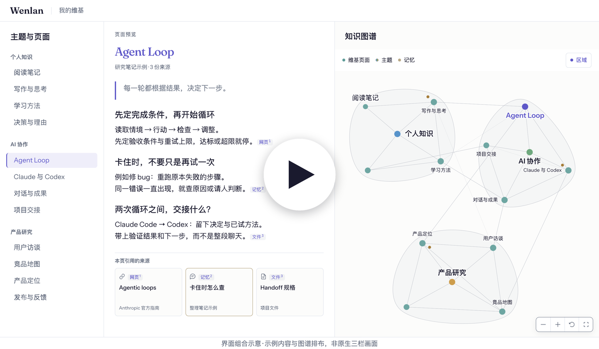
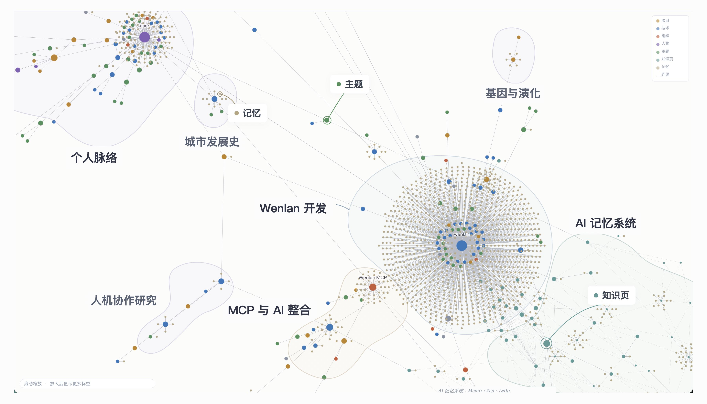
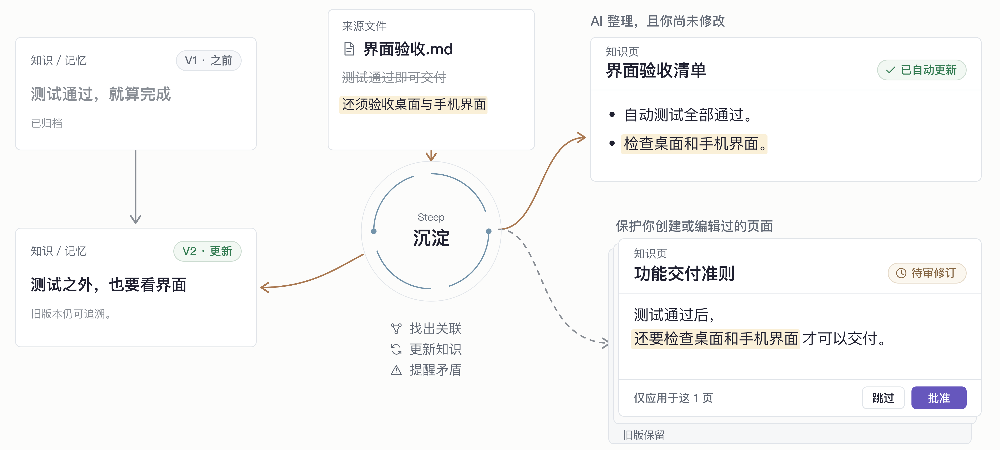

<!-- README_SYNC: source=README.md sha256=220017d2ab7183acce7a016af2bd768dfe94f830fe24cd1d24a17e489be32c84 -->

  <picture>
    <source media="(max-width: 600px)" srcset="./docs/assets/readme-banner-zh-Hans-mobile.png">
    
  </picture>

  文澜把散落各处的笔记、文档、AI 对话和写代码的记录， 
  整理成一份本地、能查回原文、你和 AI 工具共用、会跟着来源更新的知识库。

  <a href="./README.md">English</a> | 简体中文 | <a href="./README.zh-Hant.md">繁體中文</a> | <a href="./README.es-ES.md">Español</a>

  
  
  

  <a href="#start-in-30-seconds">开&#8288;始&#8288;使&#8288;用</a> ·
  <a href="#what-can-i-bring-in">功&#8288;能</a> ·
  <a href="#learn-more">文&#8288;档</a> ·
  <a href="https://discord.gg/nmzVTTU3HG">Discord</a>

<!-- R113 walkthrough: approved 0.5-second cover; 1080p; original video/audio and masters retained. -->

  

 

## 为什么用文澜

我做文澜，是因为对自己的知识一直有种焦虑：笔记、文档和 AI 对话散落各处，又一直在变。要让 Obsidian 仓库三个月后不荒废，得装插件、设计流程、不停维护；LLM wiki 那类做法，日常用起来也不轻松。我想要一个 AI 原生、不用费心照顾的知识库 App。

- **散落的资料收进一处：** 文档、Markdown 文件、Obsidian 仓库、Logseq 图谱、网页链接，还有导出的 AI 对话，都进到同一个知识库。
- **所有 AI 工具共用一份：** Claude Code、Codex、Cursor 等 MCP 工具都用同一个知识库。
- **流程全部内置：** 保存、整理、引用到更新笔记，都在同一个 App 里，不用再拼装一堆插件。

 

## 开始使用

把资料保存在 Wenlan，让你常用的 AI 工具用这些知识回答问题、完成工作。

### 1. 下载并打开 Wenlan

[下载桌面版](https://github.com/wenlan-app/wenlan/releases/latest)（macOS Apple Silicon 或 Windows x64），安装并打开。

更喜欢终端？[通过 CLI 或 AI 工具使用 Wenlan](docs/setup-and-data.zh-Hans.md#installation)。

### 2. 新建笔记或导入现有资料

在 Wenlan 中新建笔记、连接 Obsidian 仓库或 Logseq 图谱、添加文件夹，或导入过去的 AI 对话与记忆。[导入指南](docs/import-guide.md)。

### 3. 需要时再连接 AI 工具

| AI 工具 | 连接方式 | 设置入口 |
|---|---|---|
| Claude Code / Claude Desktop | 插件 / MCP | [Claude 指南](docs/setup-with-ai.md#claude-code) |
| ChatGPT Desktop（Codex）、Codex CLI | 插件 | [Codex 指南](docs/setup-with-ai.md#codex) |
| Cursor、VS Code、Gemini CLI、Muse Code | MCP | [MCP 指南](docs/setup-with-ai.md#mcp-only-setup-and-other-clients) |

安装插件后，开启新的 AI 会话并运行 `/wenlan`（Codex 中为 `$wenlan`）。它会确认 Wenlan 是否正常，需要时自动完成设置。

导入的资料可以直接使用，想整理成笔记也随时可以。连接后，就可以问 AI：

> /recall 我之前对这件事的笔记和决定，再帮我：……

Codex 中用 `$recall`。只用 MCP 的工具，直接说“先查文澜里我之前对这件事的笔记和决定，再帮我：……”。

想把导入的资料整理成带引用的笔记，运行 `/wenlan steep`（Codex 中为 `$wenlan steep`）。新安装默认以“随叫”方式[沉淀](#steep沉淀让知识跟上新发现)，由你的 AI 工具完成；也可以改成“自动”，用[模型](docs/steep.md#enable-steep)在后台整理记忆、更新笔记。

不知道该问什么？在 App 中打开“AI 能做什么”，查看要在 AI 工具里输入的确切文字。

 

## 把散落的资料整理成知识

  

保留实机节点与连线；文字经翻译，区域名称与范围为示意。

**来源**保留文档与对话；**记忆**记录值得重用的决定、经验与理由。将两者整理成可编辑的**带引用 Markdown 笔记**，用 `[[wikilinks]]` 连接笔记，并沿引用回到原始资料。笔记可以包含 Mermaid 图表，由 App 绘制；AI 工具写入笔记时，文澜会检查图表的常见错误，并指出要修改的那一行。

- **原子记忆：** 遵循 [Zettelkasten 的原子性原则](https://zettelkasten.de/posts/create-zettel-from-reading-notes/)，让每条发现都能独立检索和重用，无需加载整段对话或笔记。
- **共享主题：** 配置整理模型后，LLM 实体提取与实体消歧会将文档和对话中对同一人物、项目或概念的提及关联起来，并保留其记忆与来源。
- **知识群集：** 将相连主题分组，发现资料中的相关知识。默认使用 Label Propagation；Leiden 可作为选配算法。[图谱详情](docs/technical-foundations.md#graph-data-and-entity-resolution)。

### 来源与导入

| 导入内容 | 用途 |
| --- | --- |
| Markdown、文本、文本型 PDF 或文件夹 | 搜索和引用导入文本。文件夹可以只导入一次，也可以持续同步文件的变化。 |
| Obsidian 仓库或 Logseq 图谱 | 通过只读连接搜索和引用现有笔记。选择持续同步，在后台跟上变化；或只导入一次。不会写回。 |
| 带 URL 的网页摘录 | 粘贴文本与 URL，保存可搜索内容及原文链接。 |
| ChatGPT 或 Claude 导出 ZIP | 检索过去的对话文本（包括最后一条没有得到回复的消息）并作为上下文引用；导入是快照，不会连接实时账户。 |
| 文本形式的现有记忆 | 将偏好、决定或经验保存为单条记忆。 |

扫描版 PDF 需先提取文本；聊天附件不会导入。[导入指南（英文）](docs/import-guide.md)。

 

## 日常使用

工作中留下新发现与进度，下次直接接着用。

  

简化流程示意；插件指令与笔记整理均按需使用，没有固定顺序。

- **在 App 中使用。** 添加资料、撰写或编辑笔记、查看引用来源与审核修订，无需连接 AI。
- **运用知识、编写新笔记。** 请 AI 找回相关来源与记忆，用于当前任务（`/recall`）；也能编写带引用的新笔记，或依据现有版本更新笔记，再存回 Wenlan。笔记用 `[n]` 引用来源时，文澜会检查所引来源是否支持每个句子；未通过检查的引用太多时，不会保存该笔记。
- **留下你的新发现。** 保存决定或心得，以及其理由和来源；可在 App 操作，或请 AI 代存（`/capture`）。
- **告一段落，下次继续。** 保存发现与会话记录，更新受影响的笔记，并将进度和下一步写进项目摘要 Brief（`/handoff`）。下次读取这些上下文继续工作（`/brief`）。

**按需整理积累的记忆：** 将相关记忆整理或更新为带引用的笔记（`/wenlan distill`），不是编写新笔记的必要步骤。[插件指令](plugin/skills/README.md)。

 

## 让 AI 接续已有知识

资料放进文澜后，AI 就能接着用：找回带有依据的既有决定、保存新成果，并随着证据变化继续使用。

**适用场景：**

- **开发：** 将先前的技术决定、经验与验收标准带入实现和调试。
- **产品与网站：** 运用客户研究、定位与设计原则撰写规格或构建网页。
- **研究与学习：** 将阅读资料与保存的发现整理成带引用的报告或可复用学习笔记。

**检索与连接：** 插件会引导检索和保存；MCP 连接则提供工具供 AI 调用。

- **[本地混合检索（Hybrid Retrieval）](docs/technical-foundations.md#retrieval-pipeline)**：用 SQLite FTS5 找出相同词句、BGE 向量找出相近语义，再以加权 RRF 合并排名；基础搜索无需 API key。
- **图谱辅助排序：** 共享实体链接可提升相关记忆的排名，即使措辞不同也能关联。可选的 cross-encoder 重排会比较每条候选内容与问题，以调整顺序。
- **按 Space 限定检索：** 选择 Space，将返回的知识限制在相关项目或个人资料集合内。

在“设置”中开启“网页访问”开关，即可让 Claude、ChatGPT 或 Muse 等受支持的网页 AI 客户端，在你的电脑保持联网时搜索整个资料库或指定空间。允许应用时可以选“只能搜索”或“搜索和写入”；可以写入的应用还能新增、修改和删除内容，AI 应用可以在每次改动前先问你。此功能仍处于实验阶段；查询与结果会经过中继服务，详见[隐私边界](docs/PRIVACY.md#pre-release-standalone-wenlan-relay-connector)。

 

## 为代码仓库建 wiki

在代码仓库中运行 `/wenlan wiki`（Codex 中为 `$wenlan wiki`）。AI 工具会依据仓库本身规划 wiki：先写一篇列出所有笔记的总览，再为新人需要了解的每个部分或流程各写一篇。小工具只需几篇，大型 monorepo 会多得多。再次运行时只补写缺少的笔记。`/wenlan wiki` 取代了 `/wenlan map`，旧名称没有保留别名。

- **与代码绑定：** 每个关键句子都会记录它所依据的代码行。代码改动时，笔记会显示改了什么，并提供一个审核按钮；沉淀会把笔记更新到最新。
- **以 pull request 放进仓库：** Space 上的 GitHub 按钮会把 Space 连接到对应的仓库，并把依据这些代码的笔记以 pull request 放进仓库的 `wiki/` 文件夹。可以从按钮运行，也可以开启每日更新。同一个 pull request 还会修正仓库自身文档中与代码不再相符的句子，供你审核。
- **保留你的修改：** 有人在仓库中修改过的 wiki 笔记会保留那次修改。引用你的记忆或对话的笔记不会放进仓库。

 

## Steep（沉淀）：让知识跟上新发现

  

示意图依据当前的更新行为绘制；并非 App 截图。

保存资料只是开始。**Steep 会整理资料以便重用，并让受支持的笔记保持更新**，让你和 AI 能接续先前的发现，而不必反复重读原始材料。

在“设置”中选择两种方式之一：

- **随叫**（新安装默认）：AI 工具在文澜里保存或写入时，会顺手沉淀，不用另外下指令。想把剩下的一次做完，运行 `/wenlan steep`：它会用导入的资料写出新笔记，并把过期的笔记更新到最新。
- **自动：** 文澜用你指定的模型在后台沉淀。

沉淀会做这些事：

- **整理记忆：** 添加类型、结构化细节、搜索线索和图谱链接，让单条发现更容易在上下文中检索。
- **让依据带动更新：** 来源、记忆或引用的代码变化时，依赖它们的笔记会标记待刷新；新记忆也可以丰富符合条件的笔记。如果草稿未通过引用检查，刷新会保留已保存笔记。通过检查并不代表事实正确。
- **保留控制权与历史：** 后台刷新会更新符合条件的 AI 维护笔记；你撰写或编辑的笔记会收到修订提案。明确替代记忆时，旧记忆会隐藏或归档，同时保留其链接。笔记修订可供检查。
- **审核锁定：** 开启“我写过的页面自动上锁”（新安装默认开启）后，AI 对你写过或改过的笔记所做的修改会先等你审核。AI 写的笔记照常更新。

[Steep 指南：触发条件、审核规则与模型设置（英文）](docs/steep.md)。可选择设备端模型、本地服务器或云端提供商；由模型驱动的后台工作为选配。

 

## 系统架构

**共用本地知识库。** App、CLI 与 AI 工具通过 Wenlan 本地服务读写。笔记以 Markdown 保存；记忆、关系与搜索索引由本地 libSQL 管理。

  

架构示意。[检索、引用与模型](docs/technical-foundations.md)。

 

## 数据与隐私

**导出维基：** 将符合条件的笔记导出为 Open Knowledge Format（OKF）维基。

云端 AI 客户端可能会把找回的知识传给其服务商，云端模型也会收到它处理所需的内容。本地存储不代表这些交互都留在本机。使用统计默认关闭。

[文件位置、备份与卸载](docs/setup-and-data.zh-Hans.md#backup-and-removal) · [联网与隐私详情](docs/PRIVACY.md#when-wenlan-reaches-the-network)。

 

## 评估

这些 LongMemEval（LME）测量结果评估的是已存知识的检索，不是 AI 回答质量。Recall@5 表示相关资料出现在前五条结果中的比例。

<!-- EVAL_SNAPSHOT_START -->
| Benchmark | Recall@5 | MRR | NDCG@10 |
|---|---:|---:|---:|
| LME_Oracle (500 Q) | 93.6% | 0.857 | 0.883 |
| LME_S (deep, 90 Q) | 87.7% | 0.815 | 0.822 |
<!-- EVAL_SNAPSHOT_END -->

[评估方法与基准详情](docs/eval/README.md)。

 

## 进一步了解

- [开始使用与安装](docs/setup-and-data.zh-Hans.md#installation)
- [连接 AI 工具](docs/setup-with-ai.md)
- [来源与导入](docs/import-guide.md)
- [本地文件、备份与离线使用](docs/setup-and-data.zh-Hans.md)
- [隐私](docs/PRIVACY.md)
- [Doctor 与问题反馈](https://wenlan.app/docs/diagnostics-and-issue-reports)
- [完整文档索引](docs/README.md)

 

## 贡献

欢迎加入 [Discord 社区](https://discord.gg/nmzVTTU3HG)。请在 [GitHub issues](https://github.com/wenlan-app/wenlan/issues) 反馈问题或提出功能建议；Issue 公开可见，分享前请遮盖密钥和个人资料。

代码与文档贡献请见[贡献指南](.github/CONTRIBUTING.md)、[安全问题反馈](.github/SECURITY.md)和[行为准则](.github/CODE_OF_CONDUCT.md)。

 

## 代码签名政策

请见[各平台签名与公证说明](docs/code-signing.md)。

 

## 许可

本地 runtime、CLI、MCP server、shared types 和 plugins 使用 [Apache-2.0](LICENSE)。桌面 app 及其前端使用 [AGPL-3.0-only](app/LICENSE)；修改版若作为网络服务运行，须向用户提供其源代码。

 

## 源流与同类项目

Wenlan 名称来自文澜阁，产品方向承接 LLM-wiki 与 agent-memory 脉络：[Karpathy 的 LLM-wiki note](https://gist.github.com/karpathy/442a6bf555914893e9891c11519de94f)、[Rohitg00 的提案](https://gist.github.com/rohitg00/2067ab416f7bbe447c1977edaaa681e2)和 [nashsu/llm_wiki](https://github.com/nashsu/llm_wiki)。
