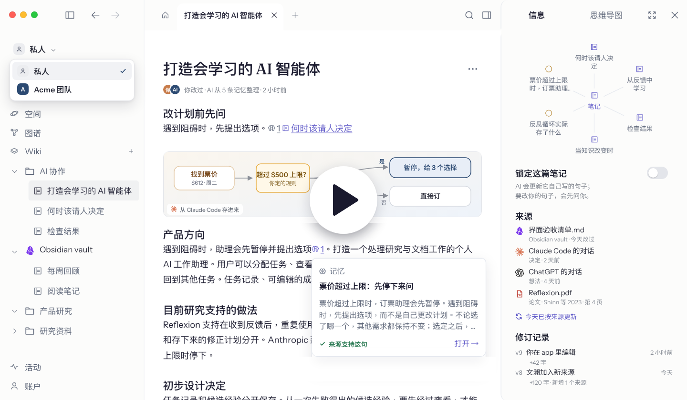

<!-- README_SYNC: source=README.md sha256=bf55db53db55222f4caa3e3f886c5301c570fb53ae498c065ff57849680640f4 -->

  <picture>
    <source media="(max-width: 600px)" srcset="./docs/assets/readme-banner-zh-Hans-mobile.png">
    
  </picture>

  <strong>开源的 Obsidian 替代品，也能直接接上你现有的仓库。</strong> 
  你的 AI 工具帮你整理、更新，不用 API key、不用插件。个人和团队都能用。

  <a href="./README.md">English</a> | 简体中文 | <a href="./README.zh-Hant.md">繁體中文</a> | <a href="./README.es-ES.md">Español</a>

  <a href="https://github.com/wenlan-app/wenlan/releases/latest"><strong>下&#8288;载</strong></a> ·
  <a href="#start-in-30-seconds">开&#8288;始&#8288;使&#8288;用</a> ·
  <a href="#what-can-i-bring-in">来&#8288;源</a> ·
  <a href="#learn-more">文&#8288;档</a> ·
  <a href="https://discord.gg/nmzVTTU3HG">Discord</a>

  
  
  

  

 

## 为什么用文澜

我做文澜，是因为笔记、文档和 AI 对话散落各处，要让笔记系统不荒废得不停维护。后来我们也不断听到有人说 Obsidian 太麻烦：要找插件、装插件，还要一直更新设置。文澜是给每天用 AI 工具、又不想维护笔记系统的人。

**个人版**：下载桌面 App，自己就能用。

**团队版（下一版推出）**：团队自己架一台文澜服务器，大家都连上去，每个人可以设成只能看或可以改。

- **自己保持最新。** AI 工具会把你在对话里的决定存成记忆，再整理进笔记；来源变了，用到它的笔记也会跟着更新。
- **不用插件，不用设置。** 在设置里点“全部连接”，一键连好你的 AI 工具。不用找插件、更新插件，也不用 API key。
- **带进现有资料。** Obsidian 仓库、笔记、文档和 AI 对话都能带进来。[完整清单](#what-can-i-bring-in)。
- **AI 能改什么由你决定。** 改了什么都看得到、能还原，也能指定哪些笔记要先问你。
- **笔记都附出处。** 点引用就回到原文；引用大多对不上的笔记不会保存。
- **页面可以是文字，也可以是 HTML。** 请 AI 帮任何一页做 HTML 视图，或把它做好的 HTML 直接存成一个 HTML 页面。HTML 视图显示的是这页当下的文字，改字不用重做。
- **共用一个 Space。** 通过 Google Drive 或 iCloud 云盘的文件夹，跟同事共用，或在自己的几台电脑间同步。

### 跟其他做法比

| | Obsidian 加插件 | Notion | LLM wiki 应用 | 文澜 |
|---|---|---|---|---|
| 谁来整理 | 你自己加插件 | 你自己，或 Notion 的 Agent | 你另外设置的 AI | 你的 AI 工具；来源变了会更新 |
| 设置 | 找插件、更新插件 | 完整 AI 要 Business 方案 | 填模型 key 或排程 | 一键连接，不用 API key |
| 检查 AI 写的东西 | 看插件 | 附出处，不检查合不合 | 链接到来源 | 引用对不上的笔记不会保存 |
| AI 能改什么 | 看插件 | 你开放给 Agent 的页面 | 它的 wiki 文件夹 | 每篇由你决定，随时可还原 |
| 笔记存在哪 | 你的电脑 | Notion 云端 | 你的电脑 | 你的电脑；能接现有仓库 |

 

## 开始使用

### 1. 下载并打开 Wenlan

[下载桌面版](https://github.com/wenlan-app/wenlan/releases/latest)，支持 macOS 11 以上的 Apple Silicon、Windows x64 和 Linux x64（AppImage 或 .deb，v0.22 起）。App 界面有英文、简体中文和繁體中文。

更喜欢终端？在 Mac 上运行 `npx -y wenlan setup`，或运行 `brew install 7xuanlu/tap/wenlan` 再运行 `wenlan setup`。Linux 和 Windows 请看 [CLI 安装说明](docs/setup-and-data.zh-Hans.md#installation)。

### 2. 带入你的资料

新建一篇笔记，或带入 Obsidian 仓库、Logseq 图谱、文件夹或之前的 AI 对话。[导入指南](docs/import-guide.md)。

### 3. 连接你的 AI 工具

在 App 的设置里，“添加工具”会找出你电脑上的 AI 工具，点“全部连接”一次设好，不用另外装东西或更新。接着开一个新的 AI 会话，问它：

> /wenlan 我之前对这件事怎么决定的？再帮我：……

只要记得 `/wenlan`（Codex 里是 `$wenlan`），后面直接说你要做什么。

支持 Claude Code、Claude Desktop、Codex、Cursor、GitHub Copilot、VS Code、Gemini CLI、Windsurf、Grok Bot 和其他 MCP 工具。[手动设置](docs/setup-with-ai.md)。

导入完成后，App 会提供“用（你的 AI 工具）写页面”，把资料写成第一批带引用的笔记，不用输入指令。

 

## 能带进什么

- **文件和文件夹：** Markdown、文本文件、文本型 PDF、DOCX。可以只导入一次，也可以让文件夹持续同步。
- **Obsidian 仓库和 Logseq 图谱：** 持续同步或只导入一次。你自己写的笔记默认是“先问我”。
- **网页链接：** 在笔记里粘贴链接就会保存为来源。YouTube、X、Threads、Instagram 和小红书会显示成卡片或视频。
- **Gmail、Notion、Google Drive、Slack、GitHub：** 你的 AI 工具用自己的连接器读取，把重要的内容存进来，附上原文链接。
- **AI 对话：** 决定和发现会存成记忆，不存完整对话记录。ChatGPT 和 Claude 导出的 ZIP 也能带进来。
- **代码仓库：** `/wenlan wiki` 写出对应到代码的笔记。[代码 wiki](#code-repository-wiki)。

也可以把 Open Knowledge Format（OKF）文件夹连接为来源。扫描版 PDF 需要先提取文字；对话附件不会导入。[导入指南](docs/import-guide.md)。

 

## 它怎么帮你整理

你的 AI 工具会读你带进来的资料，写成 Markdown 笔记：把相关的笔记连起来，标出每句话的出处，来源变了就跟着更新。任何一篇笔记你都可以打开自己写。

  

示意图依据当前的更新行为绘制；并非 App 截图。

- **每篇笔记都有出处：** 每个引用都能点回原文。笔记用 `[n]` 引用来源时，文澜会拿每个引用的句子对照它的来源；引用大多对不上时，不会保存该笔记。通过检查不代表内容一定正确。
- **跟着来源更新：** 来源、记忆或引用的代码变了，依据它们的笔记会被标出来等待更新。不需要任何模型，文澜也会建议合并近似重复的笔记，并列出还没有对应笔记的 `[[链接]]`。
- **AI 能改什么由你决定：** 你写的笔记默认是“先问我”，AI 的修改会先等你点头。每篇笔记都可以设成“直接改”或“先问我”，看得到改了什么，也能还原到之前的版本。
- **两种方式：** “随叫”是默认，由你的 AI 工具在工作时顺手写，不用另外设置 API key。“自动”则由文澜用你选的模型在后台处理，模型可以在你的电脑上，也可以在云端。[沉淀指南](docs/steep.md)。
- **在你的 AI 工具里：** 打 `/wenlan`，后面说你要做什么：找回之前的决定、存下一个心得，或接着上次做到的地方。快捷方式：`/recall`、`/capture`、`/handoff`、`/brief`。[插件指令](plugin/skills/README.md)。
- **在 App 里：** 不连 AI 也能加资料、写笔记、改笔记、查回引用、审核修改建议。笔记可以包含 Mermaid 图表，由 App 画出来。

已经用 Claude Code 或 Codex 管一个笔记文件夹？继续用就好。文澜接上同一个工具，补上文件夹自己做不到的事：检查引用、来源变了会标记，而且每篇笔记 AI 能不能改由你决定。

 

## 为代码仓库建 wiki

在代码仓库中运行 `/wenlan wiki`（Codex 中为 `$wenlan wiki`）。你的 AI 工具会写一篇总览，再为新人需要了解的每个部分或流程各写一篇。再次运行时只补写缺少的笔记。

- **与代码绑定：** 每篇笔记都会记录它依据的代码行；代码变了，笔记会显示改了什么。
- **以 pull request 放进仓库：** Space 上的 GitHub 按钮会把笔记以 pull request 放进仓库的 `wiki/` 文件夹，可以点按钮运行，也可以每天自动跑。每日更新可以在你的电脑上用你自己的 AI 工具跑，或在 GitHub Actions 上跑（AI 工具的密钥存为仓库 secret）。同一个 pull request 还会修正仓库文档中与代码不再相符的句子。
- **保留你的修改：** 有人在仓库中修改过的 wiki 笔记会保留那次修改。引用你的记忆或对话的笔记不会放进仓库。

 

## 给技术读者

**共用本地知识库。** App、CLI 与连上的 AI 工具通过文澜的本地服务读写。笔记以 Markdown 文件保存；记忆、关系与搜索索引存在本地 libSQL。本地服务、CLI 和 MCP server 用 Rust 写成；桌面 app 用 Tauri，界面是 React 和 TypeScript。

  

- **检索：** 用 SQLite FTS5 找出相同词句、BGE 向量找出相近语义（libSQL 的 DiskANN 向量索引），再以加权 RRF 合并排名；基础搜索不需要 API key。共同实体会提高相关记忆的排名，另可启用 cross-encoder reranking 精排。选定 Space 就只返回该项目的内容。
- **图谱：** 配置整理模型后，实体抽取与实体消歧会把不同来源里提到的同一人物、项目或概念连起来；用 Label Propagation（默认）或 Leiden 把相关主题分组。
- **记忆：** 发现存成一条一条独立的小记忆，不必载入整段对话或整篇笔记就能找回。

[检索、引用与模型](docs/technical-foundations.md)。

### 评估

这些 LongMemEval（LME）测量结果评估的是已存知识的检索，不是 AI 回答质量。Recall@5 表示相关资料出现在前五条结果中的比例。

<!-- EVAL_SNAPSHOT_START -->
| Benchmark | Recall@5 | MRR | NDCG@10 |
|---|---:|---:|---:|
| LME_Oracle (500 Q) | 93.6% | 0.857 | 0.883 |
| LME_S (deep, 90 Q) | 87.7% | 0.815 | 0.822 |
<!-- EVAL_SNAPSHOT_END -->

一万篇笔记的测试（生成的测试笔记，M2 Pro 16 GB，v0.20.0）：App 搜索 11 到 50 毫秒，重启不到 0.3 秒，内存峰值约 1.2 GB。0.20.1 修好搜索后，AI 工具在同一个资料库里找到了全部 30 个罕见测试字词。

在 0.20.2 导入一万篇笔记的 Obsidian 仓库（虚构的笔记，M2 Pro Mac 16 GB，debug build，由 Claude Code 写笔记）：15 秒后可以搜索，约 2 分钟写出第一篇笔记，约 4 分钟写出 8 篇带引用的笔记。

[评估方法与基准详情](docs/eval/README.md)。

 

## 数据与隐私

- 笔记是你电脑上的 Markdown 文件，只会去你让它去的地方。
- 符合条件的笔记可以导出为 Open Knowledge Format（OKF）知识库。
- 云端 AI 工具可能会把找回的内容传给它的服务商，云端模型也会收到它处理的内容，所以本地存储不代表这些交互都留在本机。
- 使用统计默认关闭。

**网页访问（实验中）：** 在“设置”中开启“网页访问”，就能让 Claude、ChatGPT 或 Muse 等网页 AI 客户端，在你的电脑保持在线时搜索整个资料库或指定空间。允许应用时可以选“只能搜索”或“搜索和写入”；可以写入的应用还能新增、修改和删除内容，AI 应用可以在每次改动前先问你。查询与结果会经过中继服务，详见[隐私边界](docs/PRIVACY.md#pre-release-standalone-wenlan-relay-connector)。

[文件位置、备份与移除](docs/setup-and-data.zh-Hans.md#backup-and-removal) · [联网与隐私详情](docs/PRIVACY.md#when-wenlan-reaches-the-network)。

 

## 进一步了解

- [开始使用与安装](docs/setup-and-data.zh-Hans.md#installation)
- [连接 AI 工具](docs/setup-with-ai.md)
- [来源与导入](docs/import-guide.md)
- [本地文件、备份与离线使用](docs/setup-and-data.zh-Hans.md)
- [隐私](docs/PRIVACY.md)
- [Doctor 与问题反馈](https://wenlan.app/docs/diagnostics-and-issue-reports)
- [每次发布的更新记录](CHANGELOG.md)
- [完整文档索引](docs/README.md)

 

## 贡献

欢迎加入 [Discord 社区](https://discord.gg/nmzVTTU3HG)。请在 [GitHub issues](https://github.com/wenlan-app/wenlan/issues) 反馈问题或提出功能建议；Issue 公开可见，分享前请遮盖密钥和个人资料。

代码与文档贡献请见[贡献指南](.github/CONTRIBUTING.md)、[安全问题反馈](.github/SECURITY.md)和[行为准则](.github/CODE_OF_CONDUCT.md)。

 

## 代码签名政策

请见[各平台签名与公证说明](docs/code-signing.md)。

 

## 许可

本地 runtime、CLI、MCP server、shared types 和 plugins 使用 [Apache-2.0](LICENSE)。桌面 app 及其前端使用 [AGPL-3.0-only](app/LICENSE)；修改版若作为网络服务运行，须向用户提供其源代码。

 

## 源流与同类项目

Wenlan 名称来自文澜阁，产品方向承接 LLM-wiki 与 agent-memory 脉络：[Karpathy 的 LLM-wiki note](https://gist.github.com/karpathy/442a6bf555914893e9891c11519de94f)、[Rohitg00 的提案](https://gist.github.com/rohitg00/2067ab416f7bbe447c1977edaaa681e2)和 [nashsu/llm_wiki](https://github.com/nashsu/llm_wiki)。
