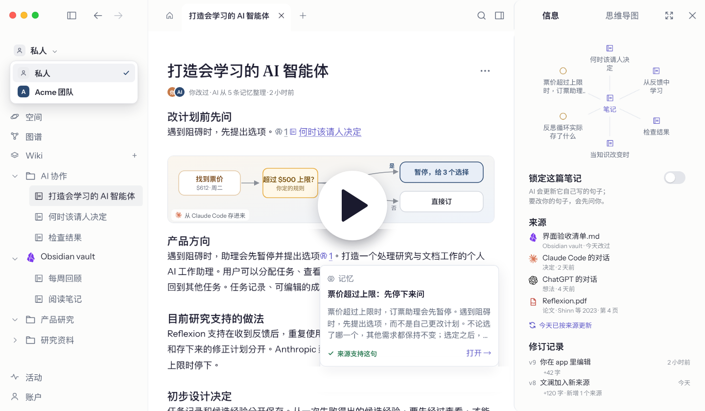

<!-- README_SYNC: source=README.md sha256=53f75872573c06e8fde49d3988478ddfbfa6c4fd9443679de75735150d686dff -->

<p align="center">
  <picture>
    <source media="(max-width: 600px)" srcset="./docs/assets/readme-banner-zh-Hans-mobile.png">
    
  </picture>
</p>

<p align="center">
  <strong>文档、技能和规则，你和 AI 工具都照着做，而且会保持最新。</strong><br>
  笔记和知识都能放进来，每份文档都附出处。免费、开源，个人和团队都能用。
</p>

<p align="center">
  <a href="./README.md">English</a> | 简体中文 | <a href="./README.zh-Hant.md">繁體中文</a> | <a href="./README.es-ES.md">Español</a>
</p>

<p align="center">
  <a href="https://github.com/wenlan-app/wenlan/releases/latest"><strong>下&#8288;载</strong></a> ·
  <a href="#start-in-30-seconds">开&#8288;始&#8288;使&#8288;用</a> ·
  <a href="#what-can-i-bring-in">来&#8288;源</a> ·
  <a href="#learn-more">文&#8288;档</a> ·
  <a href="https://discord.gg/nmzVTTU3HG">Discord</a>
</p>

<p align="center">
  <a href="https://github.com/wenlan-app/wenlan/actions/workflows/ci.yml?query=branch%3Amain"></a>
  <a href="https://github.com/wenlan-app/wenlan/releases/latest"></a>
  <a href="#license"></a>
</p>

<p align="center">
  <a href="https://youtu.be/vM2GXS6UjyA"></a>
</p>

<a id="why-wenlan"></a>

<br>

## 为什么用文澜

每个 AI 工具各记各的、规则各一份。有了文澜，你定下的事，每个工具、代理和队友都拿得到。

给每天用好几个 AI 工具的人，和工程师跟非工程师一起做事的小团队。

- **有出处的文档。** 保存前，文澜会确认每个引用的来源支持那一句。
- **技能和规则只有一份。** 同一份，在你连上的每个 AI 工具和平台上都能用。
- **整理过的记忆。** 你定下的事会整理进文档、技能和规则，所以它们一直是新的。
- **你说了算。** 改了什么都看得到、能还原；锁定的页面，AI 会先问你。
- **文件优先，可以自己架，带得走。** 都是纯 Markdown 文件，数据库只是索引。
- **人也好读。** 一页可以是文字，也可以请 AI 画成网页。

<a id="how-it-compares"></a>

### 文澜，还是每个工具各放一份规则文件？

只用一个工具、一个仓库时，一份规则文件（AGENTS.md、CLAUDE.md、.cursor/rules）就够了。再多的话：

- **一份，每个工具都用。** 不用每个工具各复制一份、再手动对齐。
- **旧规则不会一直留着。** 来源变了，你的 AI 工具会更新那一页。
- **不只规则。** 文档、技能和记忆就放在旁边。

跟 Obsidian、Notion AI 和各种记忆工具的比较：[wenlan.app/learn](https://wenlan.app/learn)。

<a id="quickstart"></a>
<a id="start-in-30-seconds"></a>
<a id="start-with-the-app"></a>
<a id="open-the-wiki"></a>
<a id="desktop-app"></a>
<a id="claude-code-in-30-seconds"></a>
<a id="codex-plugin"></a>
<a id="mcp-setup"></a>
<a id="mcp-clients"></a>

<br>

## 开始使用

**自己用。** 从你的 AI 工具开始，不用装 App。

1. 在终端运行（需要 Node.js）：

   ```sh
   npx -y wenlan setup
   ```

   也可以用 [Claude Code 插件](docs/setup-with-ai.md)、`brew install 7xuanlu/tap/wenlan`，或[其他方式](docs/setup-and-data.zh-Hans.md#installation)。

2. 带入一个放笔记或文档的文件夹，例如 Obsidian 仓库。[其他导入方式](docs/import-guide.md)。

   ```sh
   wenlan sources add ~/notes
   ```

3. 开一个新的 AI 会话，问它：

   > /wenlan 我之前对这件事怎么决定的？再帮我：……

4. 在浏览器里看和改你的页面：`wenlan open`。

想要的话再装：[桌面 App](https://github.com/wenlan-app/wenlan/releases/latest)（macOS、Windows、Linux）多了导入和一键连接 AI 工具。

**团队用。** 架一台文澜服务器。[团队服务器说明](docs/team-server.md)。

- 每个人用自己的密钥连上，每个 Space 可以设成只能看或可以改。
- 成员打开邀请链接，用自己的 AI 工具加入。桌面 App 会自己同步。

支持 Claude Code、Codex、Cursor、GitHub Copilot、Gemini CLI 和其他 MCP 工具：[设置说明](docs/setup-with-ai.md)。

<a id="what-can-i-bring-in"></a>
<a id="sources-and-imports"></a>

<br>

## 能带进什么

- **文件和文件夹：** Markdown、文本文件、文本型 PDF、DOCX。导入一次，或持续同步。
- **Obsidian 仓库和 Logseq 图谱：** 持续同步或只导入一次。你自己写的笔记默认是“先问我”。
- **网页链接：** 在页面里粘贴链接，就会保存为来源。
- **Gmail、Notion、Google Drive、Slack、GitHub：** 你的 AI 工具读取后存下重点，附上原文链接。
- **AI 对话：** 决定和发现会存成记忆。ChatGPT 和 Claude 导出的 ZIP 也能带进来。
- **代码仓库：** `/wenlan wiki` 写出对应到代码的页面。[代码文档](#code-repository-wiki)。

OKF 文件夹也可以。扫描版 PDF 需要先提取文字。[导入指南](docs/import-guide.md)。

<a id="what-makes-wenlan-distinct"></a>
<a id="why-is-wenlan-different"></a>
<a id="two-lifecycles"></a>
<a id="two-lifecycles-one-maintained-knowledge-system"></a>
<a id="local-markdown"></a>
<a id="atomic-memory"></a>
<a id="maintained-page"></a>
<a id="local-markdown-that-works-with-obsidian"></a>
<a id="keep-knowledge-current-and-preserve-history"></a>
<a id="steep-keep-knowledge-useful-as-it-changes"></a>
<a id="what-it-does-on-its-own"></a>
<a id="what-does-wenlan-build"></a>
<a id="why-it-compounds"></a>
<a id="what-is-this"></a>
<a id="what-you-get"></a>
<a id="what-can-it-do"></a>
<a id="knowledge-graph"></a>
<a id="browse-and-organize-your-knowledge"></a>
<a id="connect-your-knowledge"></a>
<a id="organize-scattered-material-into-knowledge"></a>
<a id="explore-your-personal-knowledge-graph"></a>
<a id="daily-workflow"></a>
<a id="in-everyday-use"></a>
<a id="how-wenlan-works"></a>
<a id="how-does-it-work"></a>
<a id="use-your-knowledge-with-ai"></a>
<a id="put-your-knowledge-to-work-with-ai"></a>
<a id="if-you-already-use-claude-code-on-your-notes"></a>

<a id="两套生命周期一个持续维护的知识系统"></a>
<a id="原子记忆"></a>
<a id="持续维护的页面"></a>
<a id="与-obsidian-共存的本地-markdown"></a>
<a id="持续更新知识并保留历史"></a>
<a id="这是什么"></a>
<a id="浏览和整理个人知识"></a>
<a id="让知识彼此连接"></a>
<a id="探索你的个人知识图谱"></a>
<a id="从关键词语义与关联找回正确内容"></a>
<a id="用-ai-延续已有知识"></a>
<a id="让-ai-接续已有知识"></a>
<br>

## 它怎么帮你整理

你的 AI 工具把你带进来的资料写成 Markdown 页面，连起相关的页面、标出每句的出处，并保持最新。

<p align="center">
  
</p>
<p>示意图依据当前的更新行为绘制；并非 App 截图。</p>

- **有出处的文档：** 引用大多对不上来源的页面，文澜不会保存。通过检查不代表内容一定正确。
- **跟着来源更新：** 来源、记忆或引用的代码变了，依据它们的页面会被标出来等更新。
- **AI 能改什么由你决定：** 每一页可以设成“直接改”或“先问我”，也能还原到之前的版本。
- **两种方式：** 你的 AI 工具边工作边写（默认），或由你选的模型在后台处理。[沉淀指南](docs/steep.md)。
- **在你的 AI 工具里：** 打 `/wenlan`，后面说你要做什么。[全部指令](plugin/skills/README.md)。
- **在 App 里：** 不连 AI 也能加资料、改页面、查回引用、审核修改建议。

已经用 Claude Code 或 Codex 管一个笔记文件夹？继续用就好。文澜补上引用检查和每一页的修改控制。

<a id="code-repository-wiki"></a>
<a id="a-wiki-for-your-code-repository"></a>

<br>

## 帮代码仓库写文档

在仓库里运行 `/wenlan wiki`（Codex 是 `$wenlan wiki`），AI 工具会写一篇总览，每个部分再各写一页。

- **与代码绑定：** 每一页都记录它依据的代码行；代码变了，会显示改了什么。
- **以 pull request 放进仓库：** 点一下按钮，或每天自动跑一次。
- **现有文档也一起修：** 同一个 pull request 会修正仓库文档中与代码不再相符的句子。
- **保留你的修改：** 在仓库里改过的页面会保留。引用你的记忆或对话的页面不会放进去。

<a id="what-wenlan-is-not"></a>
<a id="retrieval"></a>
<a id="retrieval-across-words-meaning-and-connections"></a>
<a id="architecture"></a>

<br>

## 给技术读者

**共用本地知识库。** App、CLI 与连上的 AI 工具通过文澜的本地服务读写。笔记以 Markdown 文件保存；记忆、关系与搜索索引存在本地 libSQL。本地服务、CLI 和 MCP server 用 Rust 写成；桌面 app 用 Tauri，界面是 React 和 TypeScript。

<p align="center">
  
</p>

- **检索：** 用 SQLite FTS5 找出相同词句、BGE 向量找出相近语义（libSQL 的 DiskANN 向量索引），再以加权 RRF 合并排名；基础搜索不需要 API key。共同实体会提高相关记忆的排名，另可启用 cross-encoder reranking 精排。选定 Space 就只返回该项目的内容。
- **图谱：** 配置整理模型后，实体抽取与实体消歧会把不同来源里提到的同一人物、项目或概念连起来；用 Label Propagation（默认）或 Leiden 把相关主题分组。
- **记忆：** 发现存成一条一条独立的小记忆，不必载入整段对话或整篇笔记就能找回。

[检索、引用与模型](docs/technical-foundations.md)。

<a id="evaluation"></a>

### 评估

这些 LongMemEval（LME）测量结果评估的是已存知识的检索，不是 AI 回答质量。Recall@5 表示相关资料出现在前五条结果中的比例。

<!-- EVAL_SNAPSHOT_START -->
| Benchmark | Recall@5 | MRR | NDCG@10 |
|---|---:|---:|---:|
| LME_Oracle (500 Q) | 93.6% | 0.857 | 0.883 |
| LME_S (deep, 90 Q) | 87.7% | 0.815 | 0.822 |
<!-- EVAL_SNAPSHOT_END -->

一万篇笔记的测试（生成的测试笔记，M2 Pro 16 GB，v0.20.0）：App 搜索 11 到 50 毫秒，重启不到 0.3 秒，内存峰值约 1.2 GB。0.20.1 修好搜索后，AI 工具在同一个资料库里找到了全部 30 个罕见测试字词。

在 0.20.2 导入一万篇笔记的 Obsidian 仓库（虚构的笔记，M2 Pro Mac 16 GB，debug build，由 Claude Code 写笔记）：15 秒后可以搜索，约 2 分钟写出第一篇笔记，约 4 分钟写出 8 篇带引用的笔记。

[评估方法与基准详情](docs/eval/README.md)。

<a id="models-and-privacy"></a>
<a id="data-and-privacy"></a>

<br>

## 数据与隐私

- 笔记是你电脑上的 Markdown 文件，只会去你让它去的地方。
- 符合条件的笔记可以导出为 Open Knowledge Format（OKF）知识库。
- 云端 AI 工具可能会把找回的内容传给它的服务商，云端模型也会收到它处理的内容，所以本地存储不代表这些交互都留在本机。
- 使用统计默认关闭。

**网页访问（实验中）：** 在“设置”中开启“网页访问”，就能让 Claude、ChatGPT 或 Muse 等网页 AI 客户端，在你的电脑保持在线时搜索整个资料库或指定空间。允许应用时可以选“只能搜索”或“搜索和写入”；可以写入的应用还能新增、修改和删除内容，AI 应用可以在每次改动前先问你。查询与结果会经过中继服务，详见[隐私边界](docs/PRIVACY.md#pre-release-standalone-wenlan-relay-connector)。

[文件位置、备份与移除](docs/setup-and-data.zh-Hans.md#backup-and-removal) · [联网与隐私详情](docs/PRIVACY.md#when-wenlan-reaches-the-network)。

<a id="learn-more"></a>
<a id="whats-new"></a>
<a id="离线队列outbox"></a>

<br>

## 进一步了解

- [开始使用与安装](docs/setup-and-data.zh-Hans.md#installation)
- [连接 AI 工具](docs/setup-with-ai.md)
- [来源与导入](docs/import-guide.md)
- [本地文件、备份与离线使用](docs/setup-and-data.zh-Hans.md)
- [隐私](docs/PRIVACY.md)
- [Doctor 与问题反馈](https://wenlan.app/docs/diagnostics-and-issue-reports)
- [每次发布的更新记录](CHANGELOG.md)
- [完整文档索引](docs/README.md)

<br>

## 贡献

欢迎加入 [Discord 社区](https://discord.gg/nmzVTTU3HG)。请在 [GitHub issues](https://github.com/wenlan-app/wenlan/issues) 反馈问题或提出功能建议；Issue 公开可见，分享前请遮盖密钥和个人资料。

代码与文档贡献请见[贡献指南](.github/CONTRIBUTING.md)、[安全问题反馈](.github/SECURITY.md)和[行为准则](.github/CODE_OF_CONDUCT.md)。

<a id="code-signing-policy"></a>

<br>

## 代码签名政策

请见[各平台签名与公证说明](docs/code-signing.md)。

<a id="license"></a>

<br>

## 许可

本地 runtime、CLI、MCP server、shared types 和 plugins 使用 [Apache-2.0](LICENSE)。桌面 app 及其前端使用 [AGPL-3.0-only](app/LICENSE)；修改版若作为网络服务运行，须向用户提供其源代码。

<a id="acknowledgments"></a>

<br>

## 源流与同类项目

Wenlan 名称来自文澜阁，产品方向承接 LLM-wiki 与 agent-memory 脉络：[Karpathy 的 LLM-wiki note](https://gist.github.com/karpathy/442a6bf555914893e9891c11519de94f)、[Rohitg00 的提案](https://gist.github.com/rohitg00/2067ab416f7bbe447c1977edaaa681e2)和 [nashsu/llm_wiki](https://github.com/nashsu/llm_wiki)。
