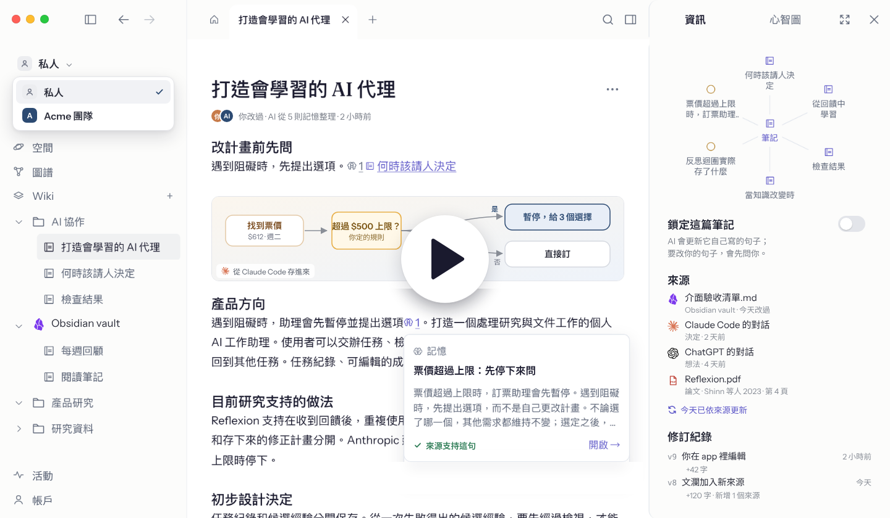

<!-- README_SYNC: source=README.md sha256=3e7a0e9c4a2ee9e36f67366c0ddd283a789fd4bac24535f7755778b3ad3e97ef -->

<p align="center">
  <picture>
    <source media="(max-width: 600px)" srcset="./docs/assets/readme-banner-zh-Hant-mobile.png">
    
  </picture>
</p>

<p align="center">
  <strong>文件、技能和規則，你和 AI 工具都照著做，而且會保持最新。</strong><br>
  筆記和知識都能放進來，每份文件都附出處。免費、開源，個人和團隊都能用。
</p>

<p align="center">
  <a href="./README.md">English</a> | <a href="./README.zh-Hans.md">简体中文</a> | 繁體中文 | <a href="./README.es-ES.md">Español</a>
</p>

<p align="center">
  <a href="https://github.com/wenlan-app/wenlan/releases/latest"><strong>下&#8288;載</strong></a> ·
  <a href="#start-in-30-seconds">開&#8288;始&#8288;使&#8288;用</a> ·
  <a href="#what-can-i-bring-in">來&#8288;源</a> ·
  <a href="#learn-more">文&#8288;件</a> ·
  <a href="https://discord.gg/nmzVTTU3HG">Discord</a>
</p>

<p align="center">
  <a href="https://github.com/wenlan-app/wenlan/actions/workflows/ci.yml?query=branch%3Amain"></a>
  <a href="https://github.com/wenlan-app/wenlan/releases/latest"></a>
  <a href="#license"></a>
</p>

<p align="center">
  <a href="https://youtu.be/vM2GXS6UjyA"></a>
</p>

<a id="why-wenlan"></a>

<br>

## 為什麼用文瀾

每個 AI 工具各記各的、規則各一份。有了文瀾，你定下的事，每個工具、代理和隊友都拿得到。

給每天用好幾個 AI 工具的人，和小團隊，全是工程師或混著其他角色都行。

- **有出處的文件。** 存下前，文瀾會確認每個引用的來源支持那一句。
- **技能和規則只有一份。** 同一份，在你連上的每個 AI 工具和平台上都能用。
- **整理過的記憶。** 你定下的事會整理進文件、技能和規則，所以它們一直是新的。
- **你說了算。** 改了什麼都看得到、能還原；鎖定的頁面，AI 會先問你。
- **檔案優先，可以自己架，帶得走。** 都是純 Markdown 檔，資料庫只是索引。
- **人也好讀。** 一頁可以是文字，也可以請 AI 畫成網頁。

<a id="how-it-compares"></a>

### 文瀾，還是每個工具各放一份規則檔？

只用一個工具、一個儲存庫時，一份規則檔（AGENTS.md、CLAUDE.md、.cursor/rules）就夠了。再多的話：

- **一份，每個工具都用。** 不用每個工具各複製一份、再手動對齊。
- **舊規則不會一直留著。** 來源變了，你的 AI 工具會更新那一頁。
- **不只規則。** 文件、技能和記憶就放在旁邊。

跟 Obsidian、Notion AI 和各種記憶工具的比較：[wenlan.app/learn](https://wenlan.app/learn)。

<a id="quickstart"></a>
<a id="start-in-30-seconds"></a>
<a id="start-with-the-app"></a>
<a id="open-the-wiki"></a>
<a id="desktop-app"></a>
<a id="claude-code-in-30-seconds"></a>
<a id="codex-plugin"></a>
<a id="mcp-setup"></a>
<a id="mcp-clients"></a>

<br>

## 開始使用

**自己用。** 從你的 AI 工具開始，不用裝 App。

1. 執行一行指令（需要 Node.js）。它會裝好、啟動文瀾，並連上它找到的 AI 工具。

   ```sh
   npx -y wenlan setup
   ```

   它會問一次要不要帶進一個放筆記或文件的資料夾，按 Enter 跳過。[其他安裝方式](docs/setup-and-data.zh-Hant.md#installation)。

   之後：`wenlan connect cursor` 再連一個工具，`wenlan sources add ~/notes` 再加一個資料夾。[更多](docs/import-guide.zh-Hant.md)。

2. 在一個 AI 工具裡說你定下的事，再換另一個工具問，馬上問得到。

   > 存到文瀾：我們每週二發版，測試過了才發。

   > 問文瀾：我們什麼時候發版？

   裝了[插件](docs/setup-with-ai.md)，這兩句就是 `/capture` 和 `/recall`。[全部指令](plugin/skills/README.md)。

3. 過一晚，文瀾把你定下的事整理成文件和規則，每條都附出處。

   第一次會問你一次。你說好之後，規則就寫進各個 AI 工具自己的規則檔。

4. 在瀏覽器裡看和改你的頁面：`wenlan open`。

想要的話再裝：[桌面 App](https://github.com/wenlan-app/wenlan/releases/latest)（macOS、Windows、Linux）多了匯入和一鍵連接 AI 工具。

**團隊用。** 架一台文瀾伺服器。[團隊伺服器說明](docs/team-server.md)。

- 每個人用自己的金鑰連上，每個 Space 可以設成只能看或可以改。
- 成員打開邀請連結，用自己的 AI 工具加入。桌面 App 會自己同步。

支援 Claude Code、Codex、Cursor、GitHub Copilot、Gemini CLI 和其他 MCP 工具：[設定說明](docs/setup-with-ai.md)。

<a id="what-can-i-bring-in"></a>
<a id="sources-and-imports"></a>

<br>

## 能帶進什麼

- **檔案和資料夾：** Markdown、文字檔、文字型 PDF、DOCX。匯入一次，或持續同步。
- **Obsidian vault 和 Logseq 圖譜：** 持續同步或只匯入一次。你自己寫的筆記預設是「先問我」。
- **網頁連結：** 在頁面裡貼上連結，就會存成來源。
- **Gmail、Notion、Google Drive、Slack、GitHub：** 你的 AI 工具讀取後存下重點，附上原文連結。
- **AI 對話：** 決定和發現會存成記憶。ChatGPT 和 Claude 匯出的 ZIP 也能帶進來。
- **程式碼儲存庫：** AI 工具讀程式碼，寫出對應到程式碼的文件。[程式碼文件](#code-repository-wiki)。

OKF 資料夾也可以。掃描版 PDF 須先擷取文字。[匯入教學](docs/import-guide.zh-Hant.md)。

<a id="what-makes-wenlan-distinct"></a>
<a id="why-is-wenlan-different"></a>
<a id="two-lifecycles"></a>
<a id="two-lifecycles-one-maintained-knowledge-system"></a>
<a id="local-markdown"></a>
<a id="atomic-memory"></a>
<a id="maintained-page"></a>
<a id="local-markdown-that-works-with-obsidian"></a>
<a id="keep-knowledge-current-and-preserve-history"></a>
<a id="steep-keep-knowledge-useful-as-it-changes"></a>
<a id="what-it-does-on-its-own"></a>
<a id="what-does-wenlan-build"></a>
<a id="why-it-compounds"></a>
<a id="what-is-this"></a>
<a id="what-you-get"></a>
<a id="what-can-it-do"></a>
<a id="knowledge-graph"></a>
<a id="browse-and-organize-your-knowledge"></a>
<a id="connect-your-knowledge"></a>
<a id="organize-scattered-material-into-knowledge"></a>
<a id="explore-your-personal-knowledge-graph"></a>
<a id="daily-workflow"></a>
<a id="in-everyday-use"></a>
<a id="how-wenlan-works"></a>
<a id="how-does-it-work"></a>
<a id="use-your-knowledge-with-ai"></a>
<a id="put-your-knowledge-to-work-with-ai"></a>
<a id="if-you-already-use-claude-code-on-your-notes"></a>

<a id="兩套生命週期一個持續維護的知識系統"></a>
<a id="原子記憶"></a>
<a id="持續維護的頁面"></a>
<a id="與-obsidian-共存的本地-markdown"></a>
<a id="持續更新知識並保留歷史"></a>
<a id="這是什麼"></a>
<a id="瀏覽與整理個人知識"></a>
<a id="讓知識彼此連結"></a>
<a id="探索你的個人知識圖譜"></a>
<a id="從關鍵字語意與關聯找回正確內容"></a>
<a id="用-ai-延續已有知識"></a>
<a id="讓-ai-接續已有知識"></a>
<br>

## 它怎麼幫你整理

你的 AI 工具把你帶進來的資料寫成 Markdown 頁面，連起相關的頁面、標出每句的出處，並保持最新。

<p align="center">
  
</p>
<p>示意圖依據目前的更新行為繪製；並非 App 截圖。</p>

- **有出處的文件：** 引用大多對不上來源的頁面，文瀾不會存。通過檢查不代表內容一定正確。
- **跟著來源更新：** 來源、記憶或引用的程式碼變了，依據它們的頁面會被標出來等更新。
- **AI 能改什麼由你決定：** 每一頁可以設成「直接改」或「先問我」，也能還原到之前的版本。
- **兩種方式：** 你的 AI 工具邊工作邊寫（預設），或由你選的模型在背景處理。[沉澱指南](docs/steep.zh-Hant.md)。
- **在你的 AI 工具裡：** 用平常的話說，提到文瀾就行。裝了插件還有 `/wenlan` 快捷指令。[全部指令](plugin/skills/README.md)。
- **在 App 裡：** 不連 AI 也能加資料、改頁面、查回引用、審核修改建議。

已經用 Claude Code 或 Codex 管一個筆記資料夾？繼續用就好。文瀾補上引用檢查和每一頁的修改控制。

<a id="code-repository-wiki"></a>
<a id="a-wiki-for-your-code-repository"></a>

<br>

## 幫程式碼儲存庫寫文件

在儲存庫裡，AI 工具讀程式碼，寫一篇總覽，每個部分再各寫一份文件。

```sh
cd your-repo
wenlan init
```

它會連上找到的 AI 工具，並問一次要不要每天開 pull request。裝了插件，可以馬上寫出文件。

- **對得回程式碼：** 每句重點都標出它依據的程式碼行；程式碼變了，你看得到。
- **以 pull request 放進儲存庫：** 按一下按鈕，或每天自動跑一次。
- **現有文件也一起修：** 同一個 pull request 會修正儲存庫文件中與程式碼不再相符的句子。
- **專案規則也一起送：** 專案規則會寫進 `AGENTS.md`，隊友的 AI 工具都讀得到。
- **保留你的修改：** 在儲存庫裡改過的頁面會保留。引用你的記憶或對話的頁面不會放進去。

<a id="what-wenlan-is-not"></a>
<a id="retrieval"></a>
<a id="retrieval-across-words-meaning-and-connections"></a>
<a id="architecture"></a>

<br>

## 給技術讀者

**共用本地知識庫。** App、CLI 與連上的 AI 工具透過文瀾的本地服務讀寫。筆記以 Markdown 檔保存；記憶、關係與搜尋索引存在本地 libSQL。本地服務、CLI 和 MCP server 用 Rust 寫成；桌面 app 用 Tauri，介面是 React 和 TypeScript。

<p align="center">
  
</p>

- **檢索：** 用 SQLite FTS5 找出相同詞句、BGE 向量找出相近語意（libSQL 的 DiskANN 向量索引），再以加權 RRF 合併排名；基礎搜尋不需 API key。共同實體會提高相關記憶的排名，另可啟用 cross-encoder reranking 精排。選定 Space 就只回傳該專案的內容。
- **圖譜：** 設定整理模型後，實體抽取與實體消歧會把不同來源裡提到的同一人物、專案或概念連起來；用 Label Propagation（預設）或 Leiden 把相關主題分組。
- **記憶：** 發現存成一則一則獨立的小記憶，不必載入整段對話或整篇筆記就能找回。

[檢索、引用與模型](docs/technical-foundations.md)。

<a id="evaluation"></a>

### 評估

這些 LongMemEval（LME）測量結果評估的是已存知識的檢索，不是 AI 回答品質。Recall@5 表示相關資料出現在前五筆結果中的比例。

<!-- EVAL_SNAPSHOT_START -->
| Benchmark | Recall@5 | MRR | NDCG@10 |
|---|---:|---:|---:|
| LME_Oracle (500 Q) | 93.6% | 0.857 | 0.883 |
| LME_S (deep, 90 Q) | 87.7% | 0.815 | 0.822 |
<!-- EVAL_SNAPSHOT_END -->

一萬篇筆記的測試（產生的測試筆記，M2 Pro 16 GB，v0.20.0）：App 搜尋 11 到 50 毫秒，重新啟動不到 0.3 秒，記憶體峰值約 1.2 GB。0.20.1 修好搜尋後，AI 工具在同一個資料庫裡找到了全部 30 個罕見測試字詞。

在 0.20.2 匯入一萬篇筆記的 Obsidian vault（虛構的筆記，M2 Pro Mac 16 GB，debug build，由 Claude Code 寫筆記）：15 秒後可以搜尋，約 2 分鐘寫出第一篇筆記，約 4 分鐘寫出 8 篇帶引用的筆記。

[評估方法與基準詳情](docs/eval/README.md)。

<a id="models-and-privacy"></a>
<a id="data-and-privacy"></a>

<br>

## 資料與隱私

- 筆記是你電腦上的 Markdown 檔，只會去你讓它去的地方。
- 符合條件的筆記可以匯出為 Open Knowledge Format（OKF）知識庫。
- 雲端 AI 工具可能會把找回的內容傳給它的服務商，雲端模型也會收到它處理的內容，所以本地儲存不代表這些互動都留在本機。
- 使用統計預設關閉。

**網頁存取（實驗中）：** 在「設定」中開啟「網頁存取」，就能讓 Claude、ChatGPT 或 Muse 等網頁 AI 用戶端，在你的電腦保持連線時搜尋整個資料庫或指定空間。允許應用程式時可以選「只能搜尋」或「搜尋和寫入」；可以寫入的應用程式還能新增、修改和刪除內容，AI 應用程式可以在每次改動前先問你。查詢與結果會經過中繼服務，詳見[隱私界限](docs/PRIVACY.md#pre-release-standalone-wenlan-relay-connector)。

[檔案位置、備份與移除](docs/setup-and-data.zh-Hant.md#backup-and-removal) · [連網與隱私詳情](docs/PRIVACY.md#when-wenlan-reaches-the-network)。

<a id="learn-more"></a>
<a id="whats-new"></a>

<a id="離線佇列outbox"></a>

<br>

## 進一步了解

- [開始使用與安裝](docs/setup-and-data.zh-Hant.md#installation)
- [連接 AI 工具](docs/setup-with-ai.md)
- [來源與匯入](docs/import-guide.zh-Hant.md)
- [本地檔案、備份與離線使用](docs/setup-and-data.zh-Hant.md)
- [隱私](docs/PRIVACY.md)
- [Doctor 與問題回報](https://wenlan.app/docs/diagnostics-and-issue-reports)
- [每次發佈的更新紀錄](CHANGELOG.md)
- [完整文件索引](docs/README.md)

<br>

## 貢獻

歡迎加入 [Discord 社群](https://discord.gg/nmzVTTU3HG)。請在 [GitHub issues](https://github.com/wenlan-app/wenlan/issues) 回報問題或提出功能建議；Issue 是公開的，分享前請遮蔽密鑰與個人資料。

程式碼與文件貢獻請見[貢獻指南](.github/CONTRIBUTING.md)、[安全性回報](.github/SECURITY.md)與[行為準則](.github/CODE_OF_CONDUCT.md)。

<a id="code-signing-policy"></a>

<br>

## 程式碼簽章政策

請見[各平台簽章與公證說明](docs/code-signing.md)。

<a id="license"></a>

<br>

## 授權

本地 runtime、CLI、MCP server、shared types 與 plugins 採用 [Apache-2.0](LICENSE)。桌面 app 與其前端採用 [AGPL-3.0-only](app/LICENSE)；若將修改版作為網路服務運行，須向使用者提供其原始碼。

<a id="acknowledgments"></a>

<br>

## 源流與同類專案

Wenlan 名稱來自文瀾閣，產品方向承接 LLM-wiki 與 agent-memory 脈絡：[Karpathy 的 LLM-wiki note](https://gist.github.com/karpathy/442a6bf555914893e9891c11519de94f)、[Rohitg00 的提案](https://gist.github.com/rohitg00/2067ab416f7bbe447c1977edaaa681e2) 與 [nashsu/llm_wiki](https://github.com/nashsu/llm_wiki)。程式碼文件方面，最接近的同類專案是 [OpenWiki](https://github.com/langchain-ai/openwiki)；文瀾每天開 pull request 的做法參考了它。
