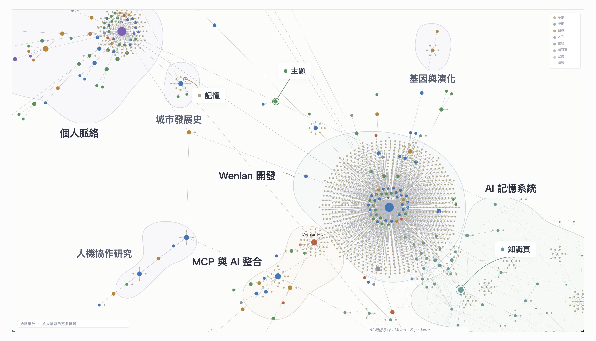
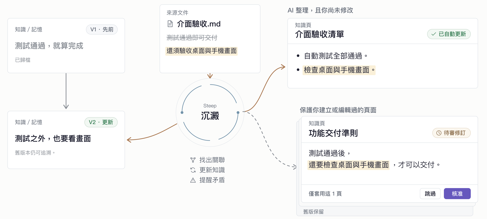

<!-- README_SYNC: source=README.md sha256=8447e871795222fb622ae3cab0a58671cacaa09db06b77db5acd17b9b20393a2 -->

  <picture>
    <source media="(max-width: 600px)" srcset="./docs/assets/readme-banner-zh-Hant-mobile.png">
    
  </picture>

  文瀾把散落各處的筆記、文件、AI 對話和寫程式的紀錄， 
  整理成一份本地、能查回原文、你和 AI 工具共用、會跟著來源更新的知識庫。

  <a href="./README.md">English</a> | <a href="./README.zh-Hans.md">简体中文</a> | 繁體中文 | <a href="./README.es-ES.md">Español</a>

  
  
  

  <a href="#start-in-30-seconds">開&#8288;始&#8288;使&#8288;用</a> ·
  <a href="#what-can-i-bring-in">功&#8288;能</a> ·
  <a href="#learn-more">文&#8288;件</a> ·
  <a href="https://discord.gg/nmzVTTU3HG">Discord</a>

<!-- R113 walkthrough: approved 0.5-second cover; 1080p; original video/audio and masters retained. -->

https://github.com/user-attachments/assets/40374fc0-dc6e-41e1-bc48-7740c735911a

封面為實機畫面與示範資料的合成圖；圖譜為示意，非 App 原生三欄版面。

 

## 為什麼用文瀾

我做文瀾，是因為對自己的知識一直有種焦慮：筆記、文件和 AI 對話散落各處，又一直在變。要讓 Obsidian vault 三個月後不荒廢，得裝外掛、設計流程、不停維護；LLM wiki 那類做法，日常用起來也不輕鬆。我想要一個 AI 原生、不用費心照顧的知識庫 App。

- **散落的資料收進一處：** 文件、Markdown 檔、Obsidian vault、網頁連結，還有匯出的 AI 對話，都進到同一個知識庫。
- **所有 AI 工具共用一份：** Claude Code、Codex、Cursor 等 MCP 工具都用同一個知識庫。
- **流程全部內建：** 保存、整理、引用到更新筆記，都在同一個 App 裡，不用再拼裝一堆外掛。

 

## 開始使用

把資料保存在 Wenlan，讓你常用的 AI 用上這些知識，回答問題、完成工作。

### 1. 下載並開啟 Wenlan

[下載桌面版](https://github.com/wenlan-app/wenlan/releases/latest)（macOS Apple Silicon、Windows x64），安裝後開啟。

偏好終端機？[透過 CLI 或 AI 工具使用 Wenlan](docs/setup-and-data.zh-Hant.md#installation)。

### 2. 建立筆記或匯入既有資料

在 Wenlan 建立一篇筆記、連接 Obsidian vault，或匯入之前的 AI 對話與記憶。[匯入教學](docs/import-guide.zh-Hant.md)。

### 3. 想使用時再連接 AI 工具

| AI 工具 | 連接方式 | 設定入口 |
|---|---|---|
| Claude Code／Claude Desktop | 插件／MCP | [Claude 指南](docs/setup-with-ai.md#claude-code) |
| ChatGPT Desktop（Codex）、Codex CLI | 插件 | [Codex 指南](docs/setup-with-ai.md#codex) |
| Cursor、VS Code、Gemini CLI、Muse Code | MCP | [MCP 指南](docs/setup-with-ai.md#mcp-only-setup-and-other-clients) |

安裝插件後，開啟新的 AI 對話並執行 `/wenlan`（Codex 中為 `$wenlan`）。它會確認 Wenlan 是否正常，需要時自動完成設定。

匯入的資料可以直接使用，想整理成筆記也隨時可以。連接後，就可以問 AI：

> /recall 我之前對這件事的筆記和決定，再幫我：……

Codex 中用 `$recall`。只用 MCP 的工具，直接說「先查文瀾裡我之前對這件事的筆記和決定，再幫我：……」。

之後可用[本地模型](docs/steep.zh-Hant.md#enable-steep)開啟 [Steep（沉澱）](#steep沉澱讓知識持續更新)，在背景整理記憶、更新筆記。

 

## 把散落的資料整理成知識

**來源**保留文件與對話原文；**記憶**留下值得重用的決定、心得與理由。兩者可整理成**帶有引用、可編輯的 Markdown 筆記**，用 `[[wikilinks]]` 連結筆記，也能沿引用查回原文。

- **原子記憶**：延續 [Zettelkasten（卡片盒筆記法）的原子化原則](https://zettelkasten.de/posts/create-zettel-from-reading-notes/)，讓每筆發現能獨立找回、重用，不必載入整段對話或整個筆記。
- **共同主題**：設定整理模型後，透過 LLM 實體抽取與實體消歧，將不同文件與對話裡提到的同一人物、專案或概念連在一起，保留相關記憶與來源。
- **知識群集（communities）**：將互有連結的主題分組，呈現散落資料間的關聯；預設使用 Label Propagation（標籤傳播），另有可選啟用的 Leiden 群集演算法。[圖譜技術說明](docs/technical-foundations.md#graph-data-and-entity-resolution)。

### 資料來源與匯入

| 可以帶入什麼 | 匯入後怎麼用 |
| --- | --- |
| Markdown、文字檔、文字型 PDF 或資料夾 | 搜尋、引用匯入的文字；已連接的檔案來源可從磁碟重新整理。 |
| Obsidian 儲存庫 | 透過唯讀連接搜尋、引用既有筆記；按需重新整理，不寫回原始檔案。 |
| 網頁摘錄與網址 | 貼上文字及網址，保存可搜尋的內容，並保留原文連結。 |
| ChatGPT 或 Claude 匯出的 ZIP | 找回先前對話文字，作為可引用的脈絡；保留匯入當時的紀錄，不持續連接帳戶。 |
| 既有記憶文字 | 將偏好、決定或心得保存為獨立記憶。 |

掃描版 PDF 須先擷取文字；對話附件不會匯入。[匯入教學](docs/import-guide.zh-Hant.md)。

  

保留實機節點與連線；文字經翻譯，區域名稱與範圍為示意。

 

## 日常使用

工作中留下新發現與進度，下次直接接著用。

  

簡化流程示意；插件指令與筆記整理均按需使用，沒有固定順序。

- **在 App 裡使用。** 加入資料、撰寫或編輯筆記、查回引用來源與審核修訂，不必連接 AI。
- **運用知識、撰寫新筆記。** 請 AI 找回相關來源與記憶，用於目前的任務（`/recall`）；也能撰寫帶引用的新筆記，或依據現有版本更新筆記，再存回 Wenlan。
- **留下你的新發現。** 保存決定或心得，以及其理由與來源；可在 App 操作，或請 AI 代存（`/capture`）。
- **告一段落，下次接續。** 保存發現與工作階段紀錄，更新受影響的筆記，將進度與下一步寫進專案摘要 Brief（`/handoff`）。下次讀取摘要，接著工作（`/brief`）。

**按需整理累積的記憶：** 將相關記憶整理或更新為帶引用的筆記（`/wenlan distill`），不是撰寫新筆記的必要步驟。[插件指令](plugin/skills/README.md)。

 

## 讓 AI 接續已有知識

資料放進文瀾後，AI 就能接著用：找回先前的決定與依據，保存新的成果，並隨依據變動繼續使用。

**可以用在：**

- **開發**：把先前的技術決定、經驗與驗收條件，用於功能實作與除錯。
- **產品與網站**：依據使用者研究、產品定位與設計原則，撰寫規格或製作網頁。
- **研究與學習**：把閱讀資料與保存的發現整理成帶引用的報告或學習筆記，供後續重用。

**檢索與連接方式：** 插件引導 AI 取用與保存知識；MCP 連接提供可供 AI 呼叫的工具。

- **[本地混合檢索（Hybrid Retrieval）](docs/technical-foundations.md#retrieval-pipeline)**：用 SQLite FTS5 找出相同詞句、BGE 向量找出相近語意，再以加權 RRF 合併排名；基礎搜尋不需 API key。
- **圖譜輔助排序**：沿共同實體提高相關記憶的排名，即使用詞不同也能建立關聯；另可啟用 cross-encoder reranking，逐一比對問題與候選內容，精排結果。
- **Spaces 範圍檢索**：選定 Space，將回傳的知識限制在相關專案或個人資料集合內。

**即將推出（Coming soon）：** Spaces 的程式碼儲存庫（coding repo）支援。

在「設定」中開啟「網頁存取」開關，即可讓 Claude、ChatGPT 或 Muse 等支援的網頁 AI 用戶端，在你的電腦保持連線時搜尋整個資料庫或指定空間。允許應用程式時可以選「只能搜尋」或「搜尋和寫入」；可以寫入的應用程式還能新增、修改和刪除內容，AI 應用程式可以在每次改動前先問你。此功能仍在實驗階段；查詢與結果會經過中繼服務，詳見[隱私界限](docs/PRIVACY.md#pre-release-standalone-wenlan-relay-connector)。

 

## Steep（沉澱）：讓知識持續更新

保存資料只是開始。**沉澱讓資料更容易重用，也讓引用它的筆記跟上新發現**，讓你和 AI 延續已有的理解，不必每次重新翻閱原始內容。

- **整理記憶**：補上類型、結構化資訊、搜尋線索與圖譜連結，讓單筆發現更容易連同脈絡被找回。
- **讓依據帶動更新**：來源或記憶變動時，標記相關筆記待更新；新記憶也可補進符合條件的筆記。草稿未通過引用檢查就保留原筆記；通過也不代表內容已證實正確。
- **保留控制與歷史**：背景刷新可更新符合條件、由 AI 維護的筆記；你建立或編輯過的筆記則提出待審修訂。明確取代記憶時，會隱藏或封存舊記憶並保留取代關係；筆記版本紀錄仍可查閱。

[沉澱指南：觸發條件、審核規則與模型設定](docs/steep.zh-Hant.md)。可選裝置端模型、本地服務或雲端供應商；模型驅動的背景處理為選配。

  

示意圖依據目前的更新行為繪製；並非 App 截圖。

 

## 系統架構

**共用本地知識庫。** App、CLI 與 AI 工具透過 Wenlan 本地服務讀寫。筆記以 Markdown 保存；記憶、關係與搜尋索引由本地 libSQL 管理。

  

架構示意。[檢索、引用與模型](docs/technical-foundations.md)。

 

## 資料與隱私

**匯出知識庫**：將符合條件的筆記匯出為 Open Knowledge Format（OKF）維基。

雲端 AI 用戶端可能會把找回的知識傳給其服務商，雲端模型也會收到它處理所需的內容。本地儲存不代表這些互動都留在本機。使用統計預設關閉。

[檔案位置、備份與移除](docs/setup-and-data.zh-Hant.md#backup-and-removal) · [連網與隱私詳情](docs/PRIVACY.md#when-wenlan-reaches-the-network)。

 

## 評估

這些 LongMemEval（LME）測量結果評估的是已存知識的檢索，不是 AI 回答品質。Recall@5 表示相關資料出現在前五筆結果中的比例。

<!-- EVAL_SNAPSHOT_START -->
| Benchmark | Recall@5 | MRR | NDCG@10 |
|---|---:|---:|---:|
| LME_Oracle (500 Q) | 93.6% | 0.857 | 0.883 |
| LME_S (deep, 90 Q) | 87.7% | 0.815 | 0.822 |
<!-- EVAL_SNAPSHOT_END -->

[評估方法與基準詳情](docs/eval/README.md)。

 

## 進一步了解

- [開始使用與安裝](docs/setup-and-data.zh-Hant.md#installation)
- [連接 AI 工具](docs/setup-with-ai.md)
- [來源與匯入](docs/import-guide.zh-Hant.md)
- [本地檔案、備份與離線使用](docs/setup-and-data.zh-Hant.md)
- [隱私](docs/PRIVACY.md)
- [Doctor 與問題回報](https://wenlan.app/docs/diagnostics-and-issue-reports)
- [完整文件索引](docs/README.md)

 

## 貢獻

歡迎加入 [Discord 社群](https://discord.gg/nmzVTTU3HG)。請在 [GitHub issues](https://github.com/wenlan-app/wenlan/issues) 回報問題或提出功能建議；Issue 是公開的，分享前請遮蔽密鑰與個人資料。

程式碼與文件貢獻請見[貢獻指南](.github/CONTRIBUTING.md)、[安全性回報](.github/SECURITY.md)與[行為準則](.github/CODE_OF_CONDUCT.md)。

 

## 程式碼簽章政策

請見[各平台簽章與公證說明](docs/code-signing.md)。

 

## 授權

本地 runtime、CLI、MCP server、shared types 與 plugins 採用 [Apache-2.0](LICENSE)。桌面 app 與其前端採用 [AGPL-3.0-only](app/LICENSE)；若將修改版作為網路服務運行，須向使用者提供其原始碼。

 

## 源流與同類專案

Wenlan 名稱來自文瀾閣，產品方向承接 LLM-wiki 與 agent-memory 脈絡：[Karpathy 的 LLM-wiki note](https://gist.github.com/karpathy/442a6bf555914893e9891c11519de94f)、[Rohitg00 的提案](https://gist.github.com/rohitg00/2067ab416f7bbe447c1977edaaa681e2) 與 [nashsu/llm_wiki](https://github.com/nashsu/llm_wiki)。
