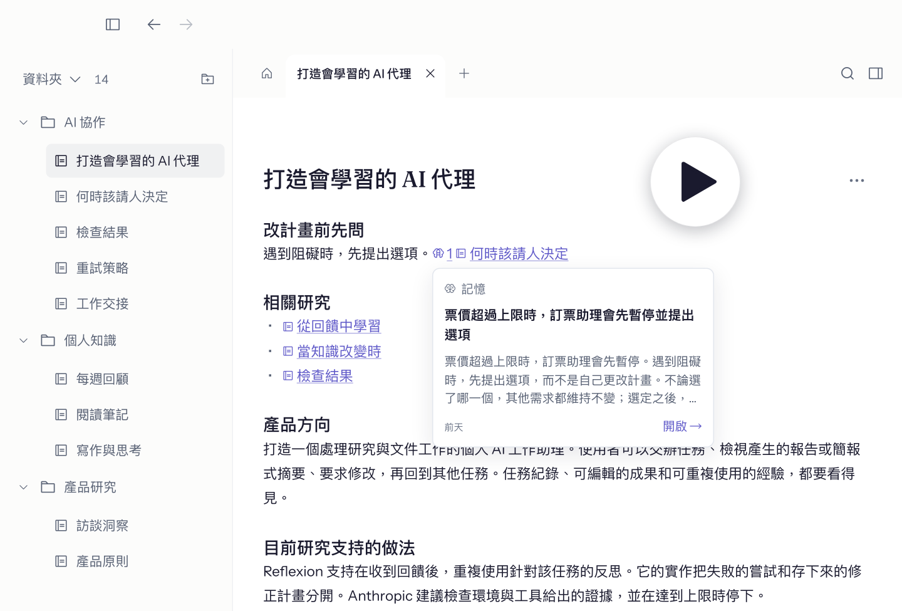

<!-- README_SYNC: source=README.md sha256=51a95b2103002be792aa2bb8b7946373a7bcd5bf31489bacca847da7bf0115f1 -->

  <picture>
    <source media="(max-width: 600px)" srcset="./docs/assets/readme-banner-zh-Hant-mobile.png">
    
  </picture>

  <strong>筆記、程式碼、AI 對話整理成知識庫，對照過來源。</strong> 
  你和 AI 工具共用同一份資料，來源變了會跟著更新。 
  你的筆記留在你的電腦上，只會送到你選的 AI 工具。

  <a href="./README.md">English</a> | <a href="./README.zh-Hans.md">简体中文</a> | 繁體中文 | <a href="./README.es-ES.md">Español</a>

  <a href="https://github.com/wenlan-app/wenlan/releases/latest"><strong>下&#8288;載</strong></a> ·
  <a href="#start-in-30-seconds">開&#8288;始&#8288;使&#8288;用</a> ·
  <a href="#what-can-i-bring-in">來&#8288;源</a> ·
  <a href="#learn-more">文&#8288;件</a> ·
  <a href="https://discord.gg/nmzVTTU3HG">Discord</a>

  
  
  

<!-- R113 walkthrough: approved 0.5-second cover; 1080p; original video/audio and masters retained. -->

  

 

## 為什麼用文瀾

我做文瀾，是因為筆記、文件和 AI 對話散落各處又一直在變，要讓筆記庫不荒廢得不停維護。我想要一個 AI 原生、不用費心照顧的知識庫。

- **你的 AI 幫你寫、幫你維護：** 你平常用的 AI 工具把你的文件、舊筆記和 AI 對話寫成新的筆記，不用另外裝模型。
- **撐不住的會告訴你：** 引用大多對不上來源的筆記不會存下，每個引用都能點回原文。
- **變了會標出來：** 來源、筆記或程式碼一變，只有依靠它的筆記會被標出來。
- **你寫的還是你的：** 沒有你同意，不會改動你原有的筆記；你寫的筆記設成「先問我」。
- **帶進現有資料，換工具也不怕：** 筆記、文件、連結和對話都能帶進來（[完整清單](#what-can-i-bring-in)），存成本地 Markdown，你選的 AI 工具都能用。

 

## 開始使用

### 1. 下載並開啟 Wenlan

[下載桌面版](https://github.com/wenlan-app/wenlan/releases/latest)，支援 macOS 11 以上的 Apple Silicon 和 Windows x64。App 介面有英文、简体中文和繁體中文。

偏好終端機？在 Mac 上執行 `npx -y wenlan setup`，或執行 `brew install 7xuanlu/tap/wenlan` 再執行 `wenlan setup`。Linux 和 Windows 請看 [CLI 安裝說明](docs/setup-and-data.zh-Hant.md#installation)。

### 2. 帶進你的資料

建立一篇筆記，或帶進 Obsidian vault、Logseq 圖譜、資料夾或之前的 AI 對話。[匯入教學](docs/import-guide.zh-Hant.md)。

### 3. 連接你的 AI 工具

| AI 工具 | 連接方式 | 設定入口 |
|---|---|---|
| Claude Code／Claude Desktop | 插件／MCP | [Claude 指南](docs/setup-with-ai.md#claude-code) |
| ChatGPT Desktop（Codex）、Codex CLI | 插件 | [Codex 指南](docs/setup-with-ai.md#codex) |
| Cursor、GitHub Copilot、VS Code、Gemini CLI、Antigravity、Windsurf、Kiro、OpenCode、Kimi Code | MCP 和技能 | [MCP 指南](docs/setup-with-ai.md#mcp-only-setup-and-other-clients) |
| Muse Code 和其他 MCP 工具 | MCP | [MCP 指南](docs/setup-with-ai.md#mcp-only-setup-and-other-clients) |

在 App 的設定裡，「新增工具」會找出你電腦上的 AI 工具，按「全部連接」一次設好。接著開一個新的 AI 對話，問它：

> /recall 我之前對這件事的筆記和決定，再幫我：……

Codex 中用 `$recall`；只用 MCP 的工具，直接請它先查文瀾。

匯入完成後，App 會提供「用（你的 AI 工具）寫頁面」，把資料寫成第一批帶引用的筆記，不用輸入指令。

 

## 資料來源與匯入

| 可以帶入什麼 | 匯入後怎麼用 |
| --- | --- |
| Markdown、文字檔、文字型 PDF、DOCX 或資料夾 | 搜尋、引用匯入的文字。資料夾可以只匯入一次，也可以持續同步檔案的變更。 |
| Obsidian 儲存庫或 Logseq 圖譜 | 搜尋、引用既有筆記。選擇持續同步，在背景跟上變更；或只匯入一次。沒有你同意，不會改動你原有的筆記：在 Obsidian vault 裡，設成「先問我」的筆記會收到 AI 的修改建議，由你接受或不要。 |
| 網頁連結 | 在筆記裡貼上連結，就會存成來源。YouTube、X、Threads、Instagram 和小紅書的連結會顯示成卡片、可播放的影片或原始貼文。也可以貼上文字及網址，保存那段摘錄。 |
| Gmail、Notion、Google Drive、Slack、GitHub | 你的 AI 工具用它自己的連接器讀取，把重要的內容存進文瀾，並附上原文連結。 |
| 程式碼儲存庫 | `/wenlan wiki` 寫出對應到程式碼行數的筆記。[程式碼 wiki](#code-repository-wiki)。 |
| OKF 資料夾 | 把 Open Knowledge Format 資料夾（例如 OpenWiki 或文瀾的匯出）連接成來源。 |
| 工作中的 AI 對話 | Claude Code、Codex 和你的其他 AI 工具，會把每次對話裡的決定、發現和進度存成記憶，筆記再引用它們。不會匯入完整對話紀錄。 |
| ChatGPT 或 Claude 匯出的 ZIP | 找回先前對話文字（包括最後一則沒有得到回覆的訊息），作為可引用的脈絡；保留匯入當時的紀錄，不持續連接帳戶。 |
| 既有記憶文字 | 將偏好、決定或心得保存為獨立記憶。 |

掃描版 PDF 須先擷取文字；對話附件不會匯入。[匯入教學](docs/import-guide.zh-Hant.md)。

 

## Steep（沉澱）：讓知識持續更新

  

示意圖依據目前的更新行為繪製；並非 App 截圖。

保存資料只是開始。**沉澱讓資料更容易重用，也讓引用它的筆記跟上新發現**，讓你和 AI 延續已有的理解，不必每次重新翻閱原始內容。

在「設定」中選擇兩種方式之一：

- **隨叫**（新安裝預設）：AI 工具在文瀾裡儲存或寫入時，會順手沉澱，並在工作時得知哪些筆記過期、哪些資料還沒寫進筆記。不用下指令；想一次全部整理，也可以執行 `/wenlan steep`。
- **自動**：文瀾用你指定的模型在背景沉澱。

沉澱會做這些事：

- **整理記憶**：補上類型、結構化資訊、搜尋線索與圖譜連結，讓單筆發現更容易連同脈絡被找回。
- **讓依據帶動更新**：來源、記憶或引用的程式碼變動時，標記相關筆記待更新；新記憶也可補進符合條件的筆記。草稿未通過引用檢查就保留原筆記；通過也不代表內容已證實正確。
- **保留控制與歷史**：背景刷新可更新符合條件、由 AI 維護的筆記；你建立或編輯過的筆記則提出待審修訂。明確取代記憶時，會隱藏或封存舊記憶並保留取代關係；筆記版本紀錄仍可查閱。
- **先問我**：開啟「我寫過的筆記：先問我」（新安裝預設開啟）後，AI 對你寫過或改過的筆記所做的修改會先等你同意。每篇筆記的「AI 修改」設定會顯示「直接改」或「先問我」。AI 寫的筆記照常更新。

### 它自己會做的事

兩種模式都會做，不需要模型：

- **標出過期的筆記**：來源、記憶或引用的程式碼變了，相關筆記會被標記。程式碼 wiki 的筆記會顯示程式碼改了什麼。
- **建議合併近似重複的筆記**：產生一張合併卡，由你或你的 AI 決定接受或略過。
- **整理連結**：列出還沒有對應筆記的 `[[連結]]`，並移除指向你已刪除記憶的引用。

重寫被標記的筆記需要模型。「自動」模式下，文瀾在背景完成；「隨叫」模式下，AI 工具會得知哪些筆記在等待更新，並能在工作時順手更新。

[沉澱指南：觸發條件、審核規則與模型設定](docs/steep.zh-Hant.md)。可選裝置端模型、本地服務或雲端供應商；模型驅動的背景處理為選配。

 

## 為程式碼儲存庫建 wiki

在程式碼儲存庫中執行 `/wenlan wiki`（Codex 中為 `$wenlan wiki`）。AI 工具會依據儲存庫本身規劃 wiki：先寫一篇列出所有筆記的總覽，再為新人需要了解的每個部分或流程各寫一篇。小工具只需幾篇，大型 monorepo 會多得多。再次執行時只補寫缺少的筆記。

- **與程式碼綁定**：每篇筆記都會記錄它所依據的程式碼行。程式碼變動時，筆記會顯示改了什麼，並提供一個審核按鈕；沉澱會把筆記更新到最新。
- **以 pull request 放進儲存庫**：Space 上的 GitHub 按鈕會把 Space 連接到對應的儲存庫，並把依據這些程式碼的筆記以 pull request 放進儲存庫的 `wiki/` 資料夾。可以從按鈕執行，也可以開啟每日更新：在你的電腦上用你自己的 AI 工具跑，或在 GitHub Actions 上跑（AI 工具的金鑰存成儲存庫 secret），電腦關著也行。同一個 pull request 還會修正儲存庫自身文件中與程式碼不再相符的句子，供你審核。
- **保留你的修改**：有人在儲存庫中修改過的 wiki 筆記會保留那次修改。引用你的記憶或對話的筆記不會放進儲存庫。

 

## 把散落的資料整理成知識

  

保留實機節點與連線；文字經翻譯，區域名稱與範圍為示意。

**來源**保留文件與對話原文；**記憶**留下值得重用的決定、心得與理由。兩者可整理成**帶有引用、可編輯的 Markdown 筆記**，用 `[[wikilinks]]` 連結筆記，也能沿引用查回原文。筆記可以包含 Mermaid 圖表，由 App 繪製；AI 工具寫入筆記時，文瀾會檢查圖表的常見錯誤，並指出要修改的那一行。

- **原子記憶**：延續 [Zettelkasten（卡片盒筆記法）的原子化原則](https://zettelkasten.de/posts/create-zettel-from-reading-notes/)，讓每筆發現能獨立找回、重用，不必載入整段對話或整個筆記。
- **共同主題**：設定整理模型後，透過 LLM 實體抽取與實體消歧，將不同文件與對話裡提到的同一人物、專案或概念連在一起，保留相關記憶與來源。
- **知識群集（communities）**：將互有連結的主題分組，呈現散落資料間的關聯；預設使用 Label Propagation（標籤傳播），另有可選啟用的 Leiden 群集演算法。[圖譜技術說明](docs/technical-foundations.md#graph-data-and-entity-resolution)。

 

## 日常使用

工作中留下新發現與進度，下次直接接著用。

  

簡化流程示意；插件指令與筆記整理均按需使用，沒有固定順序。

- **在 App 裡使用。** 加入資料、撰寫或編輯筆記、查回引用來源與審核修訂，不必連接 AI。點選單列（或系統匣）圖示會打開一個小面板，列出需要你處理的事、最近的筆記和快速記下。
- **運用知識、撰寫新筆記。** 請 AI 找回相關來源與記憶，用於目前的任務（`/recall`）；也能撰寫帶引用的新筆記，或依據現有版本更新筆記，再存回 Wenlan。筆記用 `[n]` 引用來源時，文瀾會拿每個引用的句子對照它的來源；引用大多對不上時，不會儲存該筆記。
- **留下你的新發現。** 保存決定或心得，以及其理由與來源；可在 App 操作，或請 AI 代存（`/capture`）。
- **告一段落，下次接續。** 保存發現與工作階段紀錄，更新受影響的筆記，將進度與下一步寫進專案摘要 Brief（`/handoff`）。下次讀取摘要，接著工作（`/brief`）。

**按需整理累積的記憶：** 將相關記憶整理或更新為帶引用的筆記（`/wenlan distill`），不是撰寫新筆記的必要步驟。[插件指令](plugin/skills/README.md)。

 

## 讓知識活用起來

資料放進文瀾後，AI 就能接著用：找回先前的決定與依據，保存新的成果，並隨依據變動繼續使用。

### 如果你已經用 Claude Code 或 Codex 管筆記

繼續用就好。文瀾接上同一個 AI 工具，補上一個 Markdown 資料夾自己做不到的檢查：引用大多和來源對不上的筆記不會存下，來源變了會標記，AI 改你寫的筆記先等你審核，而且沒有你同意，不會改動你原有的筆記。

**可以用在：**

- **開發**：把先前的技術決定、經驗與驗收條件，用於功能實作與除錯。
- **產品與網站**：依據使用者研究、產品定位與設計原則，撰寫規格或製作網頁。
- **研究與學習**：把閱讀資料與保存的發現整理成帶引用的報告或學習資料，供後續重用。

**檢索與連接方式：** 插件引導 AI 取用與保存知識；MCP 連接提供可供 AI 呼叫的工具。

- **[本地混合檢索（Hybrid Retrieval）](docs/technical-foundations.md#retrieval-pipeline)**：用 SQLite FTS5 找出相同詞句、BGE 向量找出相近語意（libSQL 的 DiskANN 向量索引），再以加權 RRF 合併排名；基礎搜尋不需 API key。
- **圖譜輔助排序**：沿共同實體提高相關記憶的排名，即使用詞不同也能建立關聯；另可啟用 cross-encoder reranking，逐一比對問題與候選內容，精排結果。
- **Spaces 範圍檢索**：選定 Space，將回傳的知識限制在相關專案或個人資料集合內。

在「設定」中開啟「網頁存取」開關，即可讓 Claude、ChatGPT 或 Muse 等支援的網頁 AI 用戶端，在你的電腦保持連線時搜尋整個資料庫或指定空間。允許應用程式時可以選「只能搜尋」或「搜尋和寫入」；可以寫入的應用程式還能新增、修改和刪除內容，AI 應用程式可以在每次改動前先問你。此功能仍在實驗階段；查詢與結果會經過中繼服務，詳見[隱私界限](docs/PRIVACY.md#pre-release-standalone-wenlan-relay-connector)。

 

## 系統架構

**共用本地知識庫。** App、CLI 與 AI 工具透過 Wenlan 本地服務讀寫。筆記以 Markdown 保存；記憶、關係與搜尋索引由本地 libSQL 管理。

**技術：** 本地服務、CLI 和 MCP server 用 Rust 寫成；桌面 app 用 Tauri，介面是 React 和 TypeScript。

  

架構示意。[檢索、引用與模型](docs/technical-foundations.md)。

 

## 資料與隱私

**匯出知識庫**：將符合條件的筆記匯出為 Open Knowledge Format（OKF）知識庫。

雲端 AI 用戶端可能會把找回的知識傳給其服務商，雲端模型也會收到它處理所需的內容。本地儲存不代表這些互動都留在本機。使用統計預設關閉。

[檔案位置、備份與移除](docs/setup-and-data.zh-Hant.md#backup-and-removal) · [連網與隱私詳情](docs/PRIVACY.md#when-wenlan-reaches-the-network)。

 

## 評估

這些 LongMemEval（LME）測量結果評估的是已存知識的檢索，不是 AI 回答品質。Recall@5 表示相關資料出現在前五筆結果中的比例。

<!-- EVAL_SNAPSHOT_START -->
| Benchmark | Recall@5 | MRR | NDCG@10 |
|---|---:|---:|---:|
| LME_Oracle (500 Q) | 93.6% | 0.857 | 0.883 |
| LME_S (deep, 90 Q) | 87.7% | 0.815 | 0.822 |
<!-- EVAL_SNAPSHOT_END -->

一萬篇筆記的測試（產生的測試筆記，M2 Pro 16 GB，v0.20.0）：App 搜尋 11 到 50 毫秒，重新啟動不到 0.3 秒，記憶體峰值約 1.2 GB。0.20.1 修好搜尋後，AI 工具在同一個資料庫裡找到了全部 30 個罕見測試字詞。

在 0.20.2 匯入一萬篇筆記的 Obsidian vault（虛構的筆記，M2 Pro Mac 16 GB，debug build，由 Claude Code 寫筆記）：15 秒後可以搜尋，約 2 分鐘寫出第一篇筆記，約 4 分鐘寫出 8 篇帶引用的筆記。

[評估方法與基準詳情](docs/eval/README.md)。

 

## 進一步了解

- [開始使用與安裝](docs/setup-and-data.zh-Hant.md#installation)
- [連接 AI 工具](docs/setup-with-ai.md)
- [來源與匯入](docs/import-guide.zh-Hant.md)
- [本地檔案、備份與離線使用](docs/setup-and-data.zh-Hant.md)
- [隱私](docs/PRIVACY.md)
- [Doctor 與問題回報](https://wenlan.app/docs/diagnostics-and-issue-reports)
- [每次發佈的更新紀錄](CHANGELOG.md)
- [完整文件索引](docs/README.md)

 

## 貢獻

歡迎加入 [Discord 社群](https://discord.gg/nmzVTTU3HG)。請在 [GitHub issues](https://github.com/wenlan-app/wenlan/issues) 回報問題或提出功能建議；Issue 是公開的，分享前請遮蔽密鑰與個人資料。

程式碼與文件貢獻請見[貢獻指南](.github/CONTRIBUTING.md)、[安全性回報](.github/SECURITY.md)與[行為準則](.github/CODE_OF_CONDUCT.md)。

 

## 程式碼簽章政策

請見[各平台簽章與公證說明](docs/code-signing.md)。

 

## 授權

本地 runtime、CLI、MCP server、shared types 與 plugins 採用 [Apache-2.0](LICENSE)。桌面 app 與其前端採用 [AGPL-3.0-only](app/LICENSE)；若將修改版作為網路服務運行，須向使用者提供其原始碼。

 

## 源流與同類專案

Wenlan 名稱來自文瀾閣，產品方向承接 LLM-wiki 與 agent-memory 脈絡：[Karpathy 的 LLM-wiki note](https://gist.github.com/karpathy/442a6bf555914893e9891c11519de94f)、[Rohitg00 的提案](https://gist.github.com/rohitg00/2067ab416f7bbe447c1977edaaa681e2) 與 [nashsu/llm_wiki](https://github.com/nashsu/llm_wiki)。
