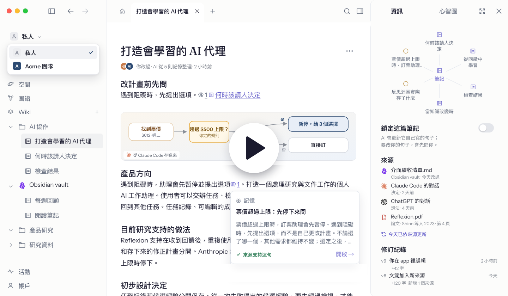

<!-- README_SYNC: source=README.md sha256=8c440ef85f8c04825c2160388b8c13688d575403262f80a35bd9bfe5b9620cba -->

  <picture>
    <source media="(max-width: 600px)" srcset="./docs/assets/readme-banner-zh-Hant-mobile.png">
    
  </picture>

  在 AI 對話裡想通的事會不見，筆記又得一直維護。 
  <strong>設定一次就好。你的 AI 工具會存下重要的內容、把筆記整理好，下次對話再帶回來；改了什麼都看得到，也能還原。</strong> 
  開源的 Obsidian 替代品，也能直接接上你現有的 vault。

  <a href="./README.md">English</a> | <a href="./README.zh-Hans.md">简体中文</a> | 繁體中文 | <a href="./README.es-ES.md">Español</a>

  <a href="https://github.com/wenlan-app/wenlan/releases/latest"><strong>下&#8288;載</strong></a> ·
  <a href="#start-in-30-seconds">開&#8288;始&#8288;使&#8288;用</a> ·
  <a href="#what-can-i-bring-in">來&#8288;源</a> ·
  <a href="#learn-more">文&#8288;件</a> ·
  <a href="https://discord.gg/nmzVTTU3HG">Discord</a>

  
  
  

  

 

## 為什麼用文瀾

我做文瀾，是因為筆記、文件和 AI 對話散落各處，要讓筆記系統不荒廢得不停維護。後來我們也不斷聽到有人說 Obsidian 太麻煩：要找插件、裝插件，還要一直更新設定。文瀾是給每天用 AI 工具、又不想維護筆記系統的人。

**個人版**：下載桌面 App，自己就能用。

**團隊版（下一版推出）**：團隊自己架一台文瀾伺服器，大家都連上去，每個人可以設成只能看或可以改。

- **自己保持最新。** AI 工具會把你在對話裡的決定存下來，再整理進筆記；來源變了，用到它的筆記也會跟著更新。
- **設定一次，不用插件。** 在設定裡按「全部連接」，一鍵連好你的 AI 工具。不用安裝或維護插件。
- **AI 能改什麼由你決定。** 每篇筆記都附出處，點引用就回到原文。改了什麼都看得到、能還原，也能指定哪些筆記要先問你。
- **帶進現有資料。** Obsidian vault、筆記、文件和 AI 對話都能帶進來。[完整清單](#what-can-i-bring-in)。

### 還有

- **頁面可以是文字，也可以是 HTML。** 請 AI 幫任何一頁做 HTML 檢視，或把它做好的 HTML 直接存成一個 HTML 頁面。HTML 檢視顯示的是這頁當下的文字，改字不用重做。
- **共用一個 Space。** 透過 Google Drive 或 iCloud 雲碟的資料夾，跟同事共用，或在自己的幾台電腦間同步。

### 跟其他做法比

| | Obsidian 加插件 | Claude Code 加一個資料夾 | LLM wiki 應用 | 文瀾 |
|---|---|---|---|---|
| 誰來整理 | 你自己加插件 | 你自己，每次交代 | 你另外設定的 AI | 你的 AI 工具；來源變了會更新 |
| 設定 | 找插件、更新插件 | 自己寫、自己維護指示和指令 | 填模型 key 或排程 | 設定一次，不用裝或維護插件 |
| 檢查 AI 寫的東西 | 看插件 | 你自己看 git diff | 連到來源 | 引用對不上的筆記不會存下 |
| AI 能改什麼 | 看插件 | 你核准的，或在設定裡允許的 | 它的 wiki 資料夾 | 每篇由你決定，隨時可還原 |
| 筆記存在哪 | 你的電腦 | 你的電腦 | 你的電腦 | 你的電腦；能接現有 vault |

 

## 開始使用

### 1. 下載 App，或從 AI 工具開始

| **下載桌面 App** | **從你的 AI 工具連接** |
|---|---|
| [完整體驗](https://github.com/wenlan-app/wenlan/releases/latest)：筆記、匯入和一鍵連接。支援 macOS 11 以上的 Apple Silicon、Windows x64 和 Linux x64（AppImage 或 .deb，v0.22 起）。介面有英文、简体中文和繁體中文。 | 在 Mac 上執行 `npx -y wenlan setup`（需要 Node.js），或執行 `brew install 7xuanlu/tap/wenlan` 再執行 `wenlan setup`。Claude Code 可以裝[插件](docs/setup-with-ai.md)。Linux 和 Windows 請看 [CLI 安裝說明](docs/setup-and-data.zh-Hant.md#installation)。 |

### 2. 帶進你的資料

建立一篇筆記，或帶進 Obsidian vault、Logseq 圖譜、資料夾或之前的 AI 對話。[匯入教學](docs/import-guide.zh-Hant.md)。

### 3. 連接你的 AI 工具

如果你是從 AI 工具開始的，它已經連好了，直接照下面問它就好。

在 App 的設定裡，「新增工具」會找出你電腦上的 AI 工具，按「全部連接」一次設好，不用另外裝東西或更新。接著開一個新的 AI 對話，問它：

> /wenlan 我之前對這件事怎麼決定的？再幫我：……

只要記得 `/wenlan`（Codex 裡是 `$wenlan`），後面直接說你要做什麼。

支援 Claude Code、Claude Desktop、Codex、Cursor、GitHub Copilot、VS Code、Gemini CLI、Windsurf、Grok Bot 和其他 MCP 工具。[手動設定](docs/setup-with-ai.md)。

匯入完成後，App 會提供「用（你的 AI 工具）寫頁面」，把資料寫成第一批帶引用的筆記，不用輸入指令。

 

## 能帶進什麼

- **檔案和資料夾：** Markdown、文字檔、文字型 PDF、DOCX。可以只匯入一次，也可以讓資料夾持續同步。
- **Obsidian vault 和 Logseq 圖譜：** 持續同步或只匯入一次。你自己寫的筆記預設是「先問我」。
- **網頁連結：** 在筆記裡貼上連結就會存成來源。YouTube、X、Threads、Instagram 和小紅書會顯示成卡片或影片。
- **Gmail、Notion、Google Drive、Slack、GitHub：** 你的 AI 工具用自己的連接器讀取，把重要的內容存進來，附上原文連結。
- **AI 對話：** 決定和發現會存成記憶，不存完整對話紀錄。ChatGPT 和 Claude 匯出的 ZIP 也能帶進來。
- **程式碼儲存庫：** `/wenlan wiki` 寫出對應到程式碼的筆記。[程式碼 wiki](#code-repository-wiki)。

也可以把 Open Knowledge Format（OKF）資料夾連接成來源。掃描版 PDF 須先擷取文字；對話附件不會匯入。[匯入教學](docs/import-guide.zh-Hant.md)。

 

## 它怎麼幫你整理

你的 AI 工具會讀你帶進來的資料，寫成 Markdown 筆記：把相關的筆記連起來，標出每句話的出處，來源變了就跟著更新。任何一篇筆記你都可以打開自己寫。

  

示意圖依據目前的更新行為繪製；並非 App 截圖。

- **每篇筆記都有出處：** 每個引用都能點回原文。筆記用 `[n]` 引用來源時，文瀾會拿每個引用的句子對照它的來源；引用大多對不上時，不會儲存該筆記。通過檢查不代表內容一定正確。
- **跟著來源更新：** 來源、記憶或引用的程式碼變了，依據它們的筆記會被標出來等待更新。不需要任何模型，文瀾也會建議合併近似重複的筆記，並列出還沒有對應筆記的 `[[連結]]`。
- **AI 能改什麼由你決定：** 你寫的筆記預設是「先問我」，AI 的修改會先等你點頭。每篇筆記都可以設成「直接改」或「先問我」，看得到改了什麼，也能還原到之前的版本。
- **兩種方式：** 「隨叫」是預設，由你的 AI 工具在工作時順手寫，不用另外設定 API key。「自動」則由文瀾用你選的模型在背景處理，模型可以在你的電腦上，也可以在雲端。[沉澱指南](docs/steep.zh-Hant.md)。
- **在你的 AI 工具裡：** 打 `/wenlan`，後面說你要做什麼：找回先前的決定、存下一個心得，或接著上次做到的地方。捷徑：`/recall`、`/capture`、`/handoff`、`/brief`。[插件指令](plugin/skills/README.md)。
- **在 App 裡：** 不連 AI 也能加資料、寫筆記、改筆記、查回引用、審核修改建議。筆記可以包含 Mermaid 圖表，由 App 畫出來。

已經用 Claude Code 或 Codex 管一個筆記資料夾？繼續用就好。文瀾接上同一個工具，補上資料夾自己做不到的事：檢查引用、來源變了會標記，而且每篇筆記 AI 能不能改由你決定。

 

## 為程式碼儲存庫建 wiki

在程式碼儲存庫中執行 `/wenlan wiki`（Codex 中為 `$wenlan wiki`）。你的 AI 工具會寫一篇總覽，再為新人需要了解的每個部分或流程各寫一篇。再次執行時只補寫缺少的筆記。

- **與程式碼綁定：** 每篇筆記都會記錄它依據的程式碼行；程式碼變了，筆記會顯示改了什麼。
- **以 pull request 放進儲存庫：** Space 上的 GitHub 按鈕會把筆記以 pull request 放進儲存庫的 `wiki/` 資料夾，可以按按鈕執行，也可以每天自動跑。每日更新可以在你的電腦上用你自己的 AI 工具跑，或在 GitHub Actions 上跑（AI 工具的金鑰存成儲存庫 secret）。同一個 pull request 還會修正儲存庫文件中與程式碼不再相符的句子。
- **保留你的修改：** 有人在儲存庫中修改過的 wiki 筆記會保留那次修改。引用你的記憶或對話的筆記不會放進儲存庫。

 

## 給技術讀者

**共用本地知識庫。** App、CLI 與連上的 AI 工具透過文瀾的本地服務讀寫。筆記以 Markdown 檔保存；記憶、關係與搜尋索引存在本地 libSQL。本地服務、CLI 和 MCP server 用 Rust 寫成；桌面 app 用 Tauri，介面是 React 和 TypeScript。

  

- **檢索：** 用 SQLite FTS5 找出相同詞句、BGE 向量找出相近語意（libSQL 的 DiskANN 向量索引），再以加權 RRF 合併排名；基礎搜尋不需 API key。共同實體會提高相關記憶的排名，另可啟用 cross-encoder reranking 精排。選定 Space 就只回傳該專案的內容。
- **圖譜：** 設定整理模型後，實體抽取與實體消歧會把不同來源裡提到的同一人物、專案或概念連起來；用 Label Propagation（預設）或 Leiden 把相關主題分組。
- **記憶：** 發現存成一則一則獨立的小記憶，不必載入整段對話或整篇筆記就能找回。

[檢索、引用與模型](docs/technical-foundations.md)。

### 評估

這些 LongMemEval（LME）測量結果評估的是已存知識的檢索，不是 AI 回答品質。Recall@5 表示相關資料出現在前五筆結果中的比例。

<!-- EVAL_SNAPSHOT_START -->
| Benchmark | Recall@5 | MRR | NDCG@10 |
|---|---:|---:|---:|
| LME_Oracle (500 Q) | 93.6% | 0.857 | 0.883 |
| LME_S (deep, 90 Q) | 87.7% | 0.815 | 0.822 |
<!-- EVAL_SNAPSHOT_END -->

一萬篇筆記的測試（產生的測試筆記，M2 Pro 16 GB，v0.20.0）：App 搜尋 11 到 50 毫秒，重新啟動不到 0.3 秒，記憶體峰值約 1.2 GB。0.20.1 修好搜尋後，AI 工具在同一個資料庫裡找到了全部 30 個罕見測試字詞。

在 0.20.2 匯入一萬篇筆記的 Obsidian vault（虛構的筆記，M2 Pro Mac 16 GB，debug build，由 Claude Code 寫筆記）：15 秒後可以搜尋，約 2 分鐘寫出第一篇筆記，約 4 分鐘寫出 8 篇帶引用的筆記。

[評估方法與基準詳情](docs/eval/README.md)。

 

## 資料與隱私

- 筆記是你電腦上的 Markdown 檔，只會去你讓它去的地方。
- 符合條件的筆記可以匯出為 Open Knowledge Format（OKF）知識庫。
- 雲端 AI 工具可能會把找回的內容傳給它的服務商，雲端模型也會收到它處理的內容，所以本地儲存不代表這些互動都留在本機。
- 使用統計預設關閉。

**網頁存取（實驗中）：** 在「設定」中開啟「網頁存取」，就能讓 Claude、ChatGPT 或 Muse 等網頁 AI 用戶端，在你的電腦保持連線時搜尋整個資料庫或指定空間。允許應用程式時可以選「只能搜尋」或「搜尋和寫入」；可以寫入的應用程式還能新增、修改和刪除內容，AI 應用程式可以在每次改動前先問你。查詢與結果會經過中繼服務，詳見[隱私界限](docs/PRIVACY.md#pre-release-standalone-wenlan-relay-connector)。

[檔案位置、備份與移除](docs/setup-and-data.zh-Hant.md#backup-and-removal) · [連網與隱私詳情](docs/PRIVACY.md#when-wenlan-reaches-the-network)。

 

## 進一步了解

- [開始使用與安裝](docs/setup-and-data.zh-Hant.md#installation)
- [連接 AI 工具](docs/setup-with-ai.md)
- [來源與匯入](docs/import-guide.zh-Hant.md)
- [本地檔案、備份與離線使用](docs/setup-and-data.zh-Hant.md)
- [隱私](docs/PRIVACY.md)
- [Doctor 與問題回報](https://wenlan.app/docs/diagnostics-and-issue-reports)
- [每次發佈的更新紀錄](CHANGELOG.md)
- [完整文件索引](docs/README.md)

 

## 貢獻

歡迎加入 [Discord 社群](https://discord.gg/nmzVTTU3HG)。請在 [GitHub issues](https://github.com/wenlan-app/wenlan/issues) 回報問題或提出功能建議；Issue 是公開的，分享前請遮蔽密鑰與個人資料。

程式碼與文件貢獻請見[貢獻指南](.github/CONTRIBUTING.md)、[安全性回報](.github/SECURITY.md)與[行為準則](.github/CODE_OF_CONDUCT.md)。

 

## 程式碼簽章政策

請見[各平台簽章與公證說明](docs/code-signing.md)。

 

## 授權

本地 runtime、CLI、MCP server、shared types 與 plugins 採用 [Apache-2.0](LICENSE)。桌面 app 與其前端採用 [AGPL-3.0-only](app/LICENSE)；若將修改版作為網路服務運行，須向使用者提供其原始碼。

 

## 源流與同類專案

Wenlan 名稱來自文瀾閣，產品方向承接 LLM-wiki 與 agent-memory 脈絡：[Karpathy 的 LLM-wiki note](https://gist.github.com/karpathy/442a6bf555914893e9891c11519de94f)、[Rohitg00 的提案](https://gist.github.com/rohitg00/2067ab416f7bbe447c1977edaaa681e2) 與 [nashsu/llm_wiki](https://github.com/nashsu/llm_wiki)。
