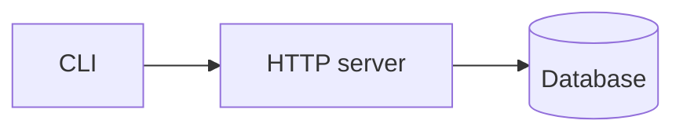

# /wenlan wiki

Read this repository and keep a wiki about it in its Space. How many pages it
has depends on the repository: a small tool may need five, a large monorepo
twenty or more. The overview page lists them all.
Each key sentence is tied to the code lines it was read from (a code basis), so
Wenlan can tell when the code moved on. The pages are written by the AI. A
rerun writes only the pages that are missing. A page whose cited code changed
is brought up to date by steep (`/wenlan steep`, or Wenlan's automatic mode),
not here: wiki writes new pages, steep keeps them current. Reply in the user's
language.

## 1. Resolve repository and Space

The skill accepts one optional inline token of the form `space:<name>`. The
bundled resolver strips it and prints the resolved Space line itself:

```bash
raw_args="<the full argument string passed to /wenlan wiki>"
resolved="$("${CLAUDE_PLUGIN_ROOT}/scripts/resolve-space.sh" --cwd "$PWD" --args "$raw_args")"
space="$(printf '%s\n' "$resolved" | cut -f1)"
repo_root="$(git -C "$PWD" rev-parse --show-toplevel)"
```

If the resolver cannot run (a background run may allow only read-only
commands), take the Space from the `space:<name>` token instead.

If the `git rev-parse` fails, say this folder is not a git repository and stop.
If `space` is empty, say this folder is not matched to a Space and that
`/wenlan wiki space:<name>` names one, then stop. Do not ask a question.

## 2. Plan the pages

Call `list_pages` with `space="<space>"` once. If it answers that the Space is
unknown, this repository has no pages yet: register the Space once with
`"$W" spaces add "$space"` (`W` as in step 8), then plan from the repository as
below. Do not stop to ask.

Find the overview page by exact title (below). If it exists, call `read_page`
on it: its `## Pages` section (`## 頁面` in Chinese) is the plan. Then look
over the repository once more for an important part or flow the list misses,
such as a new package or a new entry point, and add it to the plan.

If there is no overview, plan from the repository. Look before you plan:
`git ls-files` (count and top-level layout), the README and docs folder, the
build manifests (`package.json`, `Cargo.toml`, `pyproject.toml`, `go.mod` and
the like), the entry points, CI config, and `git log --oneline -50`.

Plan the smallest set of pages that lets a newcomer work in this repository.
Organise by parts and flows, not by copying the directory tree.

Always:

| Page | What it answers | English title | 繁體中文 title |
|---|---|---|---|
| Overview | What the project is, where the entry points are, and the list of pages | `What <project> is` | `<project>是什麼` |
| How to run it | Install, build, start | `How to run it` | `怎麼跑起來` |
| Known pitfalls | From git log, comments and existing docs | `Known pitfalls` | `已知的坑` |

As the repository needs (each only when there is real code behind it):

- **Architecture or module map**: how the parts fit and what each one owns
  (`Module map`, `模組地圖`).
- **One page per major part**: a package, crate, service or directory that
  owns real behaviour, titled by what it does.
- **One page per important flow**: from entry to effect, such as
  `How a request is handled`; for a single main path, `Main flow` / `主流程`.
- **Data and storage**, **configuration**, **release and deploy**,
  **integrations with outside services**.
- **How tests run** (`測試怎麼跑`) when the repository has tests: the layers,
  and which are slow.

Let the repository decide the count. As a rough guide, a small repository
(under about 50 tracked source files) needs 4 to 6 pages, a medium one 8 to
15, a large monorepo 15 to 30. Never plan more than 30. Do not make a page for
a folder that only holds glue, and do not split a topic that fits on one
screen.

**Existing docs come first.** When the repository already has a doc that
covers a planned topic (an architecture doc, a package's README or
REFERENCE, a contributing guide that says how to build and run it), do not
plan a page that retells it. Drop the topic from the plan and
list the doc in the overview under `## Existing docs` (`## 現有文件` in
Chinese) as `` - `<path>`: <what it covers, one line> ``. Plan a page on that
topic only for what the doc leaves out, and open it with which doc to read
first. Step 7 still checks those docs against the code.

Titles are short noun phrases in the user's language, taken from how they typed
the request. When a page already in the Space covers a planned topic (for
example an earlier wiki's `Module map`), use that page's exact title in the
plan rather than a new one.

## 3. Decide per page: write or leave

For each page in the plan, find it in the `list_pages` result by exact title,
never fuzzy.

- Missing: write it (step 4).
- Present, and listed with a `code_basis` entry in state `pending` whose
  `repo_root` is this repository: leave it. It is already on steep's list;
  say in the report that it waits for steep.
- Present, and listed with a `code_basis` entry in state `unavailable` with
  reason `file_deleted`: the file was deleted, and steep updates the page.
  Leave it, like a `pending` one. Wenlan follows a renamed file by itself, so
  a rename never shows up here.
- Present, and listed with a `code_basis` entry in state `unavailable` with
  another reason (`file_missing`, `repo_missing`), whose `repo_root` is this
  repository: Wenlan could not tell what became of the file. Re-point it
  (step 5).
- Present with nothing outstanding: leave it, and say so in the report.
  `list_pages` rechecks the cited files first and lists only code bases that
  are not `ok`, so a page with none listed is current.

Do not call `read_page` on a page you are leaving as is.

Write at most 12 new pages in one run, so a first run on a large repository
stays affordable. Write the overview first, then the rest in plan order, most
important first. The pages left over are written by the next run.

**The overview's page list.** A new overview ends with a `## Pages` section
(`## 頁面` in Chinese) listing every planned page, written or not, as
`- [[<title>]]: <what it answers, one line>`, in reading order: the wiki
folder's `README.md` lists the pages in this order.
When existing docs replaced planned topics, an `## Existing docs` section
follows it. When the plan gained pages and
the overview already exists, update only that section: take `version` from
your `read_page`, then call `write_page` with `page_id`, `expected_version`,
`minor: true`, and `content` that is the page you read with only the list
changed. Pass no `code_basis`; the page keeps the bases it has. Skip this when
the overview has a `pending` or `unavailable` code basis (steep or step 5
handles it first), and say so in the report.

## 4. Writing a page

Read the repository with Read, Glob, Grep and `git ls-files`; for a file too
large to read whole, read the part you need. Never read a file
`git check-ignore` reports, a `.env` or other secrets, or anything outside
`repo_root`. Do not run build, test or install commands, and write nothing into
the repository.

Compose the page in the user's language: about a screen, up to two for a large
part. Link other pages in the plan as `[[<title>]]` where a reader would want
to go next. Every sentence that states something read from code gets one
`code_basis` entry `{repo_root, path, line_start, line_end}` with the exact
lines it rests on. Keep 3 to 12 entries per page (up to 20 for a page about a
large part), and never more than 100, the most one write accepts. A refusal
naming a span outside the file means the line numbers are off: read those lines
again and retry once with the right span.

```
write_page(space="<space>", title="<page title>", content="<page>",
           code_basis=[{repo_root, path, line_start, line_end}, ...])
```

Whenever a tool offers a `space` field, pass the resolved Space in it; a write without it goes to the connection's default Space, which may not be this repository's. When the connection is locked to one Space the field is absent, and nothing needs passing.

**Diagrams.** Add a Mermaid diagram where a picture says it faster than
prose: how the parts call each other (module map, overview), a flow from
entry to effect, what is stored where, how a release goes out. Skip it on
`How to run it` and `Known pitfalls`, and when it would have fewer than three
boxes. At most two per page, each right after the paragraph it pictures.
Every box and arrow is something the page's own sentences say and cite; a
diagram never carries a fact the text does not. Write it so it draws the same
in Wenlan, on GitHub and in Obsidian:

- A fenced code block tagged `mermaid`, using only `flowchart LR` (how
  parts connect), `flowchart TD` (a flow) or `sequenceDiagram` (calls back
  and forth).
- At most about 12 boxes, each label a few words in the page's language.
  Keep about 5 boxes across in `flowchart LR`; for more, use `flowchart TD`
  so the diagram is not too wide to read. Edge labels are one or two words.
- File names go in box labels only on the module map; elsewhere a box names
  its role (`Worker`, not `worker.ts`), so a renamed file does not leave the
  diagram wrong.
- In a flowchart, name each box with a short ASCII id and put its label in
  double quotes, `api["HTTP server"]`, edge labels too, `-- "yes" -->`.
- Never a bare number in square brackets anywhere in the diagram, such as
  `step[1]`: Wenlan reads `[1]` as a citation.
- No styling, `click`, links, HTML or icons.



Pass no `source_memory_ids`. If the reply says `code_basis is not available
over remote connections`, say wiki needs local Wenlan and stop. A `warnings`
entry saying a code basis was not recorded is reported, not hidden. A
`warnings` entry starting `diagram N line M` means that diagram will not
draw: fix that line and write the page again with its `page_id`, or remove
the diagram.

## 5. Re-pointing a page whose code is gone

Only for a page with an `unavailable` entry whose reason is not
`file_deleted`. Call `read_page` for its
`version` and full `code_basis`. For each `unavailable` entry, find where that
fact now lives in the repository, or drop the sentence if it is no longer
true. Then call `write_page` with `page_id`, `expected_version` set to the
`version` you read, the edited `content`, and a `code_basis` list naming the
new lines; call `page_code_basis` with `action: "remove"` for each old entry.
Leave `pending` entries on that page alone: steep handles them.

A `gated` result means the user edited that page: report it as staged for
review. A refusal saying the page moved means someone edited it after your
read: read it again and redo the edit once.

## 6. Report

One line per planned page with its title: written, left as is, waiting for
steep, re-pointed, or staged for review. When pages are left over for the next
run, say how many and that `/wenlan wiki` again writes them. Then one line on
what happens later: `/brief` names how many pages rely on code that changed,
and `/wenlan steep` brings them up to date. When step 7 ran, one more line:
how many docs were read and how many fixes go into the pull request, each as
the file name and what changes.

## 7. Check the repository's own docs

When the Space is connected to this repository, Wenlan also keeps the
repository's own docs honest: a sentence the code no longer agrees with gets a
fix, and the fix goes into the same pull request as the wiki for the user to
review. In Wenlan's daily run (`WENLAN_AGENT_NAME` is `wenlan-daily`) the Space
is connected. Otherwise run the `wiki status` command of step 8 first; when it
prints `null`, or the command is missing, skip this step.

1. List the docs with `git ls-files '*.md' '*.mdx'`. Leave out the wiki folder
   (`folder` in the status, `wiki` by default), any changelog and anything
   under `node_modules`. Read at most 30 per run, in this order: `README.md`,
   `AGENTS.md`, `CLAUDE.md`, then files under `docs/`, then `SKILL.md` files,
   then the rest.
2. In each doc, look at sentences that state something the code decides:
   commands, scripts, file and folder names, versions, settings and their
   defaults, flags, routes, function or type names, and the steps to run,
   build or test. Check each one in the code.
3. Only when the code clearly says otherwise, call `doc_fix` with
   `action: "suggest"`, `space`, the doc's `path`, `old_text` copied exactly
   from the file (the sentence, or the part of it that is wrong; it must occur
   in the file once), `new_text` that changes only what is wrong, in the same
   language, tone and formatting, `reason` (one sentence: what the code says
   instead) and `code` (the lines that show it, as a list:
   `[{"path": "src/server.ts", "line_start": 4, "line_end": 6}]`).
4. Never fix opinions, plans, history, style, wording or typos, anything you
   cannot check in the code, Wenlan's own block between `<!-- WENLAN:START -->`
   and `<!-- WENLAN:END -->`, or anything in the wiki folder. When unsure,
   leave the sentence alone.
5. Suggest at most 10 fixes per run. A refusal saying the user declined it:
   leave that sentence alone. A refusal saying the text occurs more than once
   or not at all: copy it again with more of the sentence, once.
6. Finish with `doc_fix` `action: "checked"`, `space` and `docs` set to how
   many docs you read, even when you found nothing to fix.

## 8. Put the wiki in the repository

Wenlan can write the pages that rest on this repository's code into a folder of
the repository and offer them as a pull request. Skip this step when
`WENLAN_AGENT_NAME` is `wenlan-daily`: that is Wenlan's daily run, and Wenlan
publishes after it. Otherwise check whether the Space is bound:

```bash
W="$(command -v wenlan || echo "$HOME/.wenlan/bin/wenlan")"
"$W" wiki status --space "$space" --format json
```

- It prints a binding: run `"$W" wiki publish --space "$space"` and add its
  line to the report (pull request opened or updated, already up to date, or
  a link to open the pull request by hand).
- It prints `null`: find where a pull request would go with
  `git -C "$repo_root" remote get-url origin` (on GitHub, the `owner/name` in
  it). Ask once whether to put the pages in this repository's `wiki/` folder
  and open a pull request there, naming that repository in the question.
  Offer two answers, with No first and as the default: "No, keep the pages in
  Wenlan only" and "Yes, open a pull request on <owner/name>". Only a clear
  yes counts: an empty answer, a timeout, Enter on the default or anything
  unclear is no. On no, leave it and do not ask again in this run.
- On yes, run `"$W" wiki bind --space "$space" --repo "$repo_root"`, then
  `wiki publish` as above, and mention that `wiki bind --daily <hour>` keeps
  the wiki up to date every day with the user's own AI tool. When `wiki bind`
  refuses because the repository is not the user's (it names the owner), say
  whose it is and ask once more, No first and as the default; only on a clear
  yes to that repository by name run `wiki bind` again with
  `--confirm-repo <owner/name>`. Never add `--confirm-repo` on your own.
- The command is missing or has no `wiki` subcommand: skip this step without
  saying so.

Pages that cite the user's notes or chats never go into the repository; the
publish line says how many stayed out.

## Safety

- Reads and writes of pages just happen; no approval is needed.
- Wiki never deletes a page and never edits the repository's files itself.
  A doc fix of step 7 is only recorded; it reaches the repository through the
  pull request of step 8, for the user to review. Step 8 asks Wenlan to write the wiki folder on its own `wenlan/wiki` branch,
  apart from the working copy, and open a pull request; only with the user's
  clear yes to the repository named in the question, or an existing binding.
- Wiki only reads the repository. Shell commands are read-only ones such as
  `git rev-parse`, `git ls-files`, `git check-ignore`, `git log`, `git show`,
  `ls`, `wc`, `grep` and `sed -n`, plus `wenlan spaces add` for a Space that
  has no pages yet and the `wenlan wiki` commands of step 8; nothing that
  builds, installs, or changes a file.
