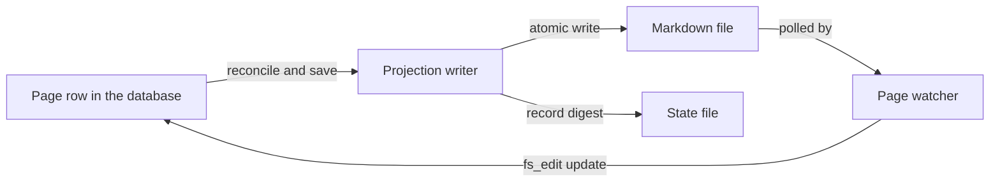

Wenlan keeps its durable data in two main places: a local libSQL database for memories, pages and the links between them, and a folder of Markdown files that mirrors the pages. The database holds the authoritative page. The files are a projection that the daemon repairs and that people can edit. This page covers where each lives, how the schema evolves, and how the two are kept in step. The process that opens them is described in [The HTTP daemon](the-http-daemon.md), and environment variables are listed in Configuration and environment.

## Where the data lives

The data root is the directory named by `WENLAN_DATA_DIR`. When that is unset it is a `wenlan` folder under the operating system's local data directory. The `config.json` file sits in that same root and honors the same override. The daemon opens its database under `<data root>/memorydb`, and the file itself is `origin_memory.db`. Opening creates the folder and the file, refuses a database that a newer build already migrated, then turns on WAL mode and foreign keys.

Pages go to a separate projection folder. It is the folder named in config, or `~/.wenlan/pages` when config names none. An isolated run is one where `WENLAN_DATA_DIR` names a root other than the installed app's own. Its default pages folder is `<data root>/pages`, so a scratch daemon does not project into the user's real vault.

## Schema and migrations

The base schema is a set of `CREATE TABLE IF NOT EXISTS` statements, and it starts with `memories`. A row holds the content, source, memory type, domain, source agent, confidence, quality, supersedes link, pinned flag, structured fields and an `embedding F32_BLOB(768)` column. Everything newer comes from numbered migrations keyed on SQLite's `user_version`. The current `SCHEMA_VERSION` is 143, and it doubles as a downgrade barrier: a database whose version is higher is refused, so an older build cannot write to a store it cannot read. Before a migration changes an existing database, `backup_before_migration` takes an online snapshot beside the live file as `pre_migration_<n>_backup.db` and records a receipt in `app_metadata`. A database created during that same boot skips the snapshot, because there is no earlier state to restore.

## Main tables

- **`memories`** is the primary store described above.
- **`pages`** came from migration 46, which renamed `concepts` to `pages`, `concept_sources` to `page_sources` and `concept_id` to `page_id`. It also rewrote ids from `concept_<uuid>` to `page_<uuid>`.
- **Entities** no longer have their own tables. Migration 123 retires the legacy `entities` and `entity_aliases` tables, dropping `entity_aliases` first, and an entity id is now the id of a shadow page. See Knowledge graph.
- **`page_code_basis`** stores one row per cited code span: page, repo root, path and line range. Its `state` is one of `ok`, `moved`, `pending` or `unavailable`.

## The Markdown projection

At startup the daemon loads the active pages and, if the pages folder exists, hands them to a projection writer for a reconcile pass. Reconcile treats the database as authoritative. A crash can leave a file missing, holding the previous version, or zero-length. Reconcile repairs these through the same atomic write path and sweeps leftover `.tmp` files. A stale version stamp is only a repair candidate, never permission to overwrite: the writer checks the digest of the last bytes it wrote and keeps external edits it does not recognise. The writer records every page in `.wenlan/state.json` inside the pages folder, which is itself written atomically through a temporary file. Each entry keeps the file name, a SHA-256 of the exact bytes installed, the version, the write time, and the title, description and space used to build the index.

The other direction is a poll-based page watcher that the scheduler calls on its ticks. It walks the projection and compares each file with its database page. A saved edit is applied back through `update_page_content` with `link_reason = "fs_edit"`, which marks the page as user edited. Files with no `origin_id`, files for unknown pages, and files whose `origin_version` is behind the database are skipped.

Each projected file starts with frontmatter built from the page: `title`, `type: page`, `description`, `tags` and `space`, `origin_id`, `origin_version`, `created`, `modified` and a `generated` stamp. The `status` is `draft` when the page has a stale reason, `deprecated` when it is not active, and `stable` otherwise. The sources block is a one-way provenance projection that the watcher never reads back. When a file is replaced, the old file is moved to `.wenlan/projection-recovery/` rather than deleted. These recovery copies are kept and are not merged or removed automatically. On a filesystem without hard-link support the save is reported as `pending` and the database write is preserved.

## Code

- [`crates/wenlan-core/src/config.rs` lines 227-247](../../crates/wenlan-core/src/config.rs#L227-L247)
- [`crates/wenlan-core/src/config.rs` lines 249-268](../../crates/wenlan-core/src/config.rs#L249-L268)
- [`crates/wenlan-core/src/config.rs` lines 277-290](../../crates/wenlan-core/src/config.rs#L277-L290)
- [`crates/wenlan-core/src/db.rs` lines 1514-1520](../../crates/wenlan-core/src/db.rs#L1514-L1520)
- [`crates/wenlan-core/src/db.rs` lines 4256-4299](../../crates/wenlan-core/src/db.rs#L4256-L4299)
- [`crates/wenlan-core/src/db.rs` lines 5114-5143](../../crates/wenlan-core/src/db.rs#L5114-L5143)
- [`crates/wenlan-core/src/db.rs` lines 8080-8094](../../crates/wenlan-core/src/db.rs#L8080-L8094)
- [`crates/wenlan-core/src/db.rs` lines 11310-11342](../../crates/wenlan-core/src/db.rs#L11310-L11342)
- [`crates/wenlan-core/src/db.rs` lines 17070-17103](../../crates/wenlan-core/src/db.rs#L17070-L17103)
- [`crates/wenlan-core/src/db/code_basis.rs` lines 38-63](../../crates/wenlan-core/src/db/code_basis.rs#L38-L63)
- [`crates/wenlan-core/src/export/knowledge.rs` lines 70-89](../../crates/wenlan-core/src/export/knowledge.rs#L70-L89)
- [`crates/wenlan-core/src/export/knowledge.rs` lines 611-623](../../crates/wenlan-core/src/export/knowledge.rs#L611-L623)
- [`crates/wenlan-core/src/export/knowledge.rs` lines 1388-1410](../../crates/wenlan-core/src/export/knowledge.rs#L1388-L1410)
- [`crates/wenlan-core/src/export/knowledge.rs` lines 5173-5224](../../crates/wenlan-core/src/export/knowledge.rs#L5173-L5224)
- [`crates/wenlan-core/src/sources/page_watcher.rs` lines 1-23](../../crates/wenlan-core/src/sources/page_watcher.rs#L1-L23)
- [`crates/wenlan-server/src/main.rs` lines 740-746](../../crates/wenlan-server/src/main.rs#L740-L746)
- [`crates/wenlan-server/src/main/startup.rs` lines 408-439](../../crates/wenlan-server/src/main/startup.rs#L408-L439)
- [`docs/markdown-projection.md` lines 34-41](../../docs/markdown-projection.md#L34-L41)

