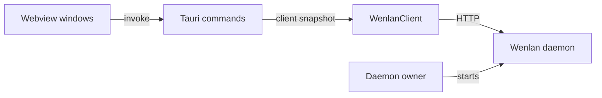

The desktop app has two halves. `app/` is a Tauri 2 Rust crate that owns startup, the tray, the bundled helper programs and every call to the daemon. `src/` is a React 19 frontend that runs inside the app's webview windows. The app keeps no database of its own: it is a client of the daemon described in [The HTTP daemon](the-http-daemon.md).

Webview windows call Tauri commands through `invoke`. Each command takes a snapshot of the shared `WenlanClient`, and the client sends HTTP requests to the daemon. A separate daemon owner starts that daemon: launchd on macOS, a bundled sidecar elsewhere. The sections below cover each arrow.

## Rust side

**Startup.** `run()` in `app/src/lib.rs` is the entry point. A debug build first runs an isolation check and panics if it fails, with the message "Start the app with `pnpm dev:all`". A debug binary therefore will not start from a bare launch. See [How to run it](how-to-run-it.md) for the dev workflow.

**Reaching the daemon.** `WenlanClient` in `app/src/api.rs` wraps an HTTP client and a base URL built from the daemon port on 127.0.0.1. Commands in `app/src/search.rs` call `daemon_client`, which clones the client out of the shared `AppState` and releases the read lock before any request is awaited. The source explains why: a lock held across a slow request can freeze the whole app. Every command is registered once in the `generate_handler!` list in `app/src/lib.rs`. Its "Lifecycle commands" block covers run-at-login, full quit, the guarded-quit acknowledgements and daemon start and restart.

**Who runs the daemon.** On macOS a first-run task installs LaunchAgents and settles which side owns the daemon. The labels are `com.wenlan.server` and `com.wenlan.desktop`, alongside legacy `com.origin.*` labels. Where no LaunchAgent exists, startup spawns the bundled `wenlan-server` sidecar instead, and that sidecar exits cleanly if a daemon already holds the port. Run at login is supported on macOS only.

**Tray and quit.** A poller updates the tray icon as the daemon comes and goes. On macOS and Windows a click on the icon opens a small panel window that carries the single Quit. Linux trays send no clicks, so there the icon has a short menu with Show Wenlan and Quit Wenlan. Quit is guarded: `request_full_quit` emits `quit-requested` to the frontend. It forces shutdown if the frontend does not acknowledge in time, or has refused several times in a row.

**Bundled programs and updates.** `app/tauri.conf.json` declares `wenlan`, `wenlan-server` and `wenlan-mcp` as `externalBin`. An updater task checks shortly after startup and then every 30 minutes. Remote access starts the `wenlan-mcp` sidecar with `WENLAN_NO_AUTOSTART=1` set, so that process never auto-starts a daemon. The outbound link to the relay at `https://relay.wenlan.app` is native code under `app/src/remote_relay.rs`, and its credentials stay native and are never returned by a Tauri command. See Web access relay and [MCP server](mcp-server.md).

## Frontend

**Windows.** `src/main.tsx` chooses what to render from `window.location.hash`. `#toast`, `#quick-capture` and `#tray-panel` mount small dedicated components. Anything else mounts `App` inside a TanStack Query provider whose defaults are no retries and no refetch on window focus. The i18n setup is awaited before the first render.

**Boot gate.** `App` asks the daemon whether to show the setup wizard, using its own bounded retry policy because the first-run daemon install is spawned asynchronously and races the query. The window is empty while the first answers arrive, and a "starting runtime" message appears while the daemon is slow. The setup wizard shows when the daemon says so, and also when the daemon never answers (the gate fails closed). A migration progress screen shows during a migration. Otherwise `Main` renders.

**IPC boundary.** `src/lib/tauri.ts` wraps `invoke` so that, while a window that opened before the daemon answered is waiting for it, daemon calls wait instead of failing.

## Related

[How tests run](how-tests-run.md) describes how the `app-check` and `app-e2e` CI jobs exercise this crate and frontend. See Release process for how the app is packaged and Configuration and environment for the environment variables.

## Code

- [`app/src/api.rs` lines 515-532](../../app/src/api.rs#L515-L532)
- [`app/src/lib.rs` lines 617-656](../../app/src/lib.rs#L617-L656)
- [`app/src/lib.rs` lines 715-721](../../app/src/lib.rs#L715-L721)
- [`app/src/lib.rs` lines 928-963](../../app/src/lib.rs#L928-L963)
- [`app/src/lib.rs` lines 1296-1311](../../app/src/lib.rs#L1296-L1311)
- [`app/src/lib.rs` lines 1356-1368](../../app/src/lib.rs#L1356-L1368)
- [`app/src/lib.rs` lines 1567-1575](../../app/src/lib.rs#L1567-L1575)
- [`app/src/lib.rs` lines 1855-1867](../../app/src/lib.rs#L1855-L1867)
- [`app/src/lifecycle.rs` lines 126-146](../../app/src/lifecycle.rs#L126-L146)
- [`app/src/remote_access.rs` lines 1300-1309](../../app/src/remote_access.rs#L1300-L1309)
- [`app/src/remote_relay.rs` lines 1-21](../../app/src/remote_relay.rs#L1-L21)
- [`app/src/search.rs` lines 27-42](../../app/src/search.rs#L27-L42)
- [`app/src/updater.rs` lines 593-605](../../app/src/updater.rs#L593-L605)
- [`app/tauri.conf.json` lines 67-71](../../app/tauri.conf.json#L67-L71)
- [`src/App.tsx` lines 35-62](../../src/App.tsx#L35-L62)
- [`src/App.tsx` lines 344-404](../../src/App.tsx#L344-L404)
- [`src/lib/tauri.ts` lines 11-20](../../src/lib/tauri.ts#L11-L20)
- [`src/main.tsx` lines 22-55](../../src/main.tsx#L22-L55)

