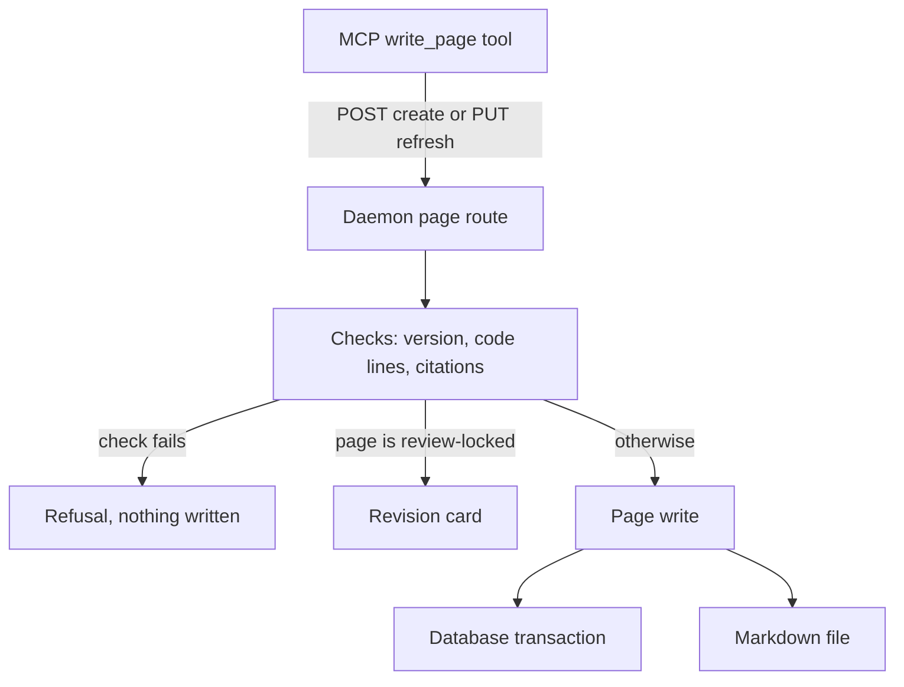

An agent writes a page by calling the `write_page` tool of the MCP server. The tool checks little itself: it sends one HTTP request to the daemon, and the daemon's page route and `wenlan-core` do the checking and the writing. This page follows one write from that call to the Markdown file on disk. For the tool see [MCP server](mcp-server.md), for the route host [The HTTP daemon](the-http-daemon.md), and for the tables underneath [Data and storage](data-and-storage.md).

## The path of one write

A create is a POST to `/api/pages`, and a refresh of an existing page is a PUT to `/api/pages/{id}`. The daemon's page route runs its checks first (version, code lines, citations), and a failed check ends the request with nothing written. If the page is review-locked, the write is held as a revision card instead of landing. Otherwise it goes to the page write, which is one database transaction plus the Markdown file.

## What the tool does

Given a `page_id`, the tool builds a refresh and sends it with PUT. Without one it requires a `title` and sends a create with POST. When the daemon answers 409 (the page moved past `expected_version`, or the refresh of a user-written page named no version), the tool reads the page's current version and gives the agent recovery steps instead of a raw error. A refused `code_basis` and a refused citation check also come back as readable tool results.

## Checks in the route

A create first takes the Space write lock, resolves the target Space, refuses note ids in the source list, and checks every note named in `basis`. It then reads and fingerprints each cited range of code, so a bad path or an unreadable file refuses the whole request before anything exists. Last it runs the citation check.

A refresh has to show that it saw the current page:

- A wrong `expected_version` gives a 409 before anything is staged.
- No `expected_version` on an unlocked page that a person owns (`user_edited`, or created as `authored`) also gives a 409, telling the agent to read the page and retry.
- Empty `source_memory_ids` on a page that has sources is a validation error.

Only after these cheap refusals does the route read code files, run the citation check, and ask `machine_write_requires_review` whether the write must be held.

## Review lock and revision cards

A review-locked page holds every agent write. A person-owned page takes an agent write directly only when the write carries a matching `expected_version`. A held write is not applied. The route stages a revision card and replies with `gated: true` and the card's id, and the page text stays unchanged until a person accepts the card. The card is a row with `pending_revision` set that supersedes the page. It is titled "Revision: " plus the page title, cut to 80 characters, holds the proposed body, and records the page version, the source revision, the writer, and why review was needed: `locked`, `background` (Wenlan's own lanes) or `owned`. The notes the write relied on ride the card and are recorded when it is accepted. Pages that Wenlan rewrites on its own meet the same gate; see [How steep keeps pages current](how-steep-keeps-pages-current.md).

The database repeats the lock check. Its UPDATE adds `review_required = 0` for every writer except manual edits, file edits and accepting a revision card, which catches a lock set after the gate looked.

## Citation check

In the page body, a numbered marker such as `[n]` points at the n-th id in `source_memory_ids`. A page with no sources or no markers is left as written. Otherwise each source contributes a capped excerpt of its text, and a source that is gone keeps its number but has no text, so it cannot verify anything. Each cited sentence is compared with the sources it cites. If it does not pass, its enclosing paragraph is tried. The score is the larger of two directions of word overlap and must reach 0.5. Markers that point outside the source list are stripped from the saved body.

The write is refused when no citation verified, or when more failed than passed. The route then answers 422 `citations_unsupported` with the counts, and nothing is written. The doc `docs/citation-checks.md` lists what "verified" does not prove.

## Code basis

A `code_basis` entry names lines of a file: an absolute `repo_root`, a `path` relative to it, and 1-based inclusive `line_start` and `line_end`. Before the write, `prepare_code_basis` accepts at most 100 entries, resolves each path against its repo root, refuses a start of 0 or an end before the start, collapses identical entries, then reads and fingerprints the files.

A recorded row is `ok` (the lines still hash the same), `moved`, `pending` (the content changed) or `unavailable` (the file or repo is gone). On a create, the route records the lines after the page exists. If that fails, the page stays and the reply carries the warning "code_basis was not recorded". A create that attached to an existing page records nothing and says so. When a write updates an existing page, the lines are saved inside the same database transaction as the new version, so a rolled-back write leaves none.

## Diagram check

Mermaid blocks in the body are checked after the write lands, and the check never blocks it. Each broken diagram adds a warning to the reply, such as "diagram 2 line 3: ... Fix it and write the page again, or remove the diagram." One of the problem kinds is a number in square brackets inside a label, because Wenlan reads that as a citation. Both create and refresh replies carry these warnings.

## The database and the file

On a create, the core writes the Markdown file first, but only when a pages folder is configured. It then inserts the page, and if the insert fails it removes the file again. On a refresh the order is reversed. The database transaction commits first. The route then re-reads the page, so a concurrent person edit is not replaced by an older snapshot, and writes the file. If that fails, it only logs "refresh saved; projection pending".

The refresh UPDATE is a compare-and-set. It matches the expected `version` (and `status = 'active'`) when one was sent, and the expected `source_revision` when the caller gave one. In the same transaction it appends a history row, then the basis marks, then the code basis, and rolls back if any step fails. The file writer renders the page to Markdown and writes it to a temporary file in the same folder. It then renames that file over the target, so a reader such as Obsidian never sees a half-written page.

To see how written pages come back out, read [How search works](how-search-works.md).

## Code

- [`crates/wenlan-core/src/citations.rs` lines 806-843](../../crates/wenlan-core/src/citations.rs#L806-L843)
- [`crates/wenlan-core/src/code_basis.rs` lines 31-34](../../crates/wenlan-core/src/code_basis.rs#L31-L34)
- [`crates/wenlan-core/src/code_basis.rs` lines 363-388](../../crates/wenlan-core/src/code_basis.rs#L363-L388)
- [`crates/wenlan-core/src/db.rs` lines 53483-53521](../../crates/wenlan-core/src/db.rs#L53483-L53521)
- [`crates/wenlan-core/src/db.rs` lines 53949-53983](../../crates/wenlan-core/src/db.rs#L53949-L53983)
- [`crates/wenlan-core/src/diagrams.rs` lines 81-123](../../crates/wenlan-core/src/diagrams.rs#L81-L123)
- [`crates/wenlan-core/src/export/knowledge.rs` lines 510-543](../../crates/wenlan-core/src/export/knowledge.rs#L510-L543)
- [`crates/wenlan-core/src/post_write/page_create.rs` lines 463-509](../../crates/wenlan-core/src/post_write/page_create.rs#L463-L509)
- [`crates/wenlan-core/src/post_write/page_update.rs` lines 365-414](../../crates/wenlan-core/src/post_write/page_update.rs#L365-L414)
- [`crates/wenlan-mcp/src/tools.rs` lines 3298-3332](../../crates/wenlan-mcp/src/tools.rs#L3298-L3332)
- [`crates/wenlan-mcp/src/tools.rs` lines 3342-3361](../../crates/wenlan-mcp/src/tools.rs#L3342-L3361)
- [`crates/wenlan-server/src/page_routes.rs` lines 627-667](../../crates/wenlan-server/src/page_routes.rs#L627-L667)
- [`crates/wenlan-server/src/page_routes.rs` lines 711-740](../../crates/wenlan-server/src/page_routes.rs#L711-L740)
- [`crates/wenlan-server/src/page_routes.rs` lines 1711-1734](../../crates/wenlan-server/src/page_routes.rs#L1711-L1734)
- [`crates/wenlan-server/src/page_routes.rs` lines 1866-1906](../../crates/wenlan-server/src/page_routes.rs#L1866-L1906)
- [`crates/wenlan-server/src/page_routes.rs` lines 1907-1961](../../crates/wenlan-server/src/page_routes.rs#L1907-L1961)
- [`crates/wenlan-server/src/page_routes.rs` lines 2007-2068](../../crates/wenlan-server/src/page_routes.rs#L2007-L2068)
- [`crates/wenlan-types/src/code_basis.rs` lines 11-34](../../crates/wenlan-types/src/code_basis.rs#L11-L34)
- [`docs/citation-checks.md` lines 13-27](../../docs/citation-checks.md#L13-L27)

