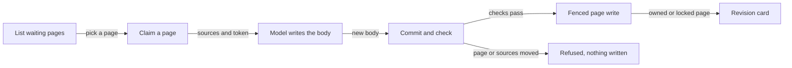

Steep is the job that brings a wiki page back in line when the material it was written from changes. It is one job with two modes, and both modes use the same checks and the same write, so a page ends up the same whichever mode did the work. [How a page is written](how-a-page-is-written.md) covers how pages are first made, and Background enrichment covers the other background work.

## Two modes, never off

Steeping has two modes, kept in the `background_ai_enabled` setting. Automatic (true) means Wenlan steeps in the background. On demand (false) means the user's AI tool steeps as it uses Wenlan. The app treats it as never "off" (`src/lib/steepMode.ts`). A brand-new install starts On demand: `new_install_config` sets `background_ai_enabled` to false and `lock_my_pages` to true (`config.rs`). See Configuration and environment for the other settings.

In Automatic mode the daemon's own model does the writing. On demand, the AI tool does the model work and the daemon does the rest: it lists the work, hands out a snapshot, checks the result and commits it. Both modes end in the same stale rebuild, so the ownership gate, the citation gate and the staleness fence are the same code (`steep.rs`). The [MCP server](mcp-server.md) and Agent plugins and skills pages describe how an AI tool reaches the On demand side.

## What marks a page stale

A page waits for steep when it carries a `stale_reason`. Two reasons come from its sources:

- `source_removed`: the SQL that drops a deleted source from a page's source list keeps the remaining sources and marks the page `source_removed` (`db.rs`).
- `source_updated`: for each page that depends on changed source memories, the database layer sets this reason, adds the number of changed sources to the page's updated-source count, bumps its source revision, and clears its stored citations (`db.rs`).

The steep worklist is every active page with one of those two reasons, newest change first. Entity pages are left out because the entity graph owns their body (`db/steep.rs`). See [Data and storage](data-and-storage.md) for where this lives.

Code is the third trigger. A page can rely on lines of code (its code basis). A code basis row goes `pending` when those lines change by more than whitespace, and a model then judges the change: `no_impact` confirms the row, `stale` leaves it pending for steep, and `needs_human` leaves it for a person (`code_basis_recheck.rs`). A row judged `stale` makes the note `code_changed`, and changed code that no model has judged yet is a `code_check`, which steep hands to the caller's small model (`steep.rs`).

## Claim, snapshot, fenced commit

The protocol has three calls. `list_work` shows the pages waiting. `claim` takes one page and returns its surviving sources, numbered `[n]`, plus a token. The token stands for the exact page row (incarnation, version and source revision) and the exact source text it was handed, and it holds the page so no other run spends a model on it. `commit` checks the new body against that snapshot. Holds live in memory, so a daemon restart ends them and the caller simply claims again (`steep.rs`).

In the diagram, the caller lists the waiting pages, picks one and claims it, and gets back the numbered sources and a token. Its model writes the new body and sends it to commit. Commit refuses with nothing written when the page or its sources moved. When the checks pass, the fenced page write lands the body, or stages it as a revision card when the page belongs to a person or is review-locked.

At commit the daemon first re-reads the page. If the page row, its version or its stale reason moved, the commit is refused as changed and the hold is released. If the page left the claimer's Space, it answers not found. If the surviving source text no longer equals what was claimed, it is refused as changed (`steep.rs`).

Then the daemon, not the caller, turns each `[n]` marker into evidence: it numbers the sources, strips markers that point nowhere, and checks each cited sentence against its source text. A marker that names no source is refused. A rewrite from sources needs at least one verified sentence and no more unverified than verified ones. A rewrite for code needs only the second condition, because a sentence that only the code supports carries no marker (`steep.rs`).

A passing body goes through `steep_update_page`, fenced on the snapshot's version and source revision, with the token as the operation id and a Space guard when the claimer was locked to a Space. The answer is `review_card` if the write was gated, `written` if it landed, or `unchanged`. A written code rewrite also settles the page's code basis rows, and anything else is refused as changed (`steep.rs`). Committing the same token twice returns the first result (`steep.rs`).

Not every waiting page can be claimed for a rewrite. The claim answers `needs_you`, with a note for the user, when the page relies on other pages, has more sources than one rewrite takes, draws on memories outside the caller's Space, or has lost every source (`steep.rs`).

## New pages from imported material

Before updating old pages, steep writes new ones. Imported notes, chats and files, and what an AI saved, sit in Wenlan as searchable memories until something writes them into pages. In Automatic mode the daemon's model does that in the background. On demand, the AI tool does the model work through `steep_new` (`steep_new.rs`).

The flow mirrors the one above. The list folds the material into items (one note, one chat, one file or one capture), and the caller's small model groups them by topic from titles and snippets. A claim holds one group's items as numbered sources. The commit checks that every source is unchanged and still uncited, that every `[n]` is in range, and that enough cited sentences match their source, then creates a `distilled` page through the normal page write (`steep_new.rs`).

A claim holds its items for 15 minutes, takes at most 12 items and 24 sources of up to 3,000 characters each, and a page needs two sources or one source of at least 800 characters (`steep_new.rs`). The page goes into the claim's Space, or Uncategorized when there is none. The answer is `created`, or `merged` when an existing page took the sources (`steep_new.rs`).

## Automatic steep and changed code

Automatic mode also rewrites notes whose code changed. The daemon's model claims the note through the same claim and commit as an On demand caller, so the snapshot, the ownership rule, the citation check and the settling of code bases are the same; only the model differs. An answer that does not land is remembered by the note's version and the verdicts it acted on, so the same inputs are not retried until the note or its code moves, or the daemon restarts (`steep_automatic.rs`).

When the model replies `STILL_ACCURATE`, the note is committed as still accurate. A rewrite that drops most of the note is not saved. Markers are dropped when the note has no sources, and Mermaid diagrams that cannot be drawn are dropped. The commit result then maps to Written, Card, StillAccurate, Failed or Moved (`steep_automatic.rs`).

## The review lock

Steep never silently overwrites a page a person wrote. A page is human-owned when `user_edited` is set or its `creation_kind` is `authored`. The write gate then works like this: a human writer is never gated; the review lock (`review_required`) gates every machine writer; an agent that sent a matching `expected_version` may update a human-owned page directly; a user-forced rebuild gates only authored pages; and every other machine writer is gated on a human-owned page (`post_write/page_update.rs`). When steep is gated, the rewrite waits as a revision card and the page itself does not change (`steep.rs`).

The `lock_my_pages` setting turns the lock on for you. When a person first writes or edits a page (app editor, vault edit, or a new page made in the app), that page's review lock turns on, so later AI changes wait as revision cards (`config.rs`).

## Code

- [`crates/wenlan-core/src/code_basis_recheck.rs` lines 4-17](../../crates/wenlan-core/src/code_basis_recheck.rs#L4-L17)
- [`crates/wenlan-core/src/config.rs` lines 105-111](../../crates/wenlan-core/src/config.rs#L105-L111)
- [`crates/wenlan-core/src/config.rs` lines 393-399](../../crates/wenlan-core/src/config.rs#L393-L399)
- [`crates/wenlan-core/src/db.rs` lines 32543-32548](../../crates/wenlan-core/src/db.rs#L32543-L32548)
- [`crates/wenlan-core/src/db.rs` lines 32817-32827](../../crates/wenlan-core/src/db.rs#L32817-L32827)
- [`crates/wenlan-core/src/db/steep.rs` lines 9-29](../../crates/wenlan-core/src/db/steep.rs#L9-L29)
- [`crates/wenlan-core/src/post_write/page_update.rs` lines 120-157](../../crates/wenlan-core/src/post_write/page_update.rs#L120-L157)
- [`crates/wenlan-core/src/steep.rs` lines 1-42](../../crates/wenlan-core/src/steep.rs#L1-L42)
- [`crates/wenlan-core/src/steep.rs` lines 579-629](../../crates/wenlan-core/src/steep.rs#L579-L629)
- [`crates/wenlan-core/src/steep.rs` lines 1199-1228](../../crates/wenlan-core/src/steep.rs#L1199-L1228)
- [`crates/wenlan-core/src/steep.rs` lines 1344-1372](../../crates/wenlan-core/src/steep.rs#L1344-L1372)
- [`crates/wenlan-core/src/steep.rs` lines 1376-1424](../../crates/wenlan-core/src/steep.rs#L1376-L1424)
- [`crates/wenlan-core/src/steep_automatic.rs` lines 2-16](../../crates/wenlan-core/src/steep_automatic.rs#L2-L16)
- [`crates/wenlan-core/src/steep_automatic.rs` lines 216-262](../../crates/wenlan-core/src/steep_automatic.rs#L216-L262)
- [`crates/wenlan-core/src/steep_new.rs` lines 1-23](../../crates/wenlan-core/src/steep_new.rs#L1-L23)
- [`crates/wenlan-core/src/steep_new.rs` lines 44-64](../../crates/wenlan-core/src/steep_new.rs#L44-L64)
- [`crates/wenlan-core/src/steep_new.rs` lines 613-654](../../crates/wenlan-core/src/steep_new.rs#L613-L654)
- [`src/lib/steepMode.ts` lines 8-13](../../src/lib/steepMode.ts#L8-L13)

