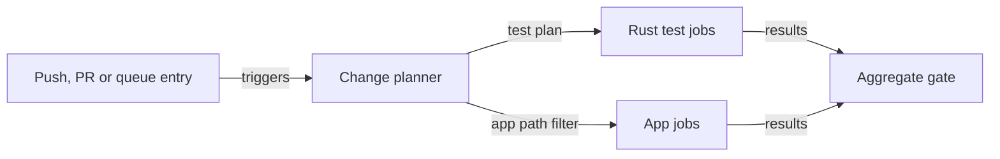

Wenlan splits testing into layers so that local commands stay fast and CI does the heavy checking. Only a few layers can block a change; the rest measure quality or run on demand. This page covers the layers, the local Git hooks, the CI workflow, the frontend and browser suites, and the smoke scripts.

A push to main, a pull request or a merge queue entry starts CI. The `detect-changes` job runs the planner, which selects the Rust jobs from the diff. A path filter selects the app jobs. The aggregate gate, a job named `conclusion`, then checks that every expected job reported success.

## Layers

| Layer | What runs | Blocks? |
|---|---|---|
| L1 dev loop | rust-analyzer in the IDE | No |
| L2 pre-commit | `cargo fmt` check, Clippy on directly changed crates (about 5 s) | Yes |
| L3 pre-push | reader-inventory freshness check, no compile (about 4 s) | Yes |
| L4 CI | fail-closed differential plan, target 20 min or less | Yes, required |
| L5 coverage | `cargo llvm-cov` on core and server, about 30 min | No |
| L6 main canary | retrieval-quality and ranking-drift pair after merge | No |
| L7 manual local | HTML coverage, GPU evals, live smokes with a real on-device model | No |
| L7b first-run gauntlet | published release artifacts on clean runners, manual | No |
| L8 pre-release | full eval against a saved baseline, per release | Soft gate |

## Local hooks

The hooks live in `.githooks/`. Pre-commit checks formatting and runs Clippy only on crates whose files changed. Pre-push is fast and non-compiling by default: it runs only the reader-inventory freshness check, and CI runs Clippy, tests and platform proofs regardless. Setting `WENLAN_PUSH_FULL=1` also runs the route-catalog test (`cargo test -p wenlan-core --lib` with an exact filter) and `scripts/ci_test_plan.py local --level push`.

## CI

`.github/workflows/ci.yml` triggers on pushes to main, pull requests, `merge_group` entries (tested on top of current main) and manual dispatch. `detect-changes` exposes plan outputs such as `workspace-lib-required`, `canonical-acceptance-required` and `clippy-required`. Linux runs from one compile-once nextest archive.

The planner, `scripts/ci_test_plan.py`, never selects `wenlan-app`: Ubuntu runners lack GTK and the app has its own lanes. The root `Cargo.toml` also leaves the app out of `default-members`, so a plain `cargo test` never compiles it. Select it with `-p wenlan-app`.

`conclusion` waits for the other jobs and runs even when they fail. For each job it asserts that a required job succeeded and an unrequired one was skipped, and it fails if `detect-changes` itself failed. On merge queue runs, `merge-group-fail-fast` cancels the run at the first failed job, and `conclusion` still runs to report it.

Rust jobs include nextest build-and-run pairs on Linux and macOS, a platform `test` matrix, `canonical-acceptance` and `contract-integration`. The nextest config runs `drift_guard::` tests first and gives full-daemon process tests the whole runner pool.

The app has two path-filtered jobs. `app-check` runs on macOS: empty sidecar placeholders, a format check, Clippy with `-D warnings`, `cargo test -p wenlan-app --lib`, `tsc`, the i18n gates, vitest, a production-bundle first-paint check, and the fixture-only Review build with its e2e. `app-e2e` runs Playwright on Ubuntu in four shards.

## Frontend and browser tests

Vitest runs in jsdom over `src`, `scripts` and `preview` tests with `maxWorkers: 4`. Coverage thresholds apply only to a whitelist: `src/lib/tauri.ts`, `src/lib/graph/**` and `src/hooks/useSearch.ts`. Playwright uses `./e2e`, one worker, 30 s per test and a Vite dev server. It runs Chromium against mocked Tauri IPC, so no daemon or native code is involved. See [Desktop app](desktop-app.md).

## Smokes and the autostart switch

`scripts/smoke-*.sh` are HTTP black-box checks against a real daemon. Those that touch the real on-device model are called live smokes and run manually. In CI the CLI and MCP surface smokes run only on non-PR runs, because each boots its own daemon (about 3 to 4 minutes). `smoke-cli.sh` runs the CLI with `WENLAN_NO_AUTOSTART=1`. When that variable is set to a non-empty value, the CLI does not start the background service after failing to reach a local daemon, so a test run cannot start a developer's real daemon. See The CLI.

## What gates and what is slow

- **Gates:** pre-commit, the fast pre-push checks, and CI through `conclusion` (target 20 minutes or less).
- **Slow but not blocking:** coverage (about 30 min), the main canary, live smokes and GPU evals (minutes to hours), the first-run gauntlet (about 30 min) and the pre-release eval (soft gate).
- **Slow inside CI:** the surface smokes and the sharded app e2e.

For flaky required checks see [Known pitfalls](known-pitfalls.md). For packaging see Release process, for retrieval quality runs see Retrieval evaluation, and for environment variables see Configuration and environment.

## Code

- [`.config/nextest.toml` lines 9-20](../../.config/nextest.toml#L9-L20)
- [`.githooks/pre-commit` lines 42-56](../../.githooks/pre-commit#L42-L56)
- [`.githooks/pre-push` lines 4-8](../../.githooks/pre-push#L4-L8)
- [`.githooks/pre-push` lines 55-82](../../.githooks/pre-push#L55-L82)
- [`.github/workflows/ci.yml` lines 3-16](../../.github/workflows/ci.yml#L3-L16)
- [`.github/workflows/ci.yml` lines 66-83](../../.github/workflows/ci.yml#L66-L83)
- [`.github/workflows/ci.yml` lines 1889-1898](../../.github/workflows/ci.yml#L1889-L1898)
- [`.github/workflows/ci.yml` lines 2449-2459](../../.github/workflows/ci.yml#L2449-L2459)
- [`.github/workflows/ci.yml` lines 2503-2532](../../.github/workflows/ci.yml#L2503-L2532)
- [`.github/workflows/ci.yml` lines 2693-2735](../../.github/workflows/ci.yml#L2693-L2735)
- [`.github/workflows/ci.yml` lines 2737-2770](../../.github/workflows/ci.yml#L2737-L2770)
- [`Cargo.toml` lines 11-14](../../Cargo.toml#L11-L14)
- [`crates/wenlan-cli/src/client/recovery.rs` lines 12-21](../../crates/wenlan-cli/src/client/recovery.rs#L12-L21)
- [`docs/test-layers.md` lines 8-26](../../docs/test-layers.md#L8-L26)
- [`playwright.config.ts` lines 28-50](../../playwright.config.ts#L28-L50)
- [`scripts/ci_test_plan.py` lines 295-300](../../scripts/ci_test_plan.py#L295-L300)
- [`scripts/smoke-cli.sh` lines 48-53](../../scripts/smoke-cli.sh#L48-L53)
- [`vitest.config.ts` lines 11-39](../../vitest.config.ts#L11-L39)

