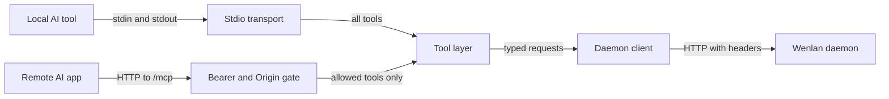

`wenlan-mcp` is the Model Context Protocol server that lets an AI tool use a Wenlan library. It is a binary built on the `rmcp` SDK, and it reaches the Wenlan daemon ([The HTTP daemon](the-http-daemon.md)) over HTTP through a small client (`main.rs`). It has two ways to run: speaking MCP over stdin and stdout for local tools, or serving Streamable HTTP for remote clients.

## Two ways to run it

With no subcommand, `wenlan-mcp` runs on stdio. It finds the daemon URL, builds the client, runs the version handshake, starts a background update check, and serves the tools over stdio (`main.rs`). The `serve` subcommand starts a Streamable HTTP server for remote clients such as claude.ai and ChatGPT, and `token` manages bearer tokens (`main.rs`). The agent name defaults to `claude-code` on stdio and `remote-mcp` for `serve`, unless `--agent-name` is given (`main.rs`).

The `serve` flags are `--tool-profile`, `--port` (default 8080), `--host` (default 127.0.0.1), `--token`, `--token-file`, `--token-env`, `--no-auth`, `--user-id`, `--allowed-origins` (default `https://claude.ai,https://chatgpt.com`) and `--whole-library` (`main.rs`).

In the diagram, a local AI tool talks to the stdio transport, which is wired to the tool layer with every tool available. A remote AI app sends HTTP to `/mcp`, where the bearer and Origin gate checks the request, and only the tools allowed for that connection reach the tool layer. The tool layer builds typed requests for the daemon client, and the client sends them to the Wenlan daemon over HTTP with identifying headers (`main.rs`, `serve.rs`, `tools.rs`, `client.rs`).

## Talking to the daemon

The global `--origin-url` flag names the daemon. Without it, `discover_origin_url` falls back to `http://127.0.0.1:7878` (`main.rs`, `client.rs`). Every call carries `x-agent-name`, a session header when the caller has a session, and `x-wenlan-space` when a Space lock is active (`client.rs`). Success bodies are capped at 8 MB and error bodies at 64 KB, and a failed status is parsed only for a stable machine-code reason, never for arbitrary daemon text (`client.rs`).

The repository rule is that MCP wrappers typed-deserialize daemon responses. The client's parse step is generic over the response type, and a body that does not fit becomes a `Deserialize` error. The `try_call!` macro keeps each call site's `let binding: T =` annotation so the concrete response type drives parsing (`client.rs`, `tools.rs`).

## Tools and profiles

The tool surface is locked at 35 tools, and a test fails if the visible stdio tools drift from the list: `accept_refinement`, `accept_revision`, `capture`, `confirm_memory`, `brief`, `create_entity`, `create_relation`, `delete_page`, `dismiss_revision`, `distill`, `doc_fix`, `forget`, `get_memory_revisions`, `get_page_revisions`, `get_page_sources`, `lint`, `lint_repair_apply`, `lint_repair_prepare`, `lint_repair_verify`, `list_pages`, `list_pending`, `list_pending_imports`, `list_pending_revisions`, `list_refinements`, `list_rejections`, `page_basis`, `page_code_basis`, `read_page`, `recall`, `rename_page`, `reject_refinement`, `save_source`, `steep`, `update_brief`, `write_page` (`tools.rs`). The `steep` tool is the On demand door described in [How steep keeps pages current](how-steep-keeps-pages-current.md).

A server runs with one of three profiles: `standard`, `query-only` and `web-write`. Query-only exposes `brief`, `recall` and `get_page_sources`. Web-write adds `read_page`, `list_pages`, `capture`, `write_page`, `rename_page`, `forget` and `delete_page`. Over the HTTP transport, local-only tools are blocked, and web-write lifts that block for `forget`, `rename_page` and `delete_page` (`tools.rs`). `call_tool` refuses a disallowed tool before it is dispatched, even if the caller never saw it listed (`tools.rs`).

Both connector profiles are made for web AI apps reached through the relay (Web access relay). They require a bearer token and exactly one scope: a strict `WENLAN_SPACE` pin or `--whole-library`. `WENLAN_DEFAULT_SPACE` alone does not satisfy it (`serve.rs`).

## The Space lock

At startup `lock_state::init_from_env` reads `WENLAN_SPACE`, the strict lock, and `WENLAN_DEFAULT_SPACE`, an overridable fallback. Both are trimmed, and an empty value counts as unset. `clear_default_space` drops the fallback for whole-library serving so an inherited default cannot narrow searches (`lock_state.rs`).

For each tool call, `effective_space` uses the locked value first, and logs a warning if the model passed a different Space. Otherwise it uses an explicit non-empty `space` argument, and then the default (`tools.rs`). While a lock is active, `list_tools` removes the `space` field from every tool schema, and the client sends `x-wenlan-space` on every call (`tools.rs`, `client.rs`). See Configuration and environment for the related settings.

## Auth and tokens

Over HTTP, the bearer middleware runs only when a token is configured. Preflight requests and `/health` skip it. It checks the bearer token first and answers 401 on failure, and then checks the `Origin` header when one is present and answers 403 if it is not allowed (`serve.rs`). The server also mounts `/health`, an initialization guard, and, for connector profiles, a bearer-gated `/connector-info` that reports the profile and Space (`serve.rs`).

A token comes from `--token`, `--token-file`, `--token-env` or the default token file when it exists; `--token-env` cannot be combined with the other token flags or `--no-auth`, and it validates both the variable name and the value shape. The help text says `--no-auth` is only allowed on loopback (`main.rs`). `token generate` makes 32 random bytes encoded as URL-safe base64 and writes the file with owner-only permissions on Unix (`token.rs`). For the command line side, see The CLI.

## Version checks

On startup the client asks the daemon's `/api/health` for its version with a 2 second timeout. It never blocks startup: an unreachable daemon or an unreadable answer produces no warning (`client.rs`). If the daemon is ahead by a minor or major version, the warning says to upgrade `wenlan-mcp`. If `wenlan-mcp` is newer than the running daemon at any level, the warning says to run `wenlan restart`. A patch-ahead daemon and unparseable versions count as compatible (`client.rs`, `version_check.rs`). A separate background task also checks for a newer `wenlan-mcp` release and prints a note (`main.rs`).

## Code

- [`crates/wenlan-mcp/src/client.rs` lines 9-28](../../crates/wenlan-mcp/src/client.rs#L9-L28)
- [`crates/wenlan-mcp/src/client.rs` lines 157-207](../../crates/wenlan-mcp/src/client.rs#L157-L207)
- [`crates/wenlan-mcp/src/client.rs` lines 351-391](../../crates/wenlan-mcp/src/client.rs#L351-L391)
- [`crates/wenlan-mcp/src/lock_state.rs` lines 17-54](../../crates/wenlan-mcp/src/lock_state.rs#L17-L54)
- [`crates/wenlan-mcp/src/main.rs` lines 1-36](../../crates/wenlan-mcp/src/main.rs#L1-L36)
- [`crates/wenlan-mcp/src/main.rs` lines 38-80](../../crates/wenlan-mcp/src/main.rs#L38-L80)
- [`crates/wenlan-mcp/src/main.rs` lines 137-184](../../crates/wenlan-mcp/src/main.rs#L137-L184)
- [`crates/wenlan-mcp/src/main.rs` lines 270-316](../../crates/wenlan-mcp/src/main.rs#L270-L316)
- [`crates/wenlan-mcp/src/serve.rs` lines 61-96](../../crates/wenlan-mcp/src/serve.rs#L61-L96)
- [`crates/wenlan-mcp/src/serve.rs` lines 166-222](../../crates/wenlan-mcp/src/serve.rs#L166-L222)
- [`crates/wenlan-mcp/src/serve.rs` lines 326-362](../../crates/wenlan-mcp/src/serve.rs#L326-L362)
- [`crates/wenlan-mcp/src/token.rs` lines 3-22](../../crates/wenlan-mcp/src/token.rs#L3-L22)
- [`crates/wenlan-mcp/src/tools.rs` lines 40-64](../../crates/wenlan-mcp/src/tools.rs#L40-L64)
- [`crates/wenlan-mcp/src/tools.rs` lines 94-148](../../crates/wenlan-mcp/src/tools.rs#L94-L148)
- [`crates/wenlan-mcp/src/tools.rs` lines 1965-1981](../../crates/wenlan-mcp/src/tools.rs#L1965-L1981)
- [`crates/wenlan-mcp/src/tools.rs` lines 5176-5221](../../crates/wenlan-mcp/src/tools.rs#L5176-L5221)
- [`crates/wenlan-mcp/src/tools.rs` lines 11483-11542](../../crates/wenlan-mcp/src/tools.rs#L11483-L11542)
- [`crates/wenlan-mcp/src/version_check.rs` lines 10-38](../../crates/wenlan-mcp/src/version_check.rs#L10-L38)

