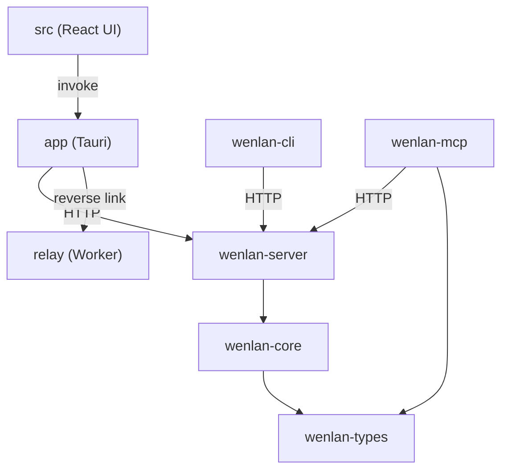

The Rust code is one Cargo workspace with six members: the five daemon crates under `crates/` and the desktop app crate in `app/`. Plain `cargo build` and `cargo test` cover only the five daemon crates. The app is built on purpose with `-p wenlan-app`, so routine daemon work never compiles the desktop app. Around the workspace sit the React UI, the agent plugins, the web relay and the release scripts. See [What Wenlan is](what-wenlan-is.md) for the entry points and [How to run it](how-to-run-it.md) for the commands.

## Crates

| Crate | What it owns |
|---|---|
| `crates/wenlan-types` | Shared wire shapes. Its only production dependencies are `anyhow`, `serde` and `serde_json`, and it must stay that light. |
| `crates/wenlan-core` | Business logic: storage, retrieval, embeddings, LLM processing and everything else that is not UI. It must not depend on Tauri or Axum. |
| `crates/wenlan-server` | The `wenlan-server` daemon: HTTP framing on Axum, all routes, and the single database writer. See [The HTTP daemon](the-http-daemon.md). |
| `crates/wenlan-cli` | The `wenlan` command. Its HTTP client reads `WENLAN_HOST` as a full URL and defaults to `http://127.0.0.1:7878`. See The CLI. |
| `crates/wenlan-mcp` | The `wenlan-mcp` MCP server. In production it depends only on `wenlan-types` and reaches the daemon over HTTP, at `http://127.0.0.1:7878` unless `--origin-url` says otherwise. See [MCP server](mcp-server.md). |
| `app` | The Tauri desktop shell. It reaches the daemon through `WenlanClient` and bundles the three binaries as sidecars. See [Desktop app](desktop-app.md). |

The CLI and the app also link `wenlan-core` and `wenlan-types` directly, but their daemon work goes through HTTP. Daemon APIs are the boundary, and business logic stays in the core.

## Inside wenlan-core

The core is a flat list of modules declared in `crates/wenlan-core/src/lib.rs`. The ones a newcomer meets first are `db` (storage, see [Data and storage](data-and-storage.md)), `ingest` and `sources` (see Sources and imports), `kg` (see Knowledge graph), `lint` and `repair` (see Lint and repair), `pages`, `repo_wiki`, `repo_wiki_ci` and `repo_wiki_github` (see Repository wiki), `reranker`, the crate-private `retrieval` (see [How search works](how-search-works.md)), and `steep` and `steep_new` (see [How steep keeps pages current](how-steep-keeps-pages-current.md)).

## Other top-level folders

| Folder | What it holds |
|---|---|
| `src/` | The React UI. It calls the app's Tauri commands through `invoke` wrappers in `src/lib/tauri.ts`. |
| `preview/` | A browser-only harness that shims the Tauri APIs, either with fixtures or by proxying a live daemon. |
| `e2e/` | Playwright browser tests (see [How tests run](how-tests-run.md)). |
| `plugin/`, `plugin-codex/`, `plugin-agents/` | The Claude Code, Codex and generic agent plugins. Their MCP entry runs `wenlan-mcp` through a runner script (see Agent plugins and skills). |
| `relay/` | The `wenlan-relay` Cloudflare Worker. The app registers with it over a native reverse transport (see Web access relay). |
| `scripts/` | Release, sidecar and repo-inventory scripts that are part of packaging, plus the isolated dev runtime (see Release process). |

## Code

- [`AGENTS.md` lines 50-57](../../AGENTS.md#L50-L57)
- [`Cargo.toml` lines 1-21](../../Cargo.toml#L1-L21)
- [`app/AGENTS.md` line 17](../../app/AGENTS.md#L17)
- [`app/Cargo.toml` lines 82-84](../../app/Cargo.toml#L82-L84)
- [`app/src/api.rs` lines 47-52](../../app/src/api.rs#L47-L52)
- [`app/tauri.conf.json` lines 67-71](../../app/tauri.conf.json#L67-L71)
- [`crates/wenlan-cli/Cargo.toml` lines 19-21](../../crates/wenlan-cli/Cargo.toml#L19-L21)
- [`crates/wenlan-cli/src/client.rs` lines 1-7](../../crates/wenlan-cli/src/client.rs#L1-L7)
- [`crates/wenlan-cli/src/client.rs` line 39](../../crates/wenlan-cli/src/client.rs#L39)
- [`crates/wenlan-core/src/lib.rs` lines 1-9](../../crates/wenlan-core/src/lib.rs#L1-L9)
- [`crates/wenlan-core/src/lib.rs` lines 26-82](../../crates/wenlan-core/src/lib.rs#L26-L82)
- [`crates/wenlan-mcp/Cargo.toml` lines 45-54](../../crates/wenlan-mcp/Cargo.toml#L45-L54)
- [`crates/wenlan-mcp/src/client.rs` lines 9-29](../../crates/wenlan-mcp/src/client.rs#L9-L29)
- [`crates/wenlan-server/Cargo.toml` lines 17-26](../../crates/wenlan-server/Cargo.toml#L17-L26)
- [`crates/wenlan-types/Cargo.toml` lines 15-18](../../crates/wenlan-types/Cargo.toml#L15-L18)
- [`plugin/.mcp.json` lines 1-7](../../plugin/.mcp.json#L1-L7)
- [`preview/AGENTS.md` lines 3-7](../../preview/AGENTS.md#L3-L7)
- [`relay/src/worker.ts` lines 1-5](../../relay/src/worker.ts#L1-L5)
- [`scripts/AGENTS.md` lines 1-17](../../scripts/AGENTS.md#L1-L17)
- [`src/lib/tauri.ts` lines 1-20](../../src/lib/tauri.ts#L1-L20)

