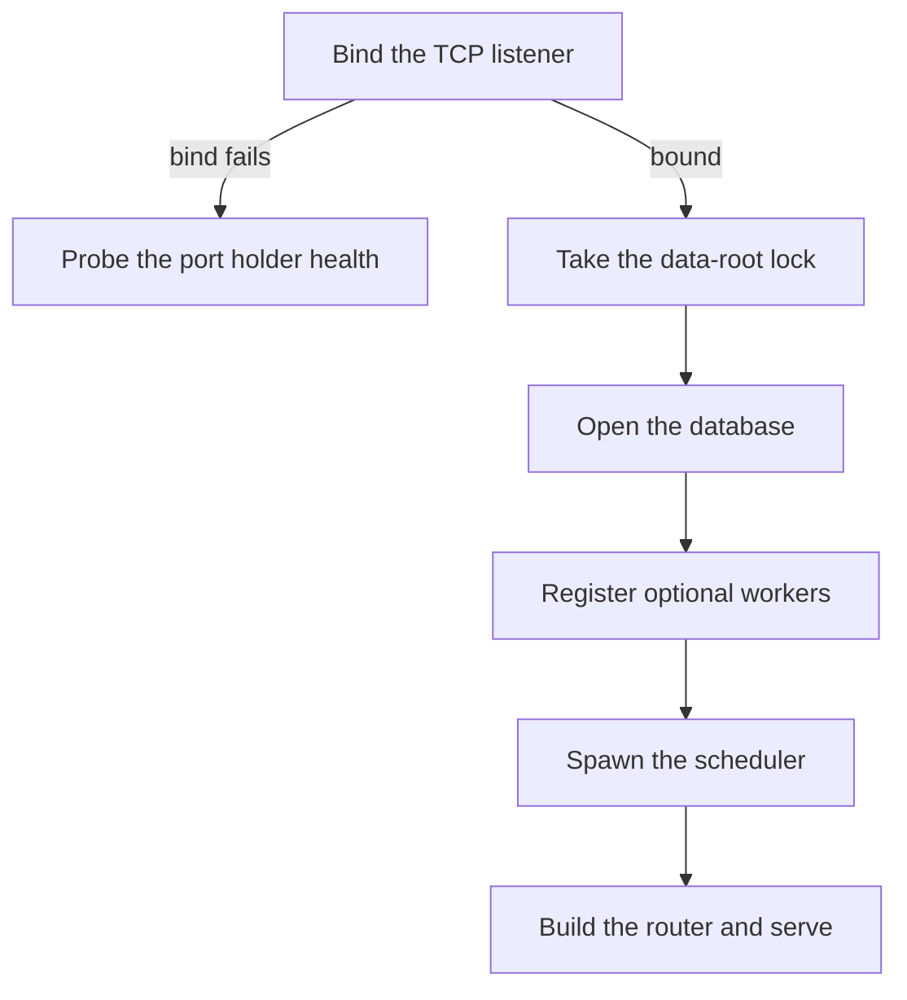

The daemon is the `wenlan-server` crate: one local Axum HTTP process that owns the routes, the shared state and the background workers. This page covers what it holds, how routes are registered, how it starts, and which workers it launches. The database it writes to is described in [Data and storage](data-and-storage.md), and the lint and repair routes are covered in Lint and repair.

## Shared state and the writer

Every handler works on one shared state, `Arc<RwLock<ServerState>>`, and its `db` field is an optional `Arc<MemoryDB>`. Next to `db`, `ServerState` carries three things that matter for writes:
- A write signal that feeds the event-driven steep scheduler.
- A maintenance coordinator that keeps background writers out of an approved apply-to-verify window.
- An ingest batcher that folds concurrent `/api/memory/store` calls into one batched upsert. Handlers fall back to a direct upsert when no batcher exists.

The single writer lives in core. `MemoryDB` owns one writer connection. A COMMIT that failed without a rollback would leave that connection inside a transaction and block every later write in the daemon, so core wraps commits in `commit_or_rollback`.

## Routes

`router.rs` is the composition root. `build_router_with_shutdown` starts from `TrackedRouter::new(Builder::Main)` and registers the lint, repair and recovery routes first. It then passes the router through one `register` helper per route module, from `routes`, `ambient_routes` and `brief_routes` through `page_routes`, `steep_routes` and `source_routes` to `websocket`, `session_routes` and `telemetry_routes`. A new route that reads user data must also be registered in core's lint serving routes and listed in `SCOPED` or `GLOBAL` in the serving review test.

`TrackedRouter` makes a forgotten registration fail loudly. `finish()` asserts that the registered sensitive read routes match core's list (the panic message is "sensitive route registration drift"). It also asserts that the truth manifest and the handler bindings cover every route. `finish_restricted()` accepts a subset of the sensitive reads but is still exact on truth coverage. After `finish()` the router gets, in this order:
- a truth-guard `route_layer`;
- a CORS layer;
- a `guard_local_only` middleware that rejects cross-origin browser traffic;
- the shutdown `Extension`;
- the state itself.

When a repair is pending the daemon serves a different router. `build_repair_router` is the fail-closed router used while one exact repair owns the writer fence. It registers only the lint, repair-execution and recovery-read routes plus `/api/health`, `/api/status` and `/api/setup/status`, and it finishes with `finish_restricted`. `serve_and_drain` picks between the two routers.

## Startup

`run_daemon` binds the listener before it touches the data directory. The port is `WENLAN_PORT` (the `--port` flag feeds it) and defaults to 7878. The address is `127.0.0.1:<port>` unless `WENLAN_BIND_ADDR` is set, for example in Docker where the daemon must listen on `0.0.0.0`. A repair-only start always uses loopback and refuses any port other than 7878. Binding first is deliberate: losing the port race should cost nothing. A retry loop that opened the database on every attempt under launchd would put lock and CPU pressure on the live daemon's SQLite file.

If the bind fails, the process probes `/api/health` on that port with a 5 second timeout. A healthy holder means exit code 75 when launchd started the process (`XPC_SERVICE_NAME` is set) and a clean exit otherwise. No healthy holder is an error.

After a successful bind the daemon follows this sequence:
1. It starts logging, takes a `DaemonDataLock` on the data root and calls `prepare_startup_state`.
2. That step opens `MemoryDB` with embedding recovery deferred. Rows with no embedding are recovered in the background after the daemon serves, because recovering a large backlog first once held the health check shut for many minutes.
3. `register_optional_runtime_workers` runs.
4. A task waits for termination signals and requests shutdown.
5. The scheduler is spawned.
6. Telemetry and the daily repo wiki job start.
7. `serve_and_drain` builds the router and serves.

When a repair is pending, optional workers are suppressed. The database opens through `MemoryDB::open_for_repair`, which skips schema, migrations, profile bootstrap and the embedder load. The scheduler slot becomes an empty task, and telemetry and the repo wiki job do not start.

`serve_and_drain` chooses the router, logs the address, and prints `WENLAN_LISTENING_ON=<addr>` to stdout. If `WENLAN_PORT_FILE` is set, it also writes the bound port to that file, so a harness can find an ephemeral port. It then serves with Axum's graceful shutdown tied to the shared shutdown handle.

## Workers

Optional workers start only when they are allowed. `register_optional_runtime_workers` first spawns an outbox drain: once at startup, then every 60 seconds, stopping when shutdown is requested.

The scheduler is one tokio task with a 30 second poll loop. All work is awaited inline, and shutdown is checked at each boundary, so the current item finishes without starting another. On each poll it asks the maintenance coordinator for a background lease and skips the poll if a maintenance fence is active. What the scheduler runs on those ticks is covered in Background enrichment. The page watcher it calls is described in [Data and storage](data-and-storage.md).

## Code

- [`crates/wenlan-core/src/db.rs` lines 1717-1726](../../crates/wenlan-core/src/db.rs#L1717-L1726)
- [`crates/wenlan-server/AGENTS.md` line 5](../../crates/wenlan-server/AGENTS.md#L5)
- [`crates/wenlan-server/AGENTS.md` lines 21-28](../../crates/wenlan-server/AGENTS.md#L21-L28)
- [`crates/wenlan-server/src/main.rs` lines 104-126](../../crates/wenlan-server/src/main.rs#L104-L126)
- [`crates/wenlan-server/src/main.rs` lines 664-680](../../crates/wenlan-server/src/main.rs#L664-L680)
- [`crates/wenlan-server/src/main.rs` lines 690-728](../../crates/wenlan-server/src/main.rs#L690-L728)
- [`crates/wenlan-server/src/main.rs` lines 732-763](../../crates/wenlan-server/src/main.rs#L732-L763)
- [`crates/wenlan-server/src/main.rs` lines 770-816](../../crates/wenlan-server/src/main.rs#L770-L816)
- [`crates/wenlan-server/src/main/runtime.rs` lines 77-107](../../crates/wenlan-server/src/main/runtime.rs#L77-L107)
- [`crates/wenlan-server/src/main/runtime.rs` lines 590-623](../../crates/wenlan-server/src/main/runtime.rs#L590-L623)
- [`crates/wenlan-server/src/main/startup.rs` lines 102-123](../../crates/wenlan-server/src/main/startup.rs#L102-L123)
- [`crates/wenlan-server/src/route_registry.rs` lines 303-330](../../crates/wenlan-server/src/route_registry.rs#L303-L330)
- [`crates/wenlan-server/src/router.rs` lines 51-98](../../crates/wenlan-server/src/router.rs#L51-L98)
- [`crates/wenlan-server/src/router.rs` lines 100-116](../../crates/wenlan-server/src/router.rs#L100-L116)
- [`crates/wenlan-server/src/router.rs` lines 119-145](../../crates/wenlan-server/src/router.rs#L119-L145)
- [`crates/wenlan-server/src/scheduler.rs` lines 1230-1240](../../crates/wenlan-server/src/scheduler.rs#L1230-L1240)
- [`crates/wenlan-server/src/scheduler.rs` lines 1315-1322](../../crates/wenlan-server/src/scheduler.rs#L1315-L1322)
- [`crates/wenlan-server/src/state.rs` lines 131-140](../../crates/wenlan-server/src/state.rs#L131-L140)

