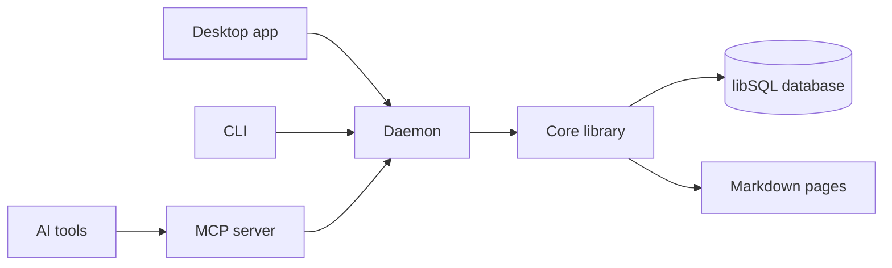

Wenlan turns scattered documents, AI chats and coding sessions into one local wiki with citations, a source of truth that a person and their AI tools share and that keeps up as the material changes. The repository calls it a local-first agent memory system, and this monorepo ships the daemon, the CLI, the shared wire types, the business-logic core, the MCP server and the Tauri desktop app. Every Rust crate is versioned together, currently at 0.20.0.

## Where things start

Everything goes through one local service. The app, the CLI and connected AI tools read and write through it. Pages are Markdown files, while memories, relationships and search indexes live in a local libSQL database. The daemon owns HTTP and is the single database writer. Business logic lives in the core library, and the app and CLI use the daemon's APIs.

The entry points are:

- **`wenlan-server`**, the headless daemon. It listens on HTTP port 7878 by default (`--port` or `WENLAN_PORT` changes it) and keeps its database under the platform data directory unless `--data-dir` or `WENLAN_DATA_DIR` points elsewhere.
- **`wenlan`**, the CLI binary built from `crates/wenlan-cli`.
- **`wenlan-mcp`**, the MCP server AI tools launch. It also has a `serve` command that runs a Streamable HTTP server for remote clients such as claude.ai and ChatGPT.
- **The desktop app**, a Tauri crate in `app/` with a React UI in `src/`. The app bundles the `wenlan`, `wenlan-server` and `wenlan-mcp` binaries as sidecars.
- **Plugins** in `plugin/` (Claude Code), `plugin-codex/` and `plugin-agents/`. Their MCP entry runs `wenlan-mcp` through a runner script.
- **`relay/`**, the `wenlan-relay` Cloudflare Worker behind Web access, served from `https://relay.wenlan.app`.

## Pages

- [What Wenlan is](what-wenlan-is.md): what the project is, its entry points, and this list of pages
- [How to run it](how-to-run-it.md): prerequisites, install, build, and starting a dev daemon and app
- [Known pitfalls](known-pitfalls.md): traps newcomers hit, and what to do instead
- [Module map](module-map.md): every crate and top-level folder, what it owns, and how they call each other
- [The HTTP daemon](the-http-daemon.md): how `wenlan-server` starts, routes requests, and runs its background workers
- [Data and storage](data-and-storage.md): the libSQL database, migrations, Markdown projection and data folders
- [How a page is written](how-a-page-is-written.md): from an agent's `write_page` to a saved, checked page on disk
- [How search works](how-search-works.md): hybrid keyword and embedding retrieval, fusion, reranking and Space scoping
- [How steep keeps pages current](how-steep-keeps-pages-current.md): Automatic and On demand steep, and what makes a page stale
- [MCP server](mcp-server.md): the `wenlan-mcp` binary, its tools, transports and Space lock
- [Desktop app](desktop-app.md): the Tauri shell, its commands and sidecars, and the React UI
- [How tests run](how-tests-run.md): test layers, git hooks, CI planning, and which suites are slow
- The CLI: the `wenlan` command, its subcommands, daemon discovery and autostart
- Sources and imports: folders, Obsidian vaults, Logseq graphs and chat exports
- Repository wiki: repository wikis tied to code lines, and the wiki pull request
- Agent plugins and skills: the Claude Code, Codex and generic agent plugins and their skills
- Web access relay: the Cloudflare relay that lets web AI clients reach a local library
- Background enrichment: the scheduler's ambient slices that classify, extract and grow pages
- Knowledge graph: entities, relations, entity resolution and communities
- Lint and repair: the lint checks, the serving-route catalog, and repair plans
- Configuration and environment: config files, data roots and the `WENLAN_*` variables
- Release process: release-please, version lockstep, signing and published channels
- Retrieval evaluation: LongMemEval runs, eval seeding and how results are recorded

## Code

- [`AGENTS.md` lines 3-4](../../AGENTS.md#L3-L4)
- [`AGENTS.md` lines 54-55](../../AGENTS.md#L54-L55)
- [`Cargo.toml` lines 23-24](../../Cargo.toml#L23-L24)
- [`README.md` lines 9-10](../../README.md#L9-L10)
- [`README.md` line 239](../../README.md#L239)
- [`app/tauri.conf.json` lines 67-71](../../app/tauri.conf.json#L67-L71)
- [`crates/wenlan-cli/Cargo.toml` lines 15-17](../../crates/wenlan-cli/Cargo.toml#L15-L17)
- [`crates/wenlan-mcp/src/main.rs` lines 30-36](../../crates/wenlan-mcp/src/main.rs#L30-L36)
- [`crates/wenlan-server/src/main.rs` lines 591-602](../../crates/wenlan-server/src/main.rs#L591-L602)
- [`plugin/.mcp.json` lines 1-7](../../plugin/.mcp.json#L1-L7)
- [`relay/README.md` lines 3-7](../../relay/README.md#L3-L7)
- [`src/main.tsx` lines 1-12](../../src/main.tsx#L1-L12)

